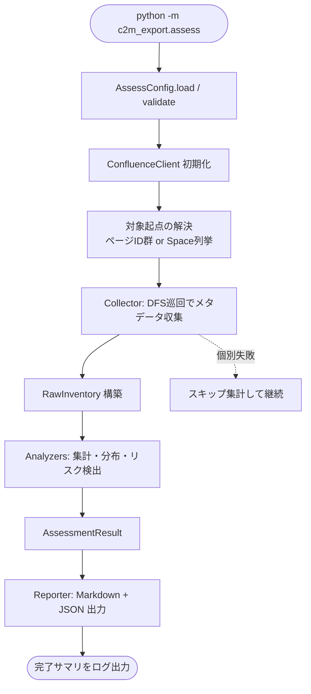
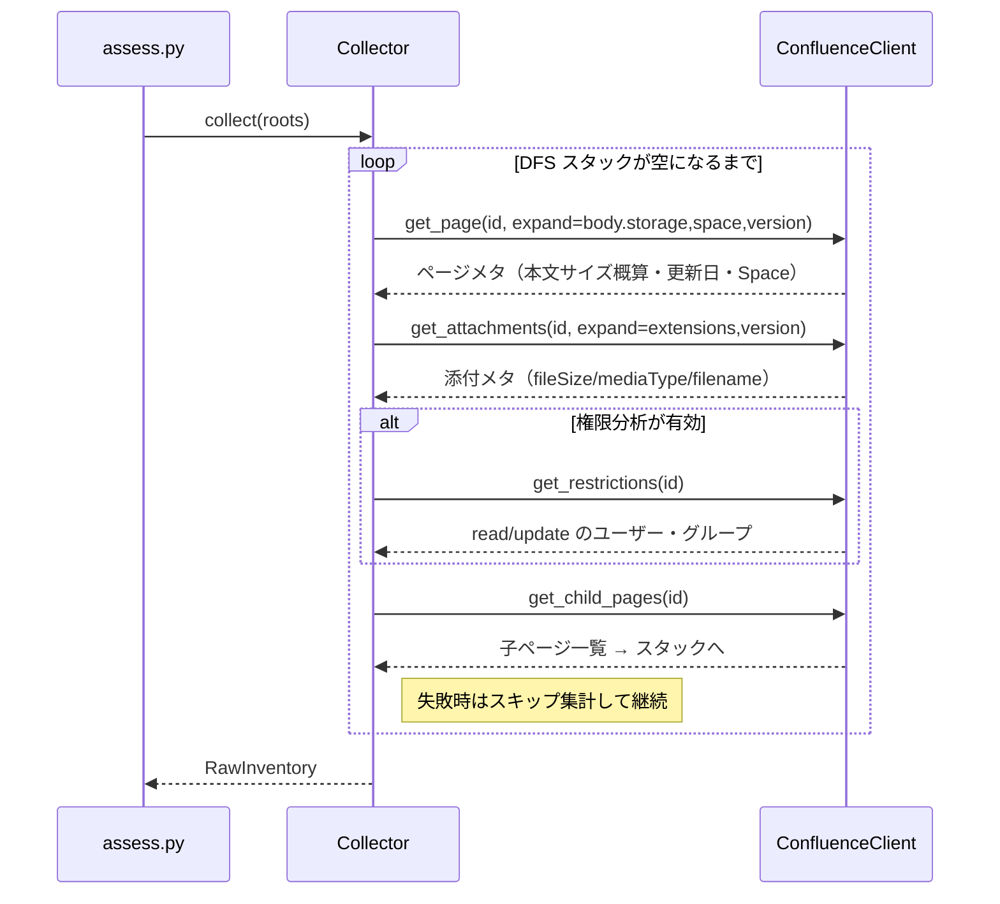

# Design Document

## 概要

本設計は、Confluence のコンテンツ（特定ページ配下 / Space / Workspace 全体）を実エクスポート前に分析し、規模・構造・移設リスク・権限サマリ・鮮度を把握するための **アセスメント機能** を C2M-Export に追加するものである。

分析は Confluence REST API のメタデータのみを用い、**添付バイナリのダウンロードや Markdown 本文のファイル書き込みは行わない**（分析レポートの書き込みを除く）。成果物として、人間可読な Markdown レポートと機械可読な JSON を出力する。

既存の結合 Markdown エクスポート（`cli.py` / `export_tree`）の挙動は一切変更しない。分析機能は独立したエントリーポイント（`python -m c2m_export.assess`）および独立したモジュール群として追加し、既存の `ConfluenceClient` を拡張（メソッド追加のみ）して再利用する。

### 設計原則（既存方針の踏襲）

- **部分成功**: 個別ページ/添付/権限の取得失敗はスキップして継続し、件数と ID を集計・報告する（既存 `export_tree` の方針）。
- **日本語ログ**: すべてのログ・エラーを日本語で、「現象・原因・対処方法」構成で出力する。
- **設定優先順位**: CLI 引数 > 環境変数 > YAML > デフォルト。
- **堅牢性**: 想定外のデータ構造でも分析全体を止めない。
- **API 負荷の抑制**: 必要最小限の `expand` と、ページング済み一覧取得を用いる。

## アーキテクチャ

### モジュール構成

既存パッケージ `c2m_export/` に以下を追加する。既存ファイル（`cli.py` / `converter.py` / `utils.py`）は分析機能からは変更しない。`confluence.py` と `config.py` のみ、後方互換を保ったまま拡張する。

```
c2m_export/
├── confluence.py      # [拡張] 添付一覧・権限・Space列挙のメソッドを追加（既存メソッドは不変）
├── config.py          # [拡張] AssessConfig を追加（既存 Config は不変）
├── assess.py          # [新規] 分析モードのエントリーポイント（python -m c2m_export.assess）
├── assessment/        # [新規] 分析ロジック一式
│   ├── __init__.py
│   ├── collector.py   # DFS巡回でページ/添付/権限/更新情報のメタデータを収集
│   ├── models.py      # 収集結果・集計結果のデータモデル（dataclass）
│   ├── analyzers.py   # 収集結果から各種集計・リスク検出を行う純粋関数群
│   ├── rules.py       # 移設先（SharePoint/OneDrive）制約の既定値と判定ロジック
│   └── report.py      # Markdown / JSON レポート生成
└── (既存ファイル)
```

### 責務分担

| モジュール | 責務 |
|---|---|
| `assess.py` | エントリーポイント。設定ロード→クライアント初期化→Collector実行→Analyzer実行→Reporter出力。 |
| `AssessConfig`（config.py） | 分析用設定の読み込み・検証・正規化。既存 `Config` とは独立。 |
| `confluence.py`（拡張） | API通信。添付一覧・権限・Space列挙の取得メソッドを追加。 |
| `assessment/collector.py` | DFS巡回しながら API を呼び、ページ/添付/権限/更新情報の **生メタデータ** を `RawInventory` に収集。I/O（API）を担う層。 |
| `assessment/models.py` | `PageMeta` / `AttachmentMeta` / `RestrictionMeta` / `RawInventory` / `AssessmentResult` 等の型定義。 |
| `assessment/analyzers.py` | `RawInventory` を入力に、集計・分布・リスク検出を行う **純粋関数**（API非依存＝テスト容易）。 |
| `assessment/rules.py` | SharePoint/OneDrive の既定制約値（パス長・禁止文字・ブロック拡張子・予約語）と判定関数。設定で上書き可能。 |
| `assessment/report.py` | `AssessmentResult` から Markdown と JSON を生成。 |

I/O（collector）と純粋ロジック（analyzers）を分離することで、analyzers と rules は API モック不要で単体テストできる。

### 全体フロー



### 収集フロー（Collector）の詳細

既存 `export_tree` と同じ DFS 骨格を用いるが、**本文の Markdown 変換は行わず**、サイズ概算と各種メタデータ取得に置き換える。



## コンポーネントと実装詳細

### 1. ConfluenceClient の拡張（confluence.py）

既存メソッド（`get_page` / `get_child_pages` / `_request`）は変更しない。以下を追加する。いずれも既存の `_request` を用いるためリトライ・Proxy・認証が自動適用される。

```python
def get_page(self, page_id, expand="body.storage,space"):
    # [変更] expand を引数化（既定値は現行と同一で後方互換）。
    # 分析時は "body.storage,space,version,history.lastUpdated" 等を渡す。

def get_attachments(self, page_id, limit=50):
    # [新規] /rest/api/content/{id}/child/attachment をページングで全件取得。
    # expand=extensions,version を付与し fileSize/mediaType/version を取得。

def get_restrictions(self, page_id):
    # [新規] /rest/api/content/{id}/restriction/byOperation を取得。
    # read / update それぞれの restrictions.user.results と .group.results を抽出。

def get_space_root_pages(self, space_key, limit=25):
    # [新規] Space 内トップレベルページ列挙。
    # /rest/api/content/{id}/child/page のルート版として
    # /rest/api/space/{key}/content/page?depth=root をページングで取得。
```

補足:
- `get_page` の `expand` 引数化は既定値を現行と同一にするため、既存呼び出し（`cli.py`）に影響しない。
- 権限 API は Data Center で `byOperation` 形式が `read` / `update` を一度に返すため、ページあたり 1 リクエストで済む（API 負荷の観点で `byOperation/{operationKey}` の 2 回呼びより有利）。

### 2. データモデル（assessment/models.py）

`dataclass` で表現する。JSON 出力と集計の双方で使うため、プリミティブ中心にする。

```python
@dataclass
class AttachmentMeta:
    page_id: str
    filename: str
    extension: str  # 小文字化・ドットなし。無い場合は空文字
    media_type: str  # MIME。取得不能なら空文字
    file_size: Optional[int]  # バイト。メタ欠落時は None
    version: Optional[int]


@dataclass
class RestrictionMeta:
    has_explicit: bool  # 個別制限の有無（False=継承/制限なし）
    read_users: list[str]
    read_groups: list[str]
    update_users: list[str]
    update_groups: list[str]
    fetch_failed: bool = False


@dataclass
class PageMeta:
    page_id: str
    title: str
    space_key: str
    level: int  # ルート=1
    body_bytes: int  # Storage Format 生サイズ（概算の素）
    last_modified: Optional[str]  # ISO8601 文字列
    ancestors_titles: list[str]  # パス算出用（ルート→自身の手前）
    attachments: list[AttachmentMeta]
    restriction: Optional[RestrictionMeta]


@dataclass
class RawInventory:
    pages: list[PageMeta]
    skipped_page_ids: list[str]
    skipped_attachment_refs: list[str]
    restriction_failed_page_ids: list[str]
    size_meta_missing_count: int  # fileSize 欠落の添付件数


@dataclass
class AssessmentResult:
    # analyzers が算出する最終集計。report はこれだけを参照する。
    ...  # 規模サマリ / 拡張子別 / リスク一覧 / 権限サマリ / 鮮度サマリ を保持
```

### 3. サイズ概算の方針（要件3.7 / 6）

- **添付サイズ**: API メタデータ `extensions.fileSize`（バイト）をそのまま合計。無変換で保存されるため **実測とほぼ一致**。
- **ページ本文サイズ**: Storage Format（XHTML）の UTF-8 バイト長を素に概算する。Markdown 変換後は一般にタグ除去で縮む傾向のため、本文の推定総サイズは **やや過大** に出やすい。この偏りはレポートとドキュメントに明示する（要件6）。
- 本文概算で変換器を回さない理由: 大規模巡回で変換コストを避け、API 負荷と実行時間を抑えるため。

> 偏りの要約（レポートに記載）: 添付は過不足ほぼなし／本文はやや過大。総サイズは「上振れ方向に安全側」の概算となる。

### 4. 対象起点の解決（要件2）

`AssessConfig` は次のいずれか/併用を受け付ける。

- `root_page_ids`: 既存同様、指定ページを起点に DFS。
- `space_keys`: 各 Space のルートページ群を `get_space_root_pages` で列挙し、各々を起点に DFS。
- Workspace 全体: 複数 `space_keys` の指定で表現する（全 Space 自動列挙はスコープ外・将来拡張）。

重複排除: 同一ページが複数起点から到達しうるため、Collector は訪問済み `page_id` 集合で二重集計を防ぐ。

### 5. 移設リスク検出（assessment/rules.py, analyzers.py / 要件5）

`rules.py` に SharePoint/OneDrive の既定制約を定数で持ち、`AssessConfig` で上書き可能にする。

| 判定 | 既定値 | 根拠/備考 |
|---|---|---|
| パス長上限 | 400 文字（相対パス換算） | SharePoint のデコード済み URL パス長の実務上の目安。設計時点の既定であり設定で変更可。 |
| 禁止文字 | `" * : < > ? / \ |` および制御文字 | OneDrive/SharePoint のファイル・フォルダ名禁止文字。 |
| 予約語/末尾ドット・スペース | 既存 `sanitize_filename` の予約語集合を流用 + 末尾 `. ` | Windows/SharePoint 共通。 |
| ブロック拡張子 | 既定リスト（例: `exe` 等）を定数化 | 設定で追加・変更可能。 |
| 単一ファイル巨大閾値 | `single_file_max_mb`（設定・既定 250MB） | 後続の実エクスポート時スキップ閾値と整合させる想定。 |

パス算出: 各ページの相対パスは `ancestors_titles + title` を `sanitize_filename` 相当で正規化して連結し、想定区切り（`/`）で結合して長さを測る。添付は `ページパス + 添付サブディレクトリ名 + 添付ファイル名`。添付サブディレクトリ名の既定は後続 spec の既定（`_attachments`）に合わせるが、本 spec では長さ計算用の既定値として扱う。

同名衝突（要件5.6）: 同一親の子ページ群のタイトルを `sanitize_filename` 正規化後に突き合わせ、重複を検出。添付も同一ページ内のファイル名正規化後の重複を検出。

### 6. 鮮度・棚卸し（要件7）

- `last_modified`（`version.when` 由来）から現在日時までの経過日数を算出し、期間別ビン（例: ~30日 / ~90日 / ~180日 / ~365日 / 365日超）で件数集計。
- `stale_days` 閾値（設定・既定 365 日）以上を「長期未更新」として件数化。
- `body_bytes` が `min_body_bytes` 閾値（設定・既定 200 バイト）未満を「空/極小ページ」として件数化。
- 現在日時は `datetime.now()` を基準とし、タイムゾーンは Confluence 返却値（通常 ISO8601 + オフセット）を解釈して差分を取る。解釈失敗時はその件数を別途計上。

### 7. レポート生成（assessment/report.py / 要件8）

`AssessmentResult` のみを入力とする（API 非依存・テスト容易）。

- **Markdown**: 冒頭に概算である旨の注記。セクション: 規模サマリ / Space別内訳 / 階層分布 / 添付拡張子別（サイズ降順）/ 移設リスク一覧 / 権限サマリ / 鮮度サマリ / スキップ・不確実性サマリ。サイズは MB/GB で表示（`bytes_to_mb` を流用、GB は追加関数）。
- **JSON**: キーが安定した構造化データ。集計値 + 個別リスク項目（対象 page_id / 名前 / パス / 理由）を配列で含む。スキーマは `report.py` 冒頭に定義コメントとして記載。
- 出力先: `AssessConfig.output_dir` 配下に既定命名（例: `confluence_assessment_<yyyymmdd_HHMMSS>.md` / `.json`）。`overwrite` 未指定で既存があれば既存方針に従いエラー（フェイルファスト）。

### 8. 設定（AssessConfig / config.py / 要件10）

既存 `Config` と並立する新クラス `AssessConfig` を追加（既存 `Config` は不変）。共通の読み込み骨格（YAML→env→CLI、`base_url` の rstrip 正規化、proxy の env 取り込み）は既存実装の方針を踏襲する。

分析固有キー（YAML / CLI）:

| キー | CLI | 既定 | 用途 |
|---|---|---|---|
| `space_keys` | `--space-key`（複数可） | なし | Space 起点の分析対象 |
| `analyze_restrictions` | `--restrictions / --no-restrictions` | true | 権限分析の有効/無効 |
| `single_file_max_mb` | `--single-file-max-mb` | 250 | 巨大添付検出の閾値（SharePoint 既定アップロード上限の目安） |
| `path_length_limit` | `--path-length-limit` | 400 | パス長リスク閾値 |
| `blocked_extensions` | `--blocked-ext`（複数可） | 既定リスト | ブロック拡張子 |
| `attachment_dir_name` | `--attachment-dir` | `_attachments` | パス長計算用の添付サブディレクトリ名 |
| `stale_days` | `--stale-days` | 365 | 長期未更新しきい値 |
| `min_body_bytes` | `--min-body-bytes` | 200 | 空/極小ページしきい値 |
| `report_formats` | `--report-format`（md/json/both） | both | 出力形式 |

すべての閾値キー（`single_file_max_mb` / `path_length_limit` / `blocked_extensions` / `attachment_dir_name` / `stale_days` / `min_body_bytes`）は設定ファイル（YAML）および CLI 引数から指定可能とし、未指定時は上記既定値を用いる。

既存キー（`base_url` / `token` / `proxy` / `output_dir` / `root_page_ids` / `overwrite`）は踏襲。`c2m_config_sample.yaml` に分析セクションのサンプルを追記する。

### 9. エントリーポイント（assess.py）

`main()` の骨格は既存 `cli.py` の構造（ログ設定→Config→クライアント初期化→フェイルファスト→実行→サマリ）を踏襲する。

```python
def main():
    logging.basicConfig(...)  # 既存同様の日本語フォーマット
    config = AssessConfig()
    config.load()
    config.validate()
    client = ConfluenceClient(config.base_url, config.token, config.proxy)
    roots = resolve_roots(client, config)  # root_page_ids / space_keys を解決
    inventory = Collector(client, config).collect(roots)
    result = analyze(inventory, config)  # analyzers + rules
    write_reports(result, config)  # report.py（md/json）
    log_summary(result)  # 総数・リスク件数・スキップ件数
```

## エラーハンドリング

既存方針（部分成功・日本語・現象/原因/対処）を全面的に踏襲する。

| 失敗点 | 挙動 |
|---|---|
| 起点ページ/Space が存在しない・権限なし | フェイルファスト（現象・原因・対処を日本語で出し終了）。 |
| 個別ページのメタ取得失敗 | スキップし `skipped_page_ids` に集計、継続。 |
| 添付一覧取得失敗 | そのページの添付を空として継続、スキップ集計。 |
| 添付の `fileSize` 欠落 | `size_meta_missing_count` を加算、サイズ合計からは除外しレポートで不確実性を明示。 |
| 権限取得失敗 | 分析は中断しない。`restriction_failed_page_ids` に集計、継続（要件6.5）。 |
| 日付解釈失敗 | 鮮度集計から除外し、解釈失敗件数を別途計上。 |
| レポート書き込み失敗 | 現象・原因・対処を日本語で出し終了。 |

## テスト戦略

既存のテスト構成（`tests/` 直下、`pytest`、`PYTHONPATH=.`）に合わせる。純粋ロジックを厚く、I/O は薄くモックする。

- `tests/test_assessment_analyzers.py`: `RawInventory` 固定入力に対する集計（総数・サイズ・階層分布・拡張子別・鮮度ビン）の検証。API モック不要。
- `tests/test_assessment_rules.py`: パス長超過・禁止文字・予約語・ブロック拡張子・巨大添付・同名衝突の各判定を境界値込みで検証。
- `tests/test_assessment_report.py`: `AssessmentResult` から生成した JSON のキー安定性・Markdown の主要セクション存在を検証。
- `tests/test_confluence_assess_client.py`: `requests` をモックし、`get_attachments` のページング全件取得、`get_restrictions` の read/update 抽出、`get_page` の expand 引数化後も既存呼び出しが不変であることを検証。
- `tests/test_assess_config.py`: CLI > env > YAML の優先順位、`base_url` rstrip、既定値を検証。

分析は概算であり厳密な実測ではない旨は、レポート内注記とドキュメントで担保する（自動の実測比較はスコープ外）。

## 設計上の決定事項（合意済み）

以下はユーザーと合意済みの決定事項である。

1. **エントリーポイントの形**: 独立モジュール `python -m c2m_export.assess` とする（既存 `cli.py` にサブコマンドを足さず、既存への影響をゼロにし分離を明確化）。
2. **閾値の既定値**: `single_file_max_mb=250`、`min_body_bytes=200`、`path_length_limit=400`、`stale_days=365`。いずれも YAML / CLI から変更可能。
3. **Space/Workspace の指定方法**: 当面は `space_keys` の明示列挙で対応する（全 Space 自動列挙は将来拡張）。
4. **権限のユーザー識別子**: Data Center 対象のため `username` を主キーとし、`displayName` を併記する。
5. **Web UI 露出**: 本 spec では CLI のみを対象とし、Streamlit への露出は後続 spec に送る。
