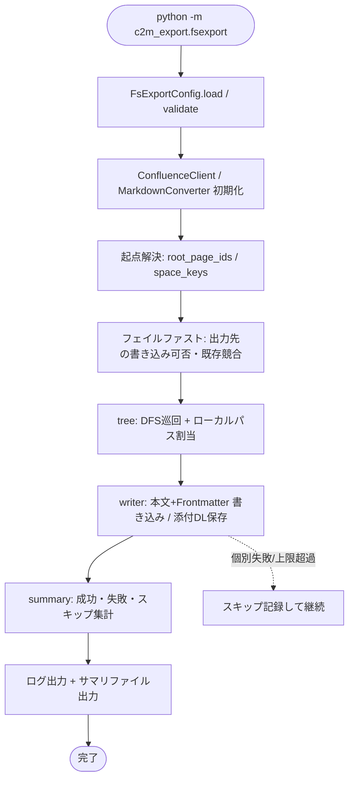

# Design Document

## 概要

本設計は、Confluence のページ階層（特定ページ配下 / Space / Workspace 全体）を、既存の結合 Markdown エクスポートとは別に、**ファイルシステムのディレクトリ/ファイル階層として出力する**機能（ファイルシステムモード）を C2M-Export に追加するものである。ページ本文の Markdown（Frontmatter 付き）に加え、ページに添付されたバイナリも併せて出力する。

本機能は利用者のワークフローの「3. エクスポート実行」を担う。分析（0003）はあくまで利用者が全体像を把握するための材料であり、本機能が分析結果から自動でルールを確定するのではない。利用者が決めた除外・制御ルール（DL しないファイル形式、単一ファイルサイズ上限など）を **設定（CLI/YAML）として受け取り**、その指示どおりに出力する。

既存の結合モード（`cli.py` / `export_tree`）の挙動は一切変更しない。ファイルシステムモードは独立エントリーポイント `python -m c2m_export.fsexport` と独立モジュール群として追加し、`ConfluenceClient` と `MarkdownConverter` を再利用する。配置先（SharePoint/OneDrive、Google Drive、Box、Nextcloud、社内ファイルサーバー等）は特定サービスに依存させず、制限値の既定は代表例を参考に定めるにとどめ、設定で変更可能とする。

### 設計原則（既存方針の踏襲）

- **部分成功**: 個別ページ/添付の失敗はスキップして継続し、成功/失敗を区別して集計・報告する（既存 `export_tree` 方針）。
- **日本語ログ**: すべてのログ・エラーを「現象・原因・対処方法」構成の日本語で出力する。
- **設定優先順位**: CLI 引数 > 環境変数 > YAML > デフォルト。
- **フェイルファスト**: 大規模取得の前に出力先の整合性（書き込み可否・既存競合）を確認する。
- **API 負荷の抑制とリトライ**: ページング全件取得・指数バックオフを踏襲する。

### 0003（分析）との関係

本 spec は 0003 で追加予定の `ConfluenceClient` 拡張（`get_page` の `expand` 引数化、`get_attachments`、`get_space_root_pages`）を再利用する。これらが未実装の場合は本 spec で追加する（いずれも既存 `_request` ベース・後方互換）。権限（`get_restrictions`）は本 spec では使用しない（C/0006 の範囲）。添付バイナリの**ダウンロード**は 0003 には無い新規実装であり、本 spec で追加する。

## アーキテクチャ

### モジュール構成

```
c2m_export/
├── confluence.py       # [拡張] get_attachments / download_attachment(新規) / get_space_root_pages / get_page の expand 引数化
├── config.py           # [拡張] FsExportConfig を追加（既存 Config・AssessConfig は不変）
├── converter.py        # [再利用] 本文変換はそのまま利用
├── utils.py            # [拡張] GB 表示・パス構築・一意名採番などのヘルパを追加
├── fsexport.py         # [新規] ファイルシステムモードのエントリーポイント（python -m c2m_export.fsexport）
├── fs_export/          # [新規] ファイルシステム出力ロジック一式
│   ├── __init__.py
│   ├── models.py       # PageNode / ExportPlan / ExportResult / SkipRecord 等
│   ├── tree.py         # DFS 巡回とツリー→ローカルパス割当（命名・衝突回避）
│   ├── writer.py       # Markdown 本文 + Frontmatter 書き込み、添付の保存
│   ├── frontmatter.py  # Frontmatter の生成（YAML フロントマター）
│   ├── links.py        # 本文中の添付参照→ローカル相対リンクへの書き換え（純粋関数）
│   └── summary.py      # 処理サマリの生成（ログ + ファイル出力）
└── (既存ファイル)
```

### 責務分担

| モジュール | 責務 |
|---|---|
| `fsexport.py` | エントリーポイント。設定ロード→クライアント/コンバータ初期化→起点解決→フェイルファスト→巡回・書き込み→サマリ出力。 |
| `FsExportConfig`（config.py） | 本モードの設定の読み込み・検証・正規化。既存 `Config` とは独立。 |
| `confluence.py`（拡張） | 添付一覧取得・添付バイナリDL・Space 列挙・`get_page` の expand 引数化。 |
| `fs_export/tree.py` | DFS 巡回しつつ各ページにローカル相対パスを割り当てる（命名方式・衝突回避・パス長/禁止文字の正規化）。I/O（API）と採番を担う。 |
| `fs_export/writer.py` | ページ Markdown（Frontmatter 付き）の書き込み、添付の保存、単一ファイル上限判定。 |
| `fs_export/frontmatter.py` | 元ページ情報の Frontmatter を生成（純粋関数・テスト容易）。 |
| `fs_export/links.py` | 変換済み本文中の添付参照を、保存済み添付へのローカル相対リンクへ書き換える（純粋関数）。未解決参照を報告。 |
| `fs_export/summary.py` | 成功/失敗/スキップを集計し、ログ出力と日時サフィックス付きサマリファイルを生成。 |
| `fs_export/models.py` | ノード・計画・結果・スキップ記録の型定義。 |

### 全体フロー



## コンポーネントと実装詳細

### 1. ConfluenceClient の拡張（confluence.py）

既存メソッド（`get_page` / `get_child_pages` / `_request`）の挙動は変えない。

```python
def get_page(self, page_id, expand="body.storage,space"):
    # [変更/0003と共通] expand を引数化（既定値は現行と同一で後方互換）。
    # 本モードでは version / ancestors / history.lastUpdated 等を追加展開して
    # Frontmatter 用メタデータ（更新日・著者・祖先）を得る。

def get_attachments(self, page_id, limit=50):
    # [0003と共通] child/attachment をページング全件取得。
    # expand=extensions,version で fileSize / mediaType / download リンクを取得。

def download_attachment(self, download_path, dest_file, max_bytes=None):
    # [新規・本モード固有] 添付バイナリを取得して dest_file へ保存する。
    # 既存 _request は JSON 前提のため使えない。session.get(stream=True) を用い、
    # chunk 単位で書き出す（メモリ肥大の回避 / 要件8.4）。
    # Proxy・認証(session 継承)・リトライ（5xx/ネットワーク）を適用する。
    # max_bytes 指定時、受信バイトが超過した時点で中断し部分ファイルを削除、超過を通知する。

def get_space_root_pages(self, space_key, limit=25):
    # [0003と共通] Space 内トップレベルページ列挙（起点解決に使用）。
```

添付のダウンロード URL は添付メタの `_links.download`（コンテキストパス相対）を `base_url` と結合して用いる。`download_attachment` は既存 `_request` のリトライ方針に合わせ、5xx・ネットワーク例外時に指数バックオフで再試行する小さなリトライループを内包する（JSON 用 `_request` とは別実装）。

### 2. ディレクトリ/ファイル構成（要件2.5）

子を持つページ（中間ノード）の本文と子ディレクトリを矛盾なく共存させるため、**各ページを「自身のディレクトリ」として表現し、本文はそのディレクトリ内の Markdown ファイルとする**方式を採る。

```
<output_dir>/
└── 【SPACE】ルートページ/                 # ルートページのディレクトリ
    ├── ルートページ.md                     # 本文（命名方式=ページタイトル由来の既定）
    ├── _attachments/                       # 添付サブディレクトリ（名称は設定可能）
    │   └── 設計書.xlsx
    └── 子ページ/
        ├── 子ページ.md
        ├── _attachments/
        └── 孫ページ/
            └── 孫ページ.md
```

- 本文ファイル名は命名方式（要件5相当）で決定する。既定「ページタイトル由来」ではディレクトリ名と同じ正規化済みタイトル + `.md`。固定名方式では `index.md`。
- 葉ページ（子なし）も一貫性のため同じ「ディレクトリ + 本文ファイル」構造とする（ツリー処理と差分同期(B)の単純化のため）。簡素化オプション（葉は単一 `.md`）は将来拡張余地として残す。

### 3. 命名方式と衝突回避（要件3 / 本文命名）

`tree.py` が DFS 中に各ノードへローカル相対パスを割り当てる。手順:

1. ページタイトルを `utils.sanitize_filename` 相当で正規化（禁止文字除去・予約語回避・末尾ドット/スペース除去・長さ切り詰め）。
2. 同一親の子群で正規化後ディレクトリ名が重複する場合、安定した順序（Confluence の子順）で連番サフィックス（例: ` (2)`）を付与。
3. 本文ファイル名は命名方式に従う。ページタイトル由来方式でも、同一ディレクトリ内に添付名と衝突しうるため、本文は常にページディレクトリ直下・添付は添付サブディレクトリ配下に分離して衝突面を切る。
4. 衝突回避で採用名が元タイトルと異なる場合、対応（page_id / 元タイトル / 採用名）をログ記録し、サマリにも含める（要件3.3）。

命名方式の設定値:

- `page_filename_mode`: `title`（既定）| `index`。
- `title` 方式のファイル名変換は上記 1〜2 と同一ルールを本文ファイルにも適用する（タイトル→ファイル名の変換ルールを要件3と一元化）。

### 4. Frontmatter（要件4.8〜4.11）

`frontmatter.py` が純粋関数で YAML フロントマターを生成し、本文 Markdown の先頭に付与する。

```yaml
---
confluence_page_id: "12345678"
confluence_space_key: "SPACE"
confluence_url: "https://host/pages/viewpage.action?pageId=12345678"
title: "ページタイトル"
last_modified: "2026-01-01T09:00:00+09:00"
version: 7
exported_at: "2026-10-27T11:00:00+09:00"
---
```

- 最低限 `confluence_url`（オリジナルへのリンク）を必ず含む（要件4.9）。
- 含める項目は設定で拡張/取捨できる構造とする（`frontmatter_fields` 設定、既定は上記項目／要件4.10）。
- 定型の `---` デリミタで囲む標準的な YAML フロントマターとし、完全移行後に機械的な一括除去（先頭フロントマターブロックの剥離）が可能な形式とする（要件4.11）。
- 既存の結合モードが本文冒頭に付けていたメタ情報（Page ID / Space Key / URL）は、本モードでは Frontmatter に集約する（本文可読性のため）。

### 5. 単一ファイルサイズ上限（要件5）

- 設定 `single_file_max_mb`（既定 250、0003 と整合）。
- **ダウンロード前判定**: 添付メタの `extensions.fileSize` が上限超過なら DL せずスキップ（要件5.2）。無駄な通信を避ける。
- **ダウンロード後判定**: メタサイズ欠落時は `download_attachment` に `max_bytes` を渡し、受信が上限を超えた時点で中断・部分ファイル削除・スキップ扱い（要件5.3）。
- スキップはファイル名・ページ・サイズ・理由を `SkipRecord` に記録し、ログとサマリ（ファイル含む）に出す（要件5.4〜5.6）。

### 6. 本文中の添付参照のリンク書き換え（要件4.7〜4.10）

既存 `MarkdownConverter` は `ac:image` / `ac:link` の添付参照を**ファイル名**として出力する（`` のような形）。本モードでは、本文中の添付参照を設定 `attachment_link_mode` に従って書き換える。

- `attachment_link_mode`: `relative`（既定）| `original`。

**(a) 相対リンクモード `relative`（既定 / 要件4.7a・4.8・4.9）**

- 書き換え先: `<添付サブディレクトリ名>/<正規化済み保存ファイル名>`（例: `_attachments/設計書.xlsx`）。正規化後の実際の保存名と一致させる（要件4.8）。
- 未保存添付の扱い（要件4.9）: 上限超過・除外拡張子・DL 失敗などでローカルに存在しない添付への参照は、誤った相対リンクを作らず**元のファイル名参照のまま残す**（解決不能であることが分かる）。この件数はサマリに記録する。
- 突き合わせの堅牢性: 同名衝突で保存名が採番された場合も、元ファイル名→保存名マップを介して正しい相対リンクに解決する。マップに一致しない参照は未保存扱い（上記）とする。

**(b) オリジナルリンクモード `original`（要件4.7b・4.10）**

- 書き換え先: Confluence 上の添付への絶対リンク（例: `<base_url>/download/attachments/<page_id>/<URLエンコード済みファイル名>`、または添付メタの `_links.download` を `base_url` と結合した絶対 URL）。
- ローカル保存の有無に依存しない。上限超過・除外・DL 失敗でローカルに無くてもオリジナルを指せる（移行期の参照先として有効）。

**共通**

- 外部 URL（`http(s)://` や `<...>` で囲まれた絶対参照）は対象外で据え置く。
- 実装方式（変換器を本モード専用に分岐させない）: `MarkdownConverter` 本体は変更せず、`fs_export` 側で後処理する。(1) そのページの添付一覧（元ファイル名 → 正規化保存名・保存可否・オリジナル download パス）のマップを `writer`/`tree` 段階で構築し、(2) 変換済み本文に対し `fs_export/links.py` のリンクリゾルバ（純粋関数）をモード指定付きで適用する。変換器出力のファイル名は Confluence の `ri:filename` 由来で、添付メタの `title`/`filename` と突き合わせ可能。

モジュール追加: `fs_export/links.py`（純粋関数のリンクリゾルバ）。入力＝変換済み本文 + 添付マップ + リンクモード、出力＝書き換え後本文 + 未解決参照の一覧（相対モード時）。

### 7. 除外・制御ルールの指示（要件はじめに / 利用者主導）

利用者が決めたルールを設定で受け取る。本 spec で提供する制御:

| 設定 | 役割 |
|---|---|
| `single_file_max_mb` | 単一ファイルサイズ上限（既定 250） |
| `exclude_extensions` | DL/出力しない添付拡張子のリスト（利用者が決定） |
| `attachment_dir_name` | 添付サブディレクトリ名（既定 `_attachments`） |
| `attachment_link_mode` | 本文中の添付参照のリンク先（`relative`=既定/`original`） |
| `page_filename_mode` | 本文ファイル命名方式（`title`/`index`、既定 `title`） |
| `path_length_limit` | パス長の正規化・警告のしきい値（既定 400、設定可） |
| `frontmatter_fields` | Frontmatter に含める項目 |

`exclude_extensions` と `single_file_max_mb` が「DL しない形式／一定サイズを超えるものを出さない」という利用者ルールの受け口になる。

### 8. パス長・禁止文字の出力時対処（要件 未確定事項）

- 禁止文字・予約語・末尾ドット/スペースは `sanitize_filename` 相当で**必ず**正規化する（出力の正当性のため必須）。
- パス長は配置先非依存。既定 `path_length_limit=400` を超える見込みの相対パスを検出し、既定は**警告ログ＋サマリ記録**（出力は継続）。能動的な短縮（タイトル切り詰め強化等）はオプションとし、既定では行わない。制限値は設定で変更可能（特定サービス非依存）。

### 9. サマリ出力（要件5.6 / 6.3〜6.5）

`summary.py` が `ExportResult` から生成する。

- 内容: 出力ページ数・出力添付数・総出力サイズ（MB/GB）・各スキップ件数に加え、**成功一覧と失敗/スキップ個別一覧**（対象識別子＝page_id/ファイル名・パス・理由）を含む（要件6.4）。
- 出力: 標準出力（ログ）＋ **実行日時サフィックス付きファイル**（年月日・時分秒、ミリ秒なし。例: `fsexport_summary_261027_110500.txt` 等）。形式はテキスト（人間可読）を既定とし、機械可読化は将来拡張。
- 出力先は `output_dir` 配下。

### 10. 設定（FsExportConfig / config.py）

既存 `Config` と並立する新クラス `FsExportConfig` を追加（既存 `Config`・`AssessConfig` は不変）。共通骨格（YAML→env→CLI、`base_url` の rstrip 正規化、proxy の env 取り込み）を踏襲。

主なキー（既存踏襲 + 本モード固有）:

| キー | CLI | 既定 | 用途 |
|---|---|---|---|
| `root_page_ids` | `--root-page-id`（複数可） | なし | 起点ページ |
| `space_keys` | `--space-key`（複数可） | なし | 起点 Space |
| `output_dir` | `--output-dir` | `.` | 出力先ルート |
| `overwrite` | `--overwrite` | false | 既存競合時の上書き |
| `attachment_dir_name` | `--attachment-dir` | `_attachments` | 添付サブディレクトリ名 |
| `attachment_link_mode` | `--attachment-link-mode` | `relative` | 本文中の添付参照のリンク先（`relative`/`original`） |
| `page_filename_mode` | `--page-filename-mode` | `title` | 本文命名方式 |
| `single_file_max_mb` | `--single-file-max-mb` | 250 | 単一ファイル上限 |
| `exclude_extensions` | `--exclude-ext`（複数可） | なし | 除外拡張子 |
| `path_length_limit` | `--path-length-limit` | 400 | パス長しきい値 |
| `frontmatter_fields` | （YAML 主体） | 既定項目 | Frontmatter 項目 |

`validate()`: `root_page_ids` と `space_keys` の少なくとも一方が必須、`base_url`・`token` 必須。既存キー（`base_url`/`token`/`proxy`）も踏襲。`c2m_config_sample.yaml` に本モードのサンプルを追記する。

### 11. エントリーポイント（fsexport.py）

骨格は既存 `cli.py`（ログ設定→Config→クライアント初期化→フェイルファスト→実行→サマリ）を踏襲。

```python
def main():
    logging.basicConfig(...)                 # 既存同様の日本語フォーマット
    config = FsExportConfig(); config.load(); config.validate()
    client = ConfluenceClient(config.base_url, config.token, config.proxy)
    converter = MarkdownConverter(config.base_url)
    roots = resolve_roots(client, config)    # root_page_ids / space_keys
    fail_fast_check(config, roots)           # 書き込み可否・既存競合（既存方針踏襲）
    result = export_tree_fs(client, converter, config, roots)  # tree + writer
    write_summary(result, config)            # ログ + 日時サフィックスファイル
```

## エラーハンドリング

既存方針（部分成功・日本語・現象/原因/対処）を全面的に踏襲する。

| 失敗点 | 挙動 |
|---|---|
| 起点ページ/Space が存在しない・権限なし | フェイルファストで終了。 |
| 出力先の書き込み不可・既存競合（overwrite 無） | フェイルファストで終了（要件7）。 |
| 個別ページの取得/変換/書き込み失敗 | スキップし継続、失敗一覧に記録（要件6）。 |
| 添付一覧取得失敗 | そのページの添付を空として継続、スキップ記録。 |
| 添付 DL 失敗 | スキップし継続、失敗一覧に記録（要件4.6）。 |
| 単一ファイル上限超過 | DL 前/後判定でスキップ、上限超過スキップとして記録（要件5）。 |
| サマリファイル書き込み失敗 | 現象・原因・対処を日本語で報告（サマリのログ出力自体は行う）。 |

## テスト戦略

既存構成（`tests/` 直下、`pytest`、`PYTHONPATH=.`）に合わせ、純粋ロジックを厚く、I/O はモックで薄く検証する。

- `tests/test_fs_tree.py`: DFS 巡回とローカルパス割当（命名方式 title/index、同名衝突の連番、禁止文字/予約語正規化、パス長しきい値検出）。
- `tests/test_fs_frontmatter.py`: Frontmatter 生成（必須 `confluence_url` の存在、項目設定による増減、定型デリミタで剥離可能なこと）。
- `tests/test_fs_links.py`: リンクリゾルバ。`relative` モード（画像/リンク参照の相対パス書き換え、正規化・採番後の保存名との一致、未保存添付は元参照のまま残し報告、外部 URL 据え置き）と `original` モード（ローカル保存の有無に依存せず Confluence 絶対リンクを生成）の双方を検証。
- `tests/test_fs_writer.py`: `ConfluenceClient` モックで、本文書き込み・添付保存・単一ファイル上限（DL前/後）・除外拡張子スキップ・部分成功を検証。
- `tests/test_fs_summary.py`: 成功/失敗/スキップ集計、失敗個別一覧の存在、日時サフィックスファイル名の形式。
- `tests/test_fs_client.py`: `requests` モックで `download_attachment` のストリーミング保存・max_bytes 超過時の中断と部分ファイル削除・リトライ、`get_page` expand 引数化後の既存呼び出し不変。
- `tests/test_fsexport_config.py`: 優先順位・rstrip・既定値・必須チェック。
- 既存の結合モードテストが不変で通ること（非破壊の確認）。

## 設計上の決定事項（0004）

1. **エントリーポイント**: 独立モジュール `python -m c2m_export.fsexport`（既存 `cli.py` 不変、分離明確）。
2. **ディレクトリ構成**: 各ページ=ディレクトリ、本文=その直下の Markdown、添付=`_attachments/`（設定名）。葉ページも同構造で一貫。
3. **本文命名**: 既定ページタイトル由来（`page_filename_mode=title`）、固定名 `index` も選択可。変換ルールは要件3の正規化・衝突回避と一元化。
4. **Frontmatter**: 標準 YAML フロントマター、最低限 `confluence_url`、項目は設定可、機械的一括除去が可能な定型形式。
5. **添付参照の書き換え**: `attachment_link_mode` で切替。既定 `relative` は保存済み添付への相対リンク（`_attachments/保存名`）、`original` は Confluence 添付への絶対リンク。変換器は変更せず `fs_export/links.py` の後処理で実施。相対モードで未保存の添付への参照は元のファイル名参照のまま残し、件数をサマリに記録。
6. **サマリ**: ログ＋日時サフィックス付きファイル、成功集計に加え失敗/スキップ個別一覧を含む。
7. **配置先非依存**: 禁止文字正規化は必須、パス長は設定可能しきい値での検出＋警告（既定は短縮しない）。

## 未確定事項（実装時に詰める）

- `last_modified` / `version` / `ancestors` を得るための `get_page` の最小 expand セット（API 往復削減との兼ね合い）。
- サマリファイルの形式（当面テキスト、JSON 併用の要否）。
- リンクリゾルバの参照照合の細部（変換器が出力しうる参照表記のバリエーション＝山括弧 `<...>` 囲み・URL エンコード差異への対応範囲）。
