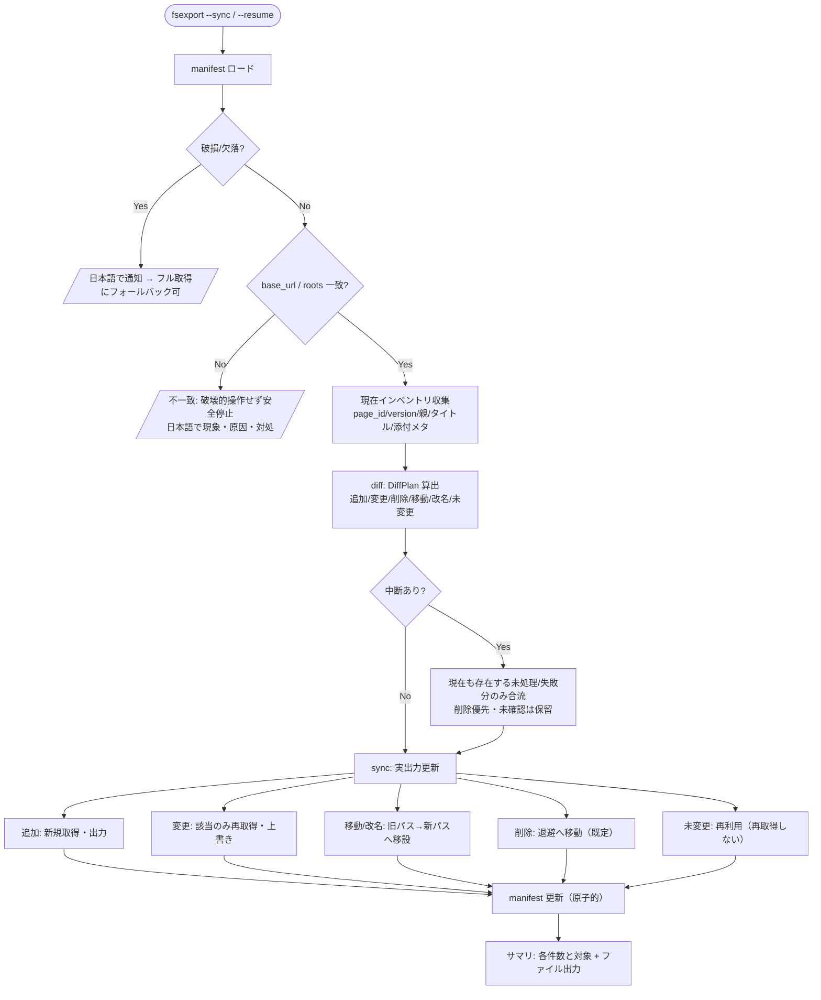

# Design Document

## 概要

本設計は、ファイルシステムエクスポート（0004）に **中断再開（レジューム）** と **差分同期**（追加・変更・削除・移動・改名の反映）を追加する。両機能は共通の基盤である **マニフェスト**（前回状態と進捗の永続記録）の上に成り立つ。

本機能は 0004 の出力構造（各ページ=ディレクトリ、本文=直下の Markdown、添付=添付サブディレクトリ、本文先頭の Frontmatter）を前提とし、`fs_export` パッケージと `FsExportConfig` を拡張して実装する。既定では 0004 の毎回フル出力を変えず、**オプトイン**（`--sync` / `--resume` 相当の設定）で有効化する。既存の結合モード（`cli.py`）は一切変更しない。

差分同期は「増えた分を足す」ではなく、前回マニフェストと現在の Confluence 状態を突き合わせ、**追加・変更・削除・移動・改名**を反映する。page_id を不変キーとして追跡することで、タイトル変更（＝タイトル由来のローカルパス変化）や親の移動にも破綻せず追従する。

### 設計原則（既存方針の踏襲）

- **既存非破壊 / オプトイン**: 指定時のみ動作。0004 のフル出力・結合モードは不変。
- **部分成功・日本語ログ**: 個別失敗はスキップして継続、現象・原因・対処方法で報告。
- **設定優先順位**: CLI > env > YAML > デフォルト。
- **安全側**: 削除・退避・整合回復は誤消去を避ける方向に倒す。一時的な取得失敗を削除と誤認しない。
- **原子性**: マニフェスト更新は書きかけ破損を避ける方法で行う。

## アーキテクチャ

### モジュール構成（0004 の `fs_export` を拡張）

```
c2m_export/
├── config.py            # [拡張] FsExportConfig に sync/resume 関連キーを追加
├── fsexport.py          # [拡張] sync/resume 指定時に SyncPlanner 経由の実行へ分岐
├── fs_export/
│   ├── (0004 既存: models / tree / writer / frontmatter / links / summary)
│   ├── manifest.py      # [新規] マニフェストの読み書き（原子的書き込み）・スキーマ・破損検出
│   ├── diff.py          # [新規] 前回マニフェスト × 現在インベントリ の差分判定（純粋ロジック）
│   ├── sync.py          # [新規] 差分に基づく同期実行（追加/変更/削除/移動/改名）とレジューム制御
│   └── quarantine.py    # [新規] 削除・改名時の退避ディレクトリ操作
└── (既存ファイル)
```

### 責務分担

| モジュール | 責務 |
|---|---|
| `manifest.py` | マニフェストのロード/セーブ（原子的: 一時ファイル→`os.replace`）、スキーマ定義、バージョン、破損検出とフォールバック通知。 |
| `diff.py` | 前回マニフェストと現在の Confluence インベントリ（page_id/version/親/タイトル/添付）を突き合わせ、`DiffPlan`（追加/変更/削除/移動/改名/未変更）を算出する**純粋関数**。 |
| `sync.py` | `DiffPlan` に従い 0004 の `tree`/`writer` を呼んで実出力を更新。レジューム時は未処理/失敗から再開。マニフェストを逐次更新。 |
| `quarantine.py` | 削除・置換時にローカル出力を退避ディレクトリへ移動（既定の削除同期）。 |
| `FsExportConfig`（拡張） | `sync`/`resume`/削除方針/退避先 等の設定。 |
| `fsexport.py`（拡張） | 通常フル出力か sync/resume 実行かを分岐。 |

I/O（manifest 読み書き・sync の API/FS 操作）と純粋ロジック（diff）を分離し、`diff.py` は API・FS モック不要で単体テストする。

### 全体フロー



## コンポーネントと実装詳細

### 1. マニフェスト（manifest.py / 要件1・6）

- **単位**: マニフェストは `output_dir` ごとに単一（固定名 1 ファイル）。Confluence サーバやワークスペースの別によってファイルが分かれるのではなく、**出力先ディレクトリ 1 つにつき 1 マニフェスト**。運用前提は「1 出力先ディレクトリ＝1 エクスポート対象（1 サーバ・1 まとまりの Space/ページ群）」。複数サーバ/複数対象は `output_dir` を分ける。
- **保存場所/名称**: 0004 の `output_dir` 直下に `.c2m_manifest.json`（ドットファイル。出力ツリーと混在しても識別可能）。
- **スコープ検証（要件1.6・1.7 / 案1 のフェイルセーフ）**: マニフェストに記録した `base_url` と `roots`（root_page_ids / space_keys）を、再実行時の指定と照合する。
  - 一致 → 通常どおり差分同期/レジュームを実行。
  - 不一致（別サーバ、または対象 Space/ページ群が異なる）→ **削除同期を含む一切の破壊的操作を行わず**、日本語（現象・原因・対処）で報告して停止する。対処として「別の `output_dir` を使う」「意図的なら `--full` で新規に取り直す」を案内する。これにより、別対象のマニフェストと突き合わせて今回対象外のコンテンツを一括削除/退避する事故を防ぐ。
  - `roots` 照合は、今回が前回の部分集合/上位集合である場合の扱い（例: 前回 2 Space・今回 1 Space）も定義する。既定は「集合が完全一致しなければ不一致として停止」とし、意図的な対象変更は `--full` で明示させる（安全側）。
- **原子的書き込み**: 一時ファイルへ書き出し `os.replace` で置換（要件6.3）。途中中断でも旧マニフェストが残る。
- **スキーマ（概要）**:

```json
{
  "schema_version": 1,
  "base_url": "https://host",
  "roots": { "root_page_ids": ["..."], "space_keys": ["..."] },
  "completed": false,
  "started_at": "ISO8601",
  "finished_at": null,
  "pages": {
    "<page_id>": {
      "version": 7,
      "title": "タイトル",
      "parent_id": "<page_id|null>",
      "rel_path": "【SPACE】親/子",
      "body_file": "子.md",
      "state": "done|pending|failed",
      "attachments": {
        "<attachment_id|filename>": {
          "version": 3, "size": 12345,
          "saved_name": "設計書.xlsx", "state": "done|pending|failed|skipped"
        }
      }
    }
  }
}
```

- `page_id` を不変キーとして採用し、タイトル/親/パスが変わっても同一エンティティとして追跡する（要件5.1）。
- **破損検出**: JSON パース失敗・`schema_version` 不一致・必須キー欠落を検出し、日本語（現象・原因・対処）で通知。`--full`（全件フル取得フォールバック）を案内（要件1.7・6.4）。

### 2. 現在インベントリの収集（要件3・4・8）

差分判定に必要な**軽量メタデータのみ**を先に収集する（本文・バイナリは取得しない）。

- ページ: DFS 巡回で `page_id` / `version.number` / `title` / 親（`ancestors` 末尾）を取得。`get_page` は差分判定用に最小 expand（`version,ancestors`）で呼ぶ。
- 添付: `get_attachments` のメタ（version/size）。
- これにより「未変更ページは本文を取らない」を実現し、大規模でも軽量（要件8.3）。
- **収集の完全性**: インベントリとともに `skipped_page_ids` と `incomplete`（範囲・失敗理由）を返す。子ページ一覧・添付一覧は全ページングが成功した場合だけ完全とし、途中ページの失敗や応答の欠落を空一覧として扱わない。
  - ページ取得失敗は当該ページと未巡回の子孫、子ページ一覧の取得・ページング失敗は当該親配下の子孫を `incomplete` とする。保護対象は前回マニフェストの親子関係から求め、そのページ群の添付も含める。
  - 添付一覧の取得・ページング失敗は、そのページの添付集合を `incomplete` とする。Space のルート一覧取得・ページング失敗はその Space 全体を対象とする。範囲を限定できない失敗ではエクスポート対象全体の削除判定を保留する。

### 3. 差分判定（diff.py / 純粋ロジック / 要件3・4・5）

入力: 前回マニフェスト（pages マップ）と現在インベントリ。出力: `DiffPlan`。

page_id 集合の比較で分類する。両方存在するページの条件は次表のとおり排他的とし、本文更新と移設が必要な場合は一つの複合アクションにする。

| 条件 | 分類 | アクション |
|---|---|---|
| 現在のみ存在 | 追加 | 新規取得・出力 |
| 両方存在・version 同一・親/タイトル同一 | 未変更 | 再利用（本文取得しない） |
| 両方存在・version 相違・親/タイトル同一 | 変更 | 該当本文のみ再取得・上書き |
| 両方存在・version 同一・親 or タイトル相違 | 移動/改名 | 新パスへ移設し旧パスを整理（本文再取得なし） |
| 両方存在・version 相違・親 or タイトル相違 | 移動/改名＋変更 | 新パスへ移設後に本文を再取得・更新し、旧パスを整理 |
| 前回のみ存在・完全な収集範囲で不在確認済み | 削除 | 削除同期（既定=退避） |
| 前回のみ存在・skipped または incomplete の範囲内 | 保留 | 前回記録とローカル出力を保持 |

- 添付は**現在存在するページ内だけ**で id/filename 集合を比較し、追加/変更/削除を分類する。添付削除も完全な添付一覧で不在確認できる場合だけとする。
- **ページ削除の包含規則**: ページを削除に分類した場合、そのページディレクトリ内の添付削除を包含する。添付を個別の削除操作として `DiffPlan` に追加・適用せず、既定ではページディレクトリの退避に添付サブディレクトリを同伴させる。`delete` / `report` でもページ単位の方針だけを適用し、同じ添付に重複操作しない。
- **削除誤認の防止（要件4.6）**: `diff` には `skipped_page_ids` と `incomplete` を渡す。前回のみ存在するページ/添付が未確認の範囲に含まれる場合は削除にせず保留し、前回マニフェストの状態・保存先とローカル出力を保持する。`deletion_policy=delete` でも物理削除しない。親ディレクトリの削除で保護対象を巻き込む場合も、その削除を保留する。
- `diff.py` は API/FS に触れない純粋関数で、固定入力でテストする。

### 4. 同期実行（sync.py / 要件2・3・4・5）

`DiffPlan` を順に適用する。実出力は 0004 の `tree`（パス割当）/`writer`（本文+Frontmatter+リンク+添付）を再利用する。

- **追加/変更**: 0004 の writer で取得・出力。マニフェストに version/保存先/state=done を記録。
- **移動/改名（要件5.2〜5.4）**: page_id で追跡し、次の順に**ローカル出力ごと移設**する（`shutil.move` 相当、添付サブディレクトリも同伴）。
  1. 現在の親子関係で親を先に処理し、移動後の親のパスを確定する。親の移設に同伴した全子孫について、page_id ごとの実際の移動元パスを旧接頭辞から新接頭辞へ更新する。
  2. 子を処理する時点で、**確定した移動後の親パス＋子の現在タイトル**から 0004 の正規化・衝突回避規約で新パスを再計算する。移動元には手順1で更新した実パスを使い、前回 `rel_path` をそのまま参照しない。移動元と新パスが同じなら再移動せず、親と子が同時に移動/改名しても二重移動を防ぐ。親への同伴だけでパスが変わる未変更の子孫も、保存先記録を更新する。
  3. タイトル由来の本文ファイル名も新タイトルに合わせて改名する。複合アクション「移動/改名＋変更」は移設後の本文を再取得・上書きし、移設・本文更新の両方が成功した場合だけ `state=done` とする。失敗時は実際の移設先と `state=failed` を記録し、次回再開で本文更新を完了させる。
  4. 旧パスが空になれば整理する。タイトルが同じパスへ正規化される場合も本文ファイル名・Frontmatter を現在のメタデータと整合させる。version 同一なら本文の再取得はしない。
  - 競合（移設先に別エンティティが既存）時は退避で回避し、安全側で処理。
- **削除（要件4.2〜4.4）**: `quarantine.py` で退避ディレクトリへ移動（既定）。ページ削除では添付サブディレクトリを含むページディレクトリを一度だけ処理する。設定で物理削除／報告のみに切替。保留対象を含むディレクトリは削除しない。
- **未変更**: 何もしない（再取得しない / 要件3.3）。

### 5. レジューム（sync.py / 要件2・6）

- マニフェストの `completed=false` を中断とみなす。`state=pending|failed` のページ/添付は、**現在インベントリで存在を確認できたものだけ**再開候補にする（要件2.1）。添付は所有ページと添付自身の双方の存在確認を必要とする。
- レジュームと差分同期は同一経路: 先に「現在インベントリ × マニフェスト」の差分と削除/保留を確定し、存在確認済みの未完了分だけを `DiffPlan` に合流する。**削除判定を常に優先**し、削除済みの pending/failed 項目を再開対象へ戻さない。未確認（skipped / incomplete）の項目は前回状態のまま保留し、再取得・削除とも行わない。既存の移動/変更アクションには未処理状態を統合し、同じ対象を二重登録しない。
- **書きかけファイルの整合（要件2.3・6.1）**: writer は本文を一時ファイル→`os.replace` で原子的に書く。`state=done` だが実ファイルが無い/一時ファイルが残るケースも、現在の存在確認と削除/保留判定を優先した上で未処理に戻して再取得する。
- `completed=true` で差分なしならレジューム指定でも何もしない（要件2.5）。

### 6. 退避ディレクトリ（quarantine.py / 要件4.3〜4.4）

- 既定の退避先: `output_dir` 直下 `_c2m_quarantine/<実行日時>/<元 rel_path>`（誤消去防止・いつ退避したか判別可能）。
- 削除対象（ページディレクトリ/添付ファイル）を構造ごと退避へ移動。マニフェストからは削除（または `state=quarantined` を記録）。
- 設定 `deletion_policy`: `quarantine`（既定）/ `delete`（物理削除）/ `report`（ローカル不変・報告のみ）。

### 7. 設定（FsExportConfig 拡張 / 要件7）

0004 の `FsExportConfig` に追加（既存キーは不変）。

| キー | CLI | 既定 | 用途 |
|---|---|---|---|
| `sync` | `--sync` | false | 差分同期を有効化（オプトイン） |
| `resume` | `--resume` | false | 中断からの再開を有効化 |
| `full` | `--full` | false | マニフェストを無視し全件フル取得（フォールバック） |
| `deletion_policy` | `--deletion-policy` | `quarantine` | 削除同期方針（quarantine/delete/report） |
| `quarantine_dir_name` | `--quarantine-dir` | `_c2m_quarantine` | 退避ディレクトリ名 |
| `manifest_name` | （内部既定） | `.c2m_manifest.json` | マニフェストファイル名 |

- `sync`/`resume` 未指定時は 0004 のフル出力そのまま（要件7.1）。
- `sync` と `resume` は併用可能（再実行は差分＋未完了合流）。

### 8. エントリーポイント分岐（fsexport.py / 要件7）

```python
def main():
    config = FsExportConfig(); config.load(); config.validate()
    client = ConfluenceClient(...); converter = MarkdownConverter(...)
    if config.full or not (config.sync or config.resume):
        run_full_export(...)          # 0004 の経路（マニフェストは最後に新規保存）
    else:
        manifest = load_manifest(config)         # 破損/欠落→通知しフォールバック案内
        verify_scope(manifest, config)           # base_url/roots 不一致→破壊的操作せず安全停止
        inv, skipped, incomplete = collect_inventory(client, config)  # 軽量メタと完全性
        plan = diff(manifest, inv, skipped, incomplete)  # 削除/保留を優先し、存在確認済み未完了分のみ合流（純粋）
        run_sync(client, converter, config, plan, manifest)  # 実出力 + 原子的更新
    write_summary(...)                # 0004 と整合（ログ + 日時サフィックスファイル）
```

- フル出力経路でも**完了時にマニフェストを新規保存**しておくことで、次回から sync/resume が使える（0004 単独実行後でも 0005 が機能する基盤を作る）。

## エラーハンドリング

| 失敗点 | 挙動 |
|---|---|
| マニフェスト破損/欠落 | 日本語（現象・原因・対処）で通知、`--full` フォールバックを案内（要件1.9）。 |
| スコープ不一致（別サーバ/別対象） | 破壊的操作を一切行わず安全停止。別 `output_dir` の使用 or `--full` を案内（要件1.6・1.7）。 |
| インベントリ収集・一覧ページングの失敗 | skipped / incomplete の範囲と理由を記録し、その範囲のページ/添付の削除を保留。`delete` でもローカル出力を保持（要件4.6）。 |
| 追加/変更の取得・書き込み失敗 | 当該を `state=failed` で記録し継続。次回再開対象。 |
| 移設先競合 | 退避で回避、安全側。 |
| マニフェスト書き込み失敗 | 原子的置換前のため旧マニフェストが保全される。現象・原因・対処を報告。 |
| 記録あり・実体なし / 実体あり・記録なし | 前者=現在の存在確認と削除/保留を優先し、存在確認済みなら未処理扱いで再取得。後者=報告し既存を壊さない（要件6.1・6.2）。 |

## テスト戦略

- `tests/test_sync_diff.py`: `diff.py` を固定入力で網羅検証（version 変更有無×親/タイトル変更有無の排他的分類、添付差分、ページ削除時の添付個別操作なし、子ページ/添付一覧の途中ページ失敗で未確認項目を保留）。API/FS モック不要。
- `tests/test_sync_manifest.py`: ロード/セーブの往復、原子的置換（一時ファイル→replace）、破損検出とフォールバック通知、schema_version 不一致、スコープ検証（base_url/roots 一致で続行、別サーバ・別対象・部分集合で安全停止し破壊的操作をしないこと）。
- `tests/test_sync_quarantine.py`: 退避先の命名・構造、ページディレクトリ/添付の移動、競合時の安全側処理。
- `tests/test_sync_apply.py`: `sync.py` をクライアント/writer モックと一時ディレクトリで検証。親子同時移動/改名・親への同伴だけの子・移動＋本文更新・途中失敗の再開・添付の重複削除なし・`delete` 時も incomplete の実ファイル保持・削除済み pending/failed（ページ/添付）の再開なし・書きかけ整合でも削除優先を含める。
- `tests/test_fsexport_sync_config.py`: `sync`/`resume`/`full`/`deletion_policy` の解決・既定・優先順位。
- 0004・結合モードの既存テストが不変で通ること（非破壊）。

## 設計上の決定事項（0005）

1. **マニフェスト**: `output_dir` ごとに単一の `.c2m_manifest.json`（1 出力先＝1 エクスポート対象）、`schema_version` 付き、原子的置換で更新。page_id を不変キー。記録した `base_url`/`roots` と実行指定を照合し、不一致なら破壊的操作せず安全停止（別対象の削除事故を防止）。
2. **変更検知**: 主に `version.number`、補助に更新日時。未変更は本文を取得しない。
3. **削除同期の既定**: 退避ディレクトリへ移動（`_c2m_quarantine/<日時>/`）。物理削除・報告のみは設定で選択。
4. **移動・改名**: 親を先に移設し、子の移動元を更新して新パスを再計算。version 変化時は複合アクションで本文も更新し旧パスを整理。
5. **レジュームと差分の統一**: 削除/保留を先に確定し、現在も存在する中断未完了分だけを合流する。
6. **削除誤認防止**: skipped / incomplete のページ・子孫・添付は前回状態とローカル出力を保持。ページ削除は添付削除を包含する。
7. **フル出力でもマニフェスト保存**: 0004 単独実行後も 0005 が使える基盤を作る。

## 未確定事項（実装時に詰める）

- 添付の不変キー（attachment id が安定して取れるか、filename フォールバックが要るか）。
- 退避ディレクトリをマニフェストの差分判定対象から除外する仕組み（`_c2m_quarantine` / `.c2m_manifest.json` の無視ルール）。
- 大規模時のマニフェストサイズ・読み書き性能（必要なら分割や索引化）。
- インベントリ収集と本文取得を一部統合して API 往復を減らす最適化の可否。
