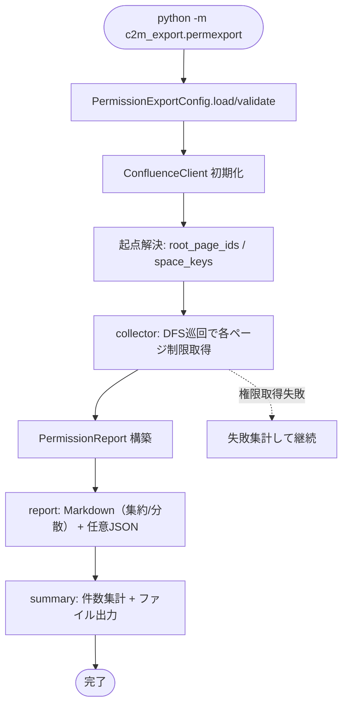

# Design Document

## 概要

本設計は、Confluence のページに設定されたアクセス権限（コンテンツ制限）を取得し、**Read / Read+Write の保有者（ユーザー・グループ）を Markdown として出力する**機能を C2M-Export に追加する。目的は、エクスポートしたコンテンツを配置先（SharePoint / OneDrive 等、特定サービスに限定しない）へ移行した後、管理者が同等のアクセス設定を再適用する際の**参照情報**を提供することにある。配置先への権限の自動適用は行わない（記録のみ）。

権限取得には 0003 で追加予定の `ConfluenceClient.get_restrictions`（Data Center の `/rest/api/content/{id}/restriction/byOperation`、read/update を 1 リクエストで取得）を再利用する。継承された制限は**実効権限へ展開せず**、個別制限を持たないページは「継承/制限なし」と記す（案A）。これにより、個別に権限が設定された箇所＝管理者が意図的に権限を操作した箇所が浮かび上がる。

本機能は独立したエントリーポイント `python -m c2m_export.permexport` として提供し、既存の結合モード・0004 のファイルシステム出力の挙動を変えない。単独でも 0004 と併用（権限レポートのローカルパスを 0004 の出力構造に対応付け）でも動作する。

### 設計原則（既存方針の踏襲）

- **既存非破壊 / オプトイン**: 指定時のみ動作。結合モード・0004 は不変。
- **部分成功・日本語ログ**: 個別ページの権限取得失敗は集計して継続、現象・原因・対処方法で報告。
- **設定優先順位**: CLI > env > YAML > デフォルト。
- **API 負荷抑制**: `byOperation` で read/update を一括取得（ページあたり 1 リクエスト）。

## アーキテクチャ

### モジュール構成

```
c2m_export/
├── confluence.py          # [再利用] get_restrictions（0003で追加）/ get_child_pages / get_space_root_pages
├── config.py              # [拡張] PermissionExportConfig を新設（独立。既存クラスは不変）
├── permexport.py          # [新規] 権限エクスポートのエントリーポイント（python -m c2m_export.permexport）
├── permission/            # [新規] 権限エクスポートロジック一式
│   ├── __init__.py
│   ├── models.py          # PagePermission / PermissionReport / PermissionResult
│   ├── collector.py       # DFS巡回で各ページの制限を取得（I/O）
│   ├── report.py          # Markdown レポート生成（集約/分散）・任意JSON（純粋ロジック）
│   └── summary.py         # 処理サマリ（ログ + 日時サフィックスファイル）
└── (既存ファイル)
```

設定方針: 権限エクスポートは単独実行もできる独立機能のため、**`PermissionExportConfig` を新設**する（既存 `Config` / `AssessConfig` / `FsExportConfig` は不変）。0004 と併用する場合のパス対応付けに必要な設定（出力先・添付ディレクトリ名・命名方式）は 0004 と同じ既定を共有する形で持つ。

### 責務分担

| モジュール | 責務 |
|---|---|
| `permexport.py` | エントリーポイント。設定ロード→クライアント初期化→起点解決→collector→report→summary。 |
| `PermissionExportConfig` | 権限エクスポートの設定の読み込み・検証・正規化。 |
| `confluence.py`（再利用） | `get_restrictions` で read/update のユーザー/グループを取得。 |
| `permission/collector.py` | DFS 巡回で各ページの `PagePermission` を収集（I/O 層）。部分成功。 |
| `permission/report.py` | `PermissionReport` から Markdown（集約/分散）と任意 JSON を生成（純粋関数）。 |
| `permission/summary.py` | 出力/個別制限/継承/失敗の集計、ログ + 日時サフィックスファイル出力。 |

I/O（collector）と純粋ロジック（report）を分離し、report は API モック不要でテストする。

### 全体フロー



## コンポーネントと実装詳細

### 1. 権限取得（collector.py / 要件1・3）

- 既存 DFS 骨格で巡回し、各ページについて `get_restrictions(page_id)` を呼ぶ。
- `get_restrictions` は `byOperation` の結果から read / update それぞれの `restrictions.user.results`（`username` / `displayName`）と `restrictions.group.results`（`name`）を抽出して返す（0003 で実装）。
- **個別制限の有無判定（案A / 要件3）**: read・update ともにユーザー/グループが空なら「継承/制限なし」とする。いずれかに対象があれば「個別制限あり」。親をさかのぼる実効権限展開は行わない。
- 本文・添付は扱わない（権限のみ）。0004 と併用時も権限取得は独立に行う。

### 2. データモデル（models.py）

```python
@dataclass
class PagePermission:
    page_id: str
    title: str
    space_key: str
    url: str  # Confluence オリジナル URL
    rel_path: Optional[str]  # 0004 併用時のローカル相対パス（単独時は None）
    has_explicit: bool  # 個別制限あり=True / 継承・制限なし=False
    read_users: list[str]  # "displayName (username)" 等の表示用文字列
    read_groups: list[str]
    readwrite_users: list[str]  # update 操作キー = Read+Write
    readwrite_groups: list[str]
    fetch_failed: bool = False
    fail_reason: str = ""


@dataclass
class PermissionReport:
    pages: list[PagePermission]


@dataclass
class PermissionResult:
    report: PermissionReport
    exported_count: int
    explicit_count: int
    inherited_count: int
    failed_page_ids: list[str]
```

### 3. 識別子表現（要件4.5）

- ユーザー: `displayName`（表示名）と `username`（ログイン名）を併記（例: `山田太郎 (t.yamada)`）。Data Center 対象のため `username` を突き合わせキーとして保持。
- グループ: グループ名（`name`）。
- 配置先アカウントとの突き合わせを容易にするため、表示名だけでなく機械的な識別子（username / group name）を必ず含める。

### 4. レポート出力（report.py / 要件4）

純粋関数で `PermissionReport` から生成する。格納形態を設定で選択。

- **集約（既定 / `report_layout=aggregate`）**: 出力先ルート直下に俯瞰ファイル（例: `_permissions.md`）を 1 つ生成。全ページを表形式で一覧し、どのページにどの権限が付与されているかを俯瞰できる。個別制限ありページを上に集める、または「個別制限あり」列で絞り込める構成とする。
- **分散（`report_layout=per_page`）**: 各ページ対応ディレクトリ（0004 の `rel_path`）に権限ファイル（例: `_permissions.md`）を配置。0004 併用時のみ有効（`rel_path` が必要）。単独実行時は集約にフォールバックし、その旨を日本語で通知。
- Markdown 内容: ページごとに page_id / タイトル / Confluence URL /（併用時）ローカル相対パス、Read 権（ユーザー・グループ）、Read+Write 権（ユーザー・グループ）、または「継承/制限なし」。
- 冒頭注記: 本レポートは Confluence 側権限の記録であり配置先への自動適用ではないこと、継承は展開せず個別制限のみを示すこと、を明示（要件4.8・3.4）。
- **任意 JSON（要件4.7）**: `report_formats` に `json` を含める場合、機械可読な権限データも出力（キー安定）。既定は Markdown のみ。

集約レポートの表イメージ:

```
| ページ | 個別制限 | Read(ユーザー/グループ) | Read+Write(ユーザー/グループ) | URL |
|---|---|---|---|---|
| 設計方針 | あり | 山田太郎 (t.yamada) / dev-team | 鈴木 (suzuki) / — | https://... |
| 議事録   | 継承/制限なし | — | — | https://... |
```

### 5. 対象範囲と起点解決（要件2）

- `root_page_ids` / `space_keys` を 0004/0005 と一貫した形で受け取る。
- Space 指定時は `get_space_root_pages` でトップレベルを列挙し各々を起点に DFS。
- 0004 併用時は 0004 と同じ命名規約で `rel_path` を算出し、権限レポートのローカルパス対応に用いる（`permission` 側に 0004 の命名ユーティリティを再利用）。

### 6. 設定（PermissionExportConfig / config.py）

既存クラスは不変。新設。

| キー | CLI | 既定 | 用途 |
|---|---|---|---|
| `root_page_ids` | `--root-page-id`（複数可） | なし | 起点ページ |
| `space_keys` | `--space-key`（複数可） | なし | 起点 Space |
| `output_dir` | `--output-dir` | `.` | レポート出力先 |
| `report_layout` | `--report-layout` | `aggregate` | 集約/分散（aggregate/per_page） |
| `report_formats` | `--report-format` | `md` | md / json / both |
| `attachment_dir_name` | `--attachment-dir` | `_attachments` | per_page 時の rel_path 整合用（0004 と共有） |
| `page_filename_mode` | `--page-filename-mode` | `title` | 同上（rel_path 算出の整合用） |
| `overwrite` | `--overwrite` | false | 既存レポートの上書き |

`validate()`: `root_page_ids` と `space_keys` の少なくとも一方が必須、`base_url`・`token` 必須。`base_url` は rstrip 正規化。`report_layout=per_page` かつ 0004 出力が無い（単独実行）場合は集約にフォールバックして警告。`c2m_config_sample.yaml` に権限セクションを追記。

### 7. エントリーポイント（permexport.py）

骨格は既存 `cli.py` を踏襲（日本語ログ→Config→クライアント初期化→起点解決→フェイルファスト（出力先）→collector→report→summary）。

```python
def main():
    config = PermissionExportConfig()
    config.load()
    config.validate()
    client = ConfluenceClient(config.base_url, config.token, config.proxy)
    roots = resolve_roots(client, config)
    report = collect_permissions(client, config, roots)  # collector
    write_permission_report(report, config)  # report（集約/分散 + 任意JSON）
    write_summary(report, config)  # ログ + 日時サフィックスファイル
```

## エラーハンドリング

| 失敗点 | 挙動 |
|---|---|
| 起点ページ/Space が存在しない・権限なし | フェイルファストで終了。 |
| 個別ページの権限取得失敗 | 本文処理と独立に、`fetch_failed=True`・理由を記録して継続（要件6.1〜6.3）。 |
| 出力先の書き込み不可・既存競合（overwrite 無） | フェイルファストで終了。 |
| per_page 指定だが 0004 出力なし | 集約へフォールバックし日本語で通知。 |
| サマリ/レポート書き込み失敗 | 現象・原因・対処を日本語で報告。 |

## テスト戦略

- `tests/test_perm_report.py`: `PermissionReport` から集約 Markdown / per_page Markdown / JSON を生成し、Read・Read+Write の区別、継承/制限なしの表記、識別子併記（displayName+username）、自動適用でない旨の注記、キー安定性を検証（API モック不要）。
- `tests/test_perm_collector.py`: `ConfluenceClient` をモックし、`get_restrictions` 結果からの個別制限あり/継承判定、部分成功（取得失敗の集計と継続）を検証。
- `tests/test_perm_summary.py`: 出力/個別制限/継承/失敗の件数集計と日時サフィックスファイル名形式。
- `tests/test_permexport_config.py`: 優先順位・rstrip・既定値・必須チェック・`report_layout`/`report_formats` 列挙値・per_page フォールバック。
- 既存（結合モード・0004）テストが不変で通ること（非破壊）。

## 設計上の決定事項（0006）

1. **継承は展開しない（案A）**: 個別制限を持たないページは「継承/制限なし」。意図的な権限操作箇所を浮かび上がらせる。
2. **格納形態**: 既定は集約（トップレベル俯瞰ファイル）、`per_page` も選択可（0004 併用時のみ有効、単独時は集約フォールバック）。
3. **識別子**: `displayName (username)` 併記、グループ名。配置先突き合わせのため機械的識別子を必ず含む。
4. **独立性**: `PermissionExportConfig` を新設し単独実行可能。0004 併用時は命名規約を共有して `rel_path` を対応付け。
5. **API 負荷**: `byOperation` で read/update を 1 リクエスト取得。
6. **自動適用はしない**: 記録のみ。レポートに明示。

## 未確定事項（実装時に詰める）

- 集約レポートが大規模ページ数で肥大化する場合の分割（Space 別ファイル等）の要否。
- スペース権限・グローバル権限を補足情報として併記するか（本 spec の主対象はページのコンテンツ制限）。
- `get_restrictions` が返すユーザー識別子の正確なフィールド（`username` / `userKey` / `displayName`）の実レスポンス確認と表記の最終化。
