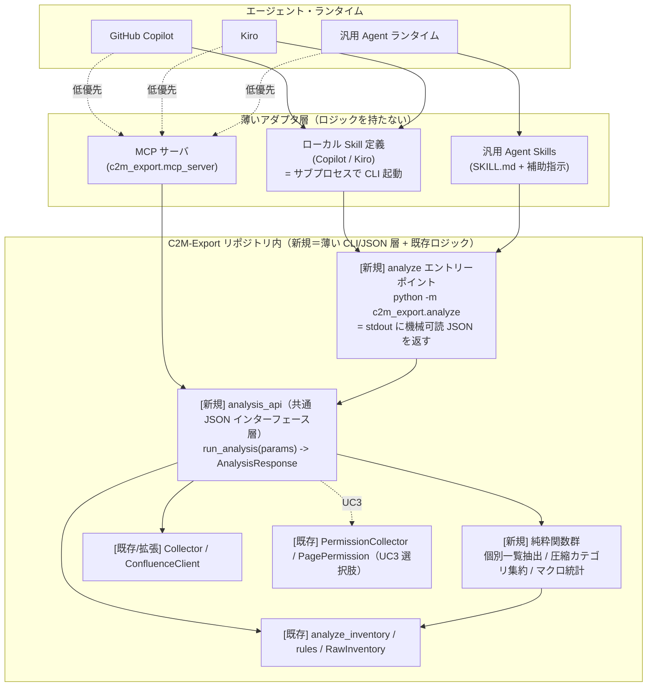
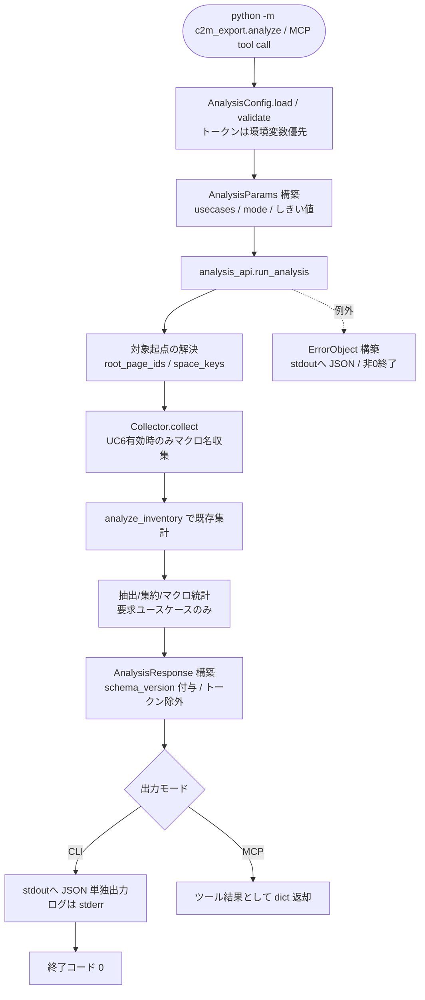

# Design Document

## 概要

本設計は、Confluence 内のワークスペース状況を**エージェント（GitHub Copilot / Kiro / 汎用 Agent Skills / MCP）から把握・分析できるようにする Skill**と、それを支える **CLI の改善**を C2M-Export に追加するものである。

要件（requirements.md）が示すとおり、既存 assess モード（spec `0003_confluence_assessment`）は「集計値（カウント・分布・サマリ）」を Markdown / JSON の**ファイル**として出力することに最適化されている。一方でエージェント連携に必要な (a)「条件に合致した個別ページ/添付の一覧」と (b)「ログや進捗を混ぜず stdout に純粋な機械可読 JSON を返す口」が（`risk_items` を除き）存在しない（`_research_notes.md` §0, §2.3）。本設計はこの 2 点を中心に CLI を**追加のみ**で拡張し、その CLI を複数の Skill 形態が共通で呼び出す構成を定義する。

設計の核は、**薄い「分析 JSON インターフェース層」を 1 つだけ新設**し、GitHub Copilot / Kiro のローカル Skill 定義、汎用 Agent Skills、MCP サーバはいずれもこの 1 層を呼ぶ**薄いアダプタ**に留める、という責務分担である。これにより分析ロジックの重複実装を避け、Skill 形態が増えても中核ロジックを一箇所で保守できる。

既存 CLI（結合エクスポート `cli.py` / assess `assess.py` / fsexport `fsexport.py` / permexport `permexport.py`）の挙動・引数・出力フォーマットは一切変更しない（requirements 要件 11・スコープ外）。既存の純粋関数（`analyze_inventory` / `rules.*` / `generate_json_report`）と I/O 層（`Collector` / `ConfluenceClient` / `PermissionCollector`）を再利用し、不足分の抽出・集約・マクロ統計の純粋関数を**追加**する。

### 設計原則（既存方針の踏襲）

- **追加のみ・非破壊**: 既存データモデル（`PageMeta` 等）・既存関数・既存 CLI の挙動を変えない。新規フィールド・新規モジュール・新規サブコマンド相当の追加で実現する（requirements 要件 11、`_research_notes.md` §8）。
- **I/O と純粋ロジックの分離**: 新規の抽出・集約・マクロ統計は API 非依存の純粋関数として実装し、API モック不要で単体テストできるようにする（0003 設計原則、requirements 受け入れ基準 14.6）。
- **部分成功**: 個別ページ/添付/権限/本文解析の失敗はスキップして継続し、件数と ID を集計・報告する（0003・`collector.py` の既存方針）。
- **日本語ログ・「現象/原因/対処方法」**: 人間向けログ・docstring は日本語。ただし機械可読 JSON モードでは stdout を JSON 専用にし、ログは stderr へ振り分ける（requirements 要件 1・10・14）。
- **設定優先順位**: CLI 引数 > 環境変数 > YAML > デフォルト（`config.py` 既存骨格）。
- **秘匿情報の非漏洩**: 認証トークンをログ・JSON 出力・エラーオブジェクト・Skill 定義ファイルに一切含めない（requirements 要件 13）。

## アーキテクチャ

### 全体構成（Skill 形態 → 共通 JSON インターフェース層 → 既存 assess ロジック）

複数の Skill 形態が共通の 1 層（分析 JSON インターフェース層 = `analysis_api`）を呼び出す。Skill 定義と MCP サーバはその上の薄いアダプタに留める。



要点:

- **共通 1 層 = `analysis_api`**。入力パラメータ（分析対象・ユースケース・しきい値・出力モード）を受け取り、`AnalysisResponse`（Python dataclass / dict）を返す純粋志向の関数層。I/O（API 呼び出し）は従来どおり `Collector` / `ConfluenceClient` に委譲する。
- **CLI（`python -m c2m_export.analyze`）は `analysis_api` の薄いラッパ**。`AnalysisResponse` を `json.dumps` して stdout に出すだけ。ローカル Skill（Copilot / Kiro）と汎用 Agent Skills はこの CLI をサブプロセス起動する。
- **MCP サーバは `analysis_api` を直接 import する薄いアダプタ**。CLI を経由せず同じ 1 層を呼ぶ（サブプロセス起動のオーバーヘッドを避ける）。
- Skill 定義・MCP サーバ・CLI のいずれも**分析ロジックを持たない**。ロジックは `analysis_api` + 純粋関数群 + 既存 assess に集約する。

### モジュール構成

既存パッケージ `c2m_export/` に以下を**追加**する。既存ファイルは、明記した「拡張（追加のみ）」を除き変更しない。

```
c2m_export/
├── analyze.py              # [新規] 分析CLIエントリーポイント（python -m c2m_export.analyze）stdout JSON
├── analysis/               # [新規] 分析JSONインターフェース層と純粋ロジック
│   ├── __init__.py
│   ├── api.py              # [新規] analysis_api: run_analysis(params) -> AnalysisResponse（共通1層）
│   ├── params.py           # [新規] AnalysisParams（入力パラメータ）とバリデーション
│   ├── response.py         # [新規] AnalysisResponse / 各ユースケース結果 / ErrorObject の dataclass と schema
│   ├── extractors.py       # [新規] 個別一覧抽出（UC2/UC3/UC5/UC1集約）純粋関数
│   ├── categories.py       # [新規] 圧縮カテゴリ集約（UC4）純粋関数と既定拡張子集合
│   └── macros.py           # [新規] マクロ統計・手作業修復候補判定（UC6）純粋関数
├── mcp_server.py           # [新規] MCP サーバ（任意依存。analysis_api を呼ぶ薄いアダプタ）
├── assessment/
│   ├── collector.py        # [拡張・追加のみ] body.storage からマクロ名を収集（UC6, 任意フラグ制御）
│   └── models.py           # [拡張・追加のみ] PageMeta に macro_counts 等の任意フィールドを追加（既定で後方互換）
├── config.py               # [拡張・追加のみ] AnalysisConfig を追加 + トークン環境変数読取を全Configに追加
└── (既存ファイルは不変)
```

Skill/MCP の配布成果物（リポジトリ内）:

```
skills/                                  # [新規・正本] SKILL.md 標準の正本（OSS 汎用 Agent Skills）
└── confluence-analysis/
    ├── SKILL.md                         # frontmatter(name/description) + 6UCの手順・入力・JSON出力・前提環境・トークン環境変数運用
    └── scripts/run_analysis.*           # CLI をサブプロセス起動する薄い補助スクリプト
.github/skills/confluence-analysis/      # [新規] GitHub Copilot プロジェクトスキル配置先（正本と同一内容を複製）
└── SKILL.md (+ scripts/)
.kiro/skills/confluence-analysis/        # [新規] Kiro スキル配置先（正本と同一内容を複製）
└── SKILL.md (+ scripts/)
requirements-mcp.txt                     # [新規] MCP 用 optional 依存（mcp パッケージ）。requirements.txt には含めない
```

> **配置先は確定済み**（「確定事項」§1）。3 形態はすべて `SKILL.md` オープン標準に**一本化**し、`skills/confluence-analysis/` を**正本**として `.github/skills/` と `.kiro/skills/` に同一内容を複製する。3 箇所の同期は保守タスクで担保する。

### 責務分担

| 層 / モジュール | 責務 | ロジックの有無 |
|---|---|---|
| ローカル Skill 定義（Copilot / Kiro） | CLI をサブプロセス起動し stdout JSON を受け取る手順を記述。トークンは環境変数で渡す運用を明記。 | なし（手順のみ） |
| 汎用 Agent Skills（`SKILL.md` + scripts） | 同上。OSS 汎用性のため自己完結の指示書＋薄い補助スクリプト。 | なし（手順＋薄いスクリプト） |
| MCP サーバ（`mcp_server.py`） | 分析機能を MCP ツールとして公開。`analysis_api.run_analysis` を呼ぶだけ。 | なし（アダプタ） |
| `analyze.py`（CLI） | 引数解析 → `AnalysisConfig` → `run_analysis` → `AnalysisResponse` を stdout に JSON 出力。終了コード設定。 | 薄い（I/O 境界のみ） |
| `analysis/api.py`（共通1層） | `AnalysisParams` を受け、対象起点解決 → Collector 実行 → 既存 `analyze_inventory` + 新規抽出/集約/マクロ統計 → `AnalysisResponse` 構築。 | 中核（調停） |
| `analysis/extractors.py` / `categories.py` / `macros.py` | 個別一覧抽出・圧縮カテゴリ集約・マクロ統計（API 非依存の純粋関数）。 | あり（純粋） |
| `assessment/collector.py`（拡張） | 既存収集に加え、必要時のみ `body.storage` からマクロ名を集計（UC6）。 | I/O |
| `config.py`（拡張） | `AnalysisConfig` 追加、トークンの環境変数読取を追加。 | 設定 |

I/O（collector/confluence）と純粋ロジック（extractors/categories/macros）を分離することで、追加ロジックは API モック不要で単体テストできる（requirements 14.6）。

### 全体フロー



## コンポーネントと実装詳細

### 1. 分析 JSON インターフェース層（analysis/api.py） — 共通 1 層

`run_analysis(params: AnalysisParams, client: Optional[ConfluenceClient] = None) -> AnalysisResponse` を公開する。`client` を引数化することで、テスト時はモック注入、本番は内部生成という両立を可能にする（テスト容易性）。

処理は次のとおり。

1. **基準時刻の確定**: `run_analysis` の先頭で `reference_time = datetime.now(timezone.utc)` を**一度だけ**生成する。この値を後続の `analyze_inventory`（鮮度の件数集計）と `extractors.extract_stale_pages`（UC2 の個別一覧）の**双方へ同値で渡す**ことで、`stale_page_count` と detail の件数の整合を保証する（レビュー指摘 1）。同じ値を `AnalysisResponse.generated_at`（§3.1）にも用いる。
2. **起点解決**: 既存 `assess.resolve_roots` は Space 解決失敗時に `logger.error` + `sys.exit(1)` を内蔵するため（`assess.py` 実装、`_research_notes.md` §2.4）、そのまま import すると `SystemExit` で落ち ErrorObject / 終了コード規約に乗らない。`assess.resolve_roots` は不変（§8）のまま、**`analysis/api.py` に `sys.exit` を使わず例外送出する独自の起点解決関数 `_resolve_roots(client, params)` を新規実装する**（レビュー指摘 5）。`root_page_ids` + `space_keys` を重複排除し、起点 Space/ページが存在しない（404）場合は `TargetNotFoundError` を送出（`run_analysis` が `TARGET_NOT_FOUND` / 終了コード 4 に変換、§3.3・エラーハンドリング表）。

   **例外→エラーコードの分類方法（`confluence.py` の実例外仕様に基づく。レビュー指摘 4）**: `ConfluenceClient._request` は実コード上、(a) 4xx を `response.raise_for_status()` で送出する＝`requests.exceptions.HTTPError`（`e.response.status_code` でステータス取得可）、(b) 5xx はリトライ上限到達後に素の `Exception`、(c) ネットワーク系は `requests.exceptions.RequestException`、(d) 全リトライ失敗時に素の `Exception` を送出する（`confluence.py` 実装確認済み）。`_resolve_roots` および `run_analysis` の API 呼び出しは次の方針で分類する（擬似コード）:

   ```python
   try:
       ... client.get_page(...) / client.get_space_root_pages(...) ...
   except requests.exceptions.HTTPError as e:
       status = getattr(e.response, "status_code", None)
       if status in (401, 403):
           raise AuthFailedError(...)      # -> AUTH_FAILED / exit 3
       if status == 404:
           raise TargetNotFoundError(...)  # -> TARGET_NOT_FOUND / exit 4
       raise ApiError(...)                 # その他 4xx -> API_ERROR / exit 5
   except requests.exceptions.RequestException:
       raise ApiError(...)                 # ネットワーク系 -> API_ERROR / exit 5
   except Exception:
       raise ApiError(...)                 # 5xx リトライ尽き等の素の Exception -> API_ERROR / exit 5
   ```

   これらの独自例外（`AuthFailedError` / `TargetNotFoundError` / `ApiError`）は `analysis/api.py` に定義し、`run_analysis` 直下の最外 `try/except` で §3.3 の `code` と終了コードへ一元変換する。想定外の例外は `INTERNAL_ERROR` / 終了コード 10 に落とす。

   **部分失敗（0 件 Space）の扱い（要件 14.2、レビュー指摘 8）**: `space_keys` の一部が「存在するがトップレベルページ 0 件」だった場合は**致命とせず継続**し、当該 Space キーを `uncertainties.empty_space_keys`（新規）に列挙して報告する。`TARGET_NOT_FOUND`（終了コード 4）に落とすのは、**全起点（全 `root_page_ids` + 全 `space_keys`）の解決結果が空**になった場合のみとする。`scope.resolved_root_count` には実際に解決できた起点ページ数を反映する。
3. **収集**: `Collector(client, analyze_restrictions=...).collect(root_ids)` で `RawInventory` を得る。UC6（マクロ統計）が要求された場合のみ、collector に `collect_macros=True` を渡して `body.storage` からマクロ名を集計する（§5）。
4. **既存集計**: `analyze_inventory(inventory, ..., reference_time=reference_time)` で `AssessmentResult` を得る（UC1 のリスク、UC4 の基盤、鮮度/権限カウントなどの基盤データ）。`reference_time` は手順 1 で生成した同一値を渡す。
5. **ユースケース別の抽出・集約**: 要求された `usecases` のみ、`extractors` / `categories` / `macros` の純粋関数を呼ぶ。経過日数・古いページ抽出には手順 1 の `reference_time` を、URL 構築には `params` 経由で注入した `base_url`（§3.1）を渡す。
6. `AnalysisResponse` を構築。`schema_version` を付与し、トークンを含むフィールドを一切持たせない（§7）。

**軽量サマリ / 詳細（個別一覧）モード（requirements 要件 2）**: `params.mode ∈ {"summary", "detail"}`。`summary` は各ユースケースのカウント・分布のみ、`detail` は個別一覧（`items[]`）を含める。`detail` 時は `params.limit`（既定 1000）/ `params.sort`（ユースケース別の既定キー）で上位 N に制限する（要件 2.4）。`limit` 超過時は `truncated: true` と `total_count` を返して過大出力を防ぐ。

**純粋関数と api.py の責務境界（レビュー指摘 1）**: `extractors` / `categories` / `macros` の各純粋関数は、**該当ユースケースの `items[]` に相当する「全件のレコード列」と、`counts` に相当する生の集計値（カウント・分布）のみ**を返す。`sort` / `limit` の適用、`truncated` / `total_count` の算出、`usecases.<key>` ブロック（`counts` と detail 時の `items` / `total_count` / `truncated`）の**組み立ては `analysis/api.py`（`run_analysis`）が一括で行う**。これにより純粋関数は「抽出・集約」の責務のみを持ち、出力モードやページネーションに依存しない（単体テストが容易＝要件 14.6）。各純粋関数の返り値型は §3.2 の表に「関数の返り値」として明示する。

**sort / limit / truncated / total_count の適用層（レビュー指摘 2）**: 抽出・集約関数は**全件のレコード列を返す**（内部で `sort` も `limit` も適用しない）。`run_analysis` は共通ヘルパ `_paginate(records, sort_key, limit, descending=True)` を 1 つ持ち、全ユースケース共通で次を一括実施する — (1) `sort_key`（ユースケース別既定、§2.1 の「既定 sort」列）で `descending` 方向にソート、(2) `total_count = len(records)` を記録、(3) 先頭 `limit` 件に切り詰め、(4) `len(records) > limit` なら `truncated = true`。**ソート方向は `descending` 引数で制御する**: リスク件数・経過日数・添付数など「大きいほど注目」のキーは降順（既定 `descending=True`）、`page_id` のような安定順キーは昇順（`descending=False`）を指定する（§2.1 の UC3 行と整合。NIT 指摘）。`mode == "summary"` のときは `items` 自体を省略し `counts` のみ出力する（`total_count` / `truncated` も付けない）。`--sort` が未指定ならユースケース別既定を用い、ユースケースが `sort` を持たない集約系（`archives` / `macros`）では `--sort` を受理しても無視する（§2.1・§3.2 に明記）。

### 2. 入力パラメータ（analysis/params.py）

| フィールド | 型 | 既定 | 意味 / 対応 CLI |
|---|---|---|---|
| `usecases` | `List[str]` | 全 6 種 | 実行するユースケース（`risk` / `stale` / `restricted` / `archives` / `empty_with_attachments` / `macros`）。`--usecase`（複数可） |
| `mode` | `str` | `"summary"` | `summary` / `detail`。`--mode` |
| `limit` | `int` | `1000` | 詳細モードの件数上限。`--limit` |
| `stale_days` | `int` | `365` | UC2 しきい値（既存 `stale_days` 踏襲）。`--stale-days`。`--stale-years` も受理し内部で `years × 365` で換算する。この換算は**閏年を考慮しない単純近似**であり、実効しきい値は `stale_threshold_days`（= 換算後日数）として UC2 の `counts` に明示する（要件 4.2、レビュー NIT）。`--stale-days` と `--stale-years` 両指定時は `--stale-days` 優先（§2 バリデーション） |
| `min_body_bytes` | `int` | `200` | UC5/UC7 しきい値（既存踏襲）。`--min-body-bytes` |
| `archive_extensions` | `Set[str]` | `categories.DEFAULT_ARCHIVE_EXTENSIONS` | UC4 圧縮カテゴリ集合。`--archive-ext`（複数可、上書き）（要件 6.4） |
| `analyze_restrictions` | `Optional[bool]` | `None`（未指定時は YAML/既定を尊重） | UC3 権限収集の有効/無効。`--restrictions`（`default=None`）/ `--no-restrictions`（`store_false`） |

`--restrictions` は既存 `AssessConfig` と同一の **`default=None` の 3 値動作**（未指定時は YAML/既定を尊重、`--restrictions` で明示的に有効化、`--no-restrictions` で明示的に無効化）とし、既存踏襲を崩さない（`config.py` 実装、レビュー指摘 11）。`AnalysisConfig` を追加する際は周辺の属性命名も既存 `AssessConfig` に合わせる（例: `report_format` のように**単数形**に揃え、命名ゆれを防ぐ。レビュー指摘 12）。

バリデーション（`params.py` の `validate()`。違反はすべて `ErrorObject`（`INVALID_PARAM` / 終了コード 2）、レビュー指摘 6）:

- `usecases`: 許可集合（§2.1 の受理値表）のみ。未知値を含む場合はエラー。**未指定時は全 6 種**を既定実行するが、`--usecase` を**明示的に空指定**した場合（空集合）は `INVALID_PARAM`（意図不明の空指定を許さない）。
- `mode`: `summary` / `detail` の 2 値のみ。
- `limit`: 整数かつ `>= 1`。`0` 以下・非整数はエラー。
- `stale_days`: 整数かつ `>= 0`。`--stale-years` 指定時は `stale_days = years * 365`（`years >= 0` の整数）で換算し、`--stale-days` と `--stale-years` の**両方が指定された場合は `--stale-days` を優先**する（§2.1 の `stale_days` 行の注記と一致）。
- `min_body_bytes`: 整数かつ `>= 0`。
- `archive_extensions`: **空集合を許容**する（空の場合 UC4 は 0 件として正常に返す。エラーにしない）。各要素は小文字・ドット無しに正規化する。
- `analyze_restrictions`: 3 値（`None` / `True` / `False`）。`--usecase restricted` と `--no-restrictions` の矛盾組み合わせの扱いは §6 で定義する。

#### 2.1 `--usecase` 受理値と UC 番号の対応（設計内の単一の真実、レビュー指摘 3）

`--usecase` の受理値・内部 `usecases` キー・要件 UC 番号の対応は**本表を唯一の正**とし、§4.2・§9（Skill 例）はここを参照する（取り違え防止、特に `empty_with_attachments`）。

| 要件 UC | `--usecase` 値（= 内部キー） | 既定 sort（detail 時） | 内容 |
|---|---|---|---|
| UC1 | `risk` | `risk_count` 降順 | 移行リスクが高いページ一覧 |
| UC2 | `stale` | `days_since_modified` 降順 | 直近 N 年未更新の古いページ一覧 |
| UC3 | `restricted` | `page_id` 昇順（安定順。`_paginate(..., descending=False)`） | 個別権限が設定されたページ一覧 |
| UC4 | `archives` | （集約。`--sort` 無視。拡張子内訳は `total_size_bytes` 降順固定） | 圧縮形式ファイルの個数・概算合計サイズ |
| UC5 | `empty_with_attachments` | `attachment_count` 降順 | 添付あり かつ 本文がほぼ空のページ一覧 |
| UC6 | `macros` | （集約。`--sort` 無視。`macro_usage` / `items` は `count` 降順固定） | マクロ使用統計と手作業修復候補 |

未指定時は全 6 値を実行する。

### 3. JSON 出力スキーマ定義（analysis/response.py）

スキーマは `response.py` 冒頭に定義コメントとして記載し、`dataclass` で表現する。**安定スキーマ**として `schema_version`（文字列、例 `"1.0"`）をトップレベルに必須で持たせる（requirements 1.3）。基盤の `summary` ブロックは既存 `generate_json_report` の `summary` キー構造を再利用し互換を保つ（requirements 1.5、`_research_notes.md` §2.3）。

#### 3.1 トップレベル（AnalysisResponse）

| フィールド | 型 | 意味 |
|---|---|---|
| `schema_version` | string | スキーマバージョン（例 `"1.0"`）。安定性の識別子。 |
| `status` | string | `"ok"` / `"error"`。`error` 時は `usecases` を省略し `error` を持つ。 |
| `generated_at` | string (ISO8601) | 生成時刻。**UTC** の `datetime.now(timezone.utc).isoformat()`（§1 手順 1 の `reference_time` と同値）。出力ごとに変化するためテストでは比較対象から除外する（テスト戦略）。 |
| `mode` | string | `"summary"` / `"detail"`。 |
| `scope` | object | `{ "root_page_ids": [...], "space_keys": [...], "resolved_root_count": int }`。トークンは含めない（`base_url` はログ・URL 構築に用いる非機微情報のため載せてよい）。 |
| `summary` | object | 規模サマリ（既存 `generate_json_report.summary` と同一キー: `total_pages` / `total_attachments` / `estimated_body_bytes` / `total_attachment_bytes` / `max_depth` / `level_distribution` / `space_summary`）。**`level_distribution` は内部では `Dict[int, int]`（`analyzers.py`）だが、`json.dumps` により JSON 上はキーが文字列化される**（例 `{"1": 10, "2": 25}`）。これは既存 `generate_json_report` と同一の JSON 表現であり、`schema_version` が保証する安定性の対象には「キーが文字列化される」この JSON 表現を含める（レビュー指摘 5）。`AnalysisResponse` の dataclass では `Dict[str, int]` 相当として扱い、実表現との齟齬を避ける。 |
| `usecases` | object | 要求された各ユースケース結果（下記 3.2）。要求されなかったキーは省略。 |
| `uncertainties` | object | `skipped_page_ids` / `skipped_attachment_refs` / `restriction_failed_page_ids` / `size_meta_missing_count` / `macro_parse_failed_count`（既存 + 新規）、`empty_space_keys`（トップレベルページ 0 件だった Space キー、§1 手順 2）、`restrictions_disabled`（UC3 要求時に権限収集が無効だった旨の真偽、§6）。 |
| `error` | object \| null | エラー時のみ（3.3）。 |

#### 3.2 ユースケース結果ブロック（usecases 配下）

各ブロックは共通して `counts`（summary モードでも常時）と、detail モードのみ `items` / `total_count` / `truncated` を持つ。

| キー | 対応 UC | `counts`（summary 常時） | `items[]` 要素（detail 時） | 根拠フィールド / 抽出関数 |
|---|---|---|---|---|
| `risk` | UC1 | `summary_counts`（= `risk_summary_counts`） | ページ集約: `{page_id, title, url, risk_types[], risk_count, reasons[]}` | `AssessmentResult.risk_items`（`RiskItem`）+ `raw_inventory.pages`／`extractors.extract_risk_pages`（下記 risk 補足） |
| `stale` | UC2 | `stale_page_count` / `stale_threshold_days`（実効しきい値 = 換算後日数）/ `freshness_distribution`（30/90/180/365 の固定ビン。可変しきい値とは独立の参考値） | `{page_id, title, last_modified, days_since_modified}` | `PageMeta.last_modified` ／ `extractors.extract_stale_pages`（下記 stale 補足） |
| `restricted` | UC3 | `explicit_restriction_count` / `read_only_restriction_count` / `read_write_restriction_count` | `{page_id, title, url, read_users[], read_groups[], readwrite_users[], readwrite_groups[]}` | `PageMeta.restriction`（`RestrictionMeta`）／ `extractors.extract_restricted_pages`（§6） |
| `archives` | UC4 | `{file_count, total_size_bytes, size_meta_missing_count}` | `{extension, count, total_size_bytes, max_size_bytes}`（カテゴリ内の拡張子別内訳） | `raw_inventory.pages[].attachments` ／ `categories.summarize_archives`（下記 archives 補足） |
| `empty_with_attachments` | UC5 | `count` | `{page_id, title, attachment_count, body_bytes}` | `PageMeta.attachments` / `body_bytes`／ `extractors.extract_empty_with_attachments` |
| `macros` | UC6 | `macro_usage[]`（`{name, count}` 降順） | `{name, count, repair_category, repair_reason}` | 新規 `PageMeta.macro_counts`／ `macros.summarize_macros`（§5、下記 macros 補足） |

共通補足:
- `items` が `limit` で切り詰められた場合 `truncated: true` と全件数 `total_count` を併記（要件 2.4）。
- ページ URL は `base_url + "/pages/viewpage.action?pageId=" + page_id` 形式で構築（Data Center で page_id のみから解決可能な安定形）。タイトル依存の `/display/...` は使わない（タイトル変更・空白で壊れにくい）。`PageMeta` には `url` も `base_url` も無い（`models.py`）ため、**URL を構築する抽出関数には `base_url: str` を引数で渡す**（`run_analysis` が `config.base_url` を注入。§1 手順 5、レビュー指摘 6）。`base_url` 自体は認証情報ではなく、`scope` にも生で載せてよい（トークンのみ除外）。
- **スキーマ内で同一意味の値は同一キー名に統一する**。サイズ系は `counts` / `items[]` の双方で `total_size_bytes` / `max_size_bytes`（バイト整数）に揃える（レビュー指摘 4）。

##### risk（UC1）の detail 集約ロジック（レビュー指摘 7・10）

`AssessmentResult.risk_items` は「ページ + 添付 + 種別ごとの行」で返る（同一ページが複数行、添付行も `page_id` に紐づく。`analyzers.py`）。`extractors.extract_risk_pages(result)` はこれを **`page_id` でグルーピング**して detail を作る。

- `title`: `raw_inventory.pages` から `page_id → title` の辞書を引いて確定する（`RiskItem.item_name` は添付行だと添付名のため使わない）。該当 page_id が `pages` に無い場合は空文字とし `uncertainties` で報告。
- `risk_count`: 当該 `page_id` に紐づく `RiskItem` の**行数**。
- `risk_types[]`: 当該ページの `risk_type` を**重複排除**した集合。値域は `{PATH_LENGTH, INVALID_CHAR, BLOCKED_EXT, LARGE_FILE, DUPLICATE_NAME}` の 5 種。`RESERVED_NAME` は実コードで `INVALID_CHAR` に畳まれ**出力種別には現れない**（`_research_notes.md` §2.1、レビュー指摘 10）。
- `reasons[]`: 各 `RiskItem.reason` のリスト。添付起因のリスクは `reason` 文に添付名（`item_name`）を含めてページ集約後も対象を失わないようにする（要件 3.1「対象 page_id / 添付名 / パスと理由」の保持）。
- 並べ替え: `params.sort` 既定は `risk_count` 降順。`limit` で上位 N 抽出（要件 3.3）。

##### stale（UC2）の detail 抽出と経過日数（レビュー指摘 1・2）

`extractors.extract_stale_pages(inventory: RawInventory, stale_days: int, reference_time: datetime) -> List[...]`（UC2 の `items[]` は `url` を持たないため `base_url` は不要。URL を含む UC1/UC3 の抽出関数のみ `base_url` を受け取る）:

- `reference_time` は `run_analysis` が生成した UTC 値（§1 手順 1）を受け取り、`analyze_inventory` と**同一値**を共有する（件数整合の保証）。
- 各 `PageMeta` について、既存の純粋関数 **`analyzers.parse_iso_datetime(last_modified)` を再利用**して日時をパースする（別実装にしない。レビュー指摘 1）。
- **tz 正規化（必須。最終整合レビュー HIGH 指摘）**: `analyzers.parse_iso_datetime` はタイムゾーン情報を持たない ISO 文字列に対して **naive な `datetime`** を返す（`analyzers.py` 実装: `datetime.fromisoformat` の結果をそのまま返す）。一方 `reference_time` は aware（UTC）であるため、naive のまま引き算すると `TypeError`（aware と naive の減算不可）になる。`extract_stale_pages` は `analyze_inventory` の鮮度集計と**完全に同一の補正手順**を踏むこと: パース結果 `dt` に対し `if dt.tzinfo is None: dt = dt.replace(tzinfo=timezone.utc)` で UTC を付与してから減算する。この補正を省くと UC2 の individual 抽出が例外で落ち、`stale_page_count` と detail 件数の整合（本設計の中核保証）も破壊される。
- `days_since_modified = (reference_time - dt).days`（`dt` は上記 tz 正規化済み）で算出し、`days_since_modified >= stale_days` のページのみを一覧に含める。`analyze_inventory` 側の判定式（`days_ago = (reference_time - dt).days`、`>= stale_days`）と**同一**であることで件数一致を保証する。
- `stale_days` は `run_analysis` が `params.stale_days` を `analyze_inventory(stale_days=...)` と `extract_stale_pages(stale_days=...)` の**両方へ同値で渡す**（レビュー指摘 2）。
- `last_modified` が None またはパース失敗のページは「不明」として一覧に含めない（要件 4.4）。`items[]` 要素は `{page_id, title, last_modified, days_since_modified}`。

##### archives（UC4）の集計源と欠落件数（レビュー指摘 3・4）

`extension_summary` は `file_size=None` を `0` として合算済みで欠落件数を持たず、`RawInventory.size_meta_missing_count` は**全添付横断の値でカテゴリ限定ではない**（`analyzers.py` / `collector.py`、`_research_notes.md` §7(4)）。そのため UC4 の集計源を `extension_summary` から **`raw_inventory.pages[].attachments` の走査に変更する**（レビュー指摘 3 の案 a を採用。純粋関数化＝要件 14.6 とも整合）。

`categories.summarize_archives(inventory: RawInventory, archive_extensions: Set[str]) -> dict` が次を一括算出する。

- `file_count`: カテゴリ該当（`attachment.extension in archive_extensions`）の添付総数。
- `total_size_bytes`: カテゴリ該当のうち **`file_size is not None` のみ**を合算した概算合計サイズ。
- `size_meta_missing_count`: **カテゴリ内で `file_size is None` の件数**（全体値ではない）。これにより「概算合計から除外されている旨を明示」できる（要件 6.5）。
- detail（拡張子別内訳）: カテゴリ内の拡張子ごとに `{extension, count, total_size_bytes, max_size_bytes}`（キー名は counts と統一、レビュー指摘 4）。
- `tar.gz` 等の複合拡張子は collector が `rsplit(".", 1)` で末尾トークンのみ（`gz`）を取る既存挙動に従って判定する（要件 6.3）。

##### macros（UC6）の非対称構造（レビュー指摘 9）

マクロ UC は他 UC（summary=カウント、detail=個別ページ一覧）と**構造が異なる**。detail は「個別ページ一覧」ではなく「**マクロ別**の修復分類付き一覧」である（意図的な非対称）。

- summary（`counts`）= `macro_usage[]`（`{name, count}` を count 降順）**のみ**。`repair_category` は付けない。
- detail（`items[]`）= `{name, count, repair_category, repair_reason}`（マクロ別に修復分類を付与）。
- `repair_reason` は `macros.py` の `MACRO_REPAIR_RULES` 内に区分ごとに保持する**定型日本語文**を引いて設定する（§5.4、レビュー指摘 9）。

#### 3.3 エラーオブジェクト（ErrorObject）

| フィールド | 型 | 意味 |
|---|---|---|
| `code` | string | 機械判別用コード（下表）。 |
| `message` | string | 日本語の「現象・原因・対処方法」構成メッセージ（トークンを含めない）。 |
| `detail` | string \| null | 補足（例外クラス名等。トークンを含めない）。 |

| `code` | 事象 | 終了コード |
|---|---|---|
| `INVALID_PARAM` | 引数/設定の不正（必須欠落・未知 usecase 等） | 2 |
| `AUTH_FAILED` | 認証失敗（401/403） | 3 |
| `TARGET_NOT_FOUND` | 起点ページ/Space が存在しない | 4 |
| `API_ERROR` | リトライ後も解消しない 5xx / ネットワーク | 5 |
| `INTERNAL_ERROR` | 想定外の内部例外 | 10 |

#### 3.4 どのユースケースがどのスキーマに乗るか（明示）

- UC1〜UC6 はすべて `usecases` 配下の該当キーに乗る（3.2 の表）。6 件とも **サマリ版 = `counts`**、**詳細版 = `items[]`**（`mode=detail` 時）という同一スキーマ構造を共有する。
- 規模の全体像（総ページ数等）は常時 `summary` ブロックに乗る（ユースケース指定に関わらず付与）。
- エラー時はトップレベル `error`（ErrorObject）に乗り、`usecases` は省略する。

### 4. CLI インターフェース仕様（analyze.py）

#### 4.1 方式の選択

要件の「未確定事項」である stdout JSON の実現方式について、次の 2 案を検討した。

- 案 A: 既存 `assess.py` に `--json-stdout` フラグを追加し、同プロセスで stdout に JSON を返す。
- 案 B: **専用エントリーポイント `python -m c2m_export.analyze` を新設**し、assess とは独立させる。

**案 B を採用する**。理由は、(1) 0003 が「既存 `cli.py` にサブコマンドを足さず独立モジュールにして影響をゼロにする」決定を取っており本 spec も同方針が一貫する（0003 設計上の決定事項 1）、(2) assess はファイル出力・日本語ログ前提で stdout にログを出す実装（`assess.py` の `logging.basicConfig(... StreamHandler(sys.stdout))`）であり、ここに JSON モードを混ぜると stdout 汚染リスクが高い、(3) 個別一覧という assess に無い出力次元を持つため独立モジュールの方が責務が明快、である。assess は一切変更しないため後方互換が自動的に担保される（requirements 11.1）。

#### 4.2 引数・終了コード

| 引数 | 意味 |
|---|---|
| `--base-url` / `--token` / `--proxy` / `--config` | 既存踏襲（11.2）。`--token` は非推奨とし環境変数を推奨（§7）。 |
| `--root-page-id`（複数可） / `--space-key`（複数可） | 起点指定（既存踏襲）。 |
| `--usecase`（複数可） | 実行ユースケース（既定: 全 6 種）。 |
| `--mode {summary,detail}` | 出力モード（既定 `summary`）。 |
| `--limit` / `--stale-days` / `--stale-years` / `--min-body-bytes` / `--archive-ext` / `--restrictions` / `--no-restrictions` | §2 のしきい値。 |

出力は**常に stdout に JSON 単独**（本モードは機械可読専用のため `--json-stdout` のようなトグルは設けず、モード自体が JSON 出力）。進捗・警告・エラーの人間向けログは **stderr** に出す（requirements 1.2 / 10.4 / 14.4）。ファイルは一切書き出さない（スコープ外「実エクスポートしない」、冪等性 要件 9.4）。

終了コード規約: `0` = 正常、非 0 = 3.3 の `code` に対応（`INVALID_PARAM=2` / `AUTH_FAILED=3` / `TARGET_NOT_FOUND=4` / `API_ERROR=5` / `INTERNAL_ERROR=10`）。エラー時も可能な限り stdout に ErrorObject を含む `AnalysisResponse`（`status:"error"`）を出し、エージェントが機械的に理由を判別できるようにする（要件 10.1）。

#### 4.3 後方互換・非対話・冪等

- **後方互換**: 新規エントリーポイント・新規設定クラス・新規モジュールのみ。既存 CLI/関数/出力は不変（requirements 11.1、`_research_notes.md` §8）。`config.py` への追加はトークン環境変数読取と `AnalysisConfig` のみで、既存 Config クラスの既存挙動は変えない（§8）。
- **非対話**: 標準入力を要求するプロンプトを一切出さない。必須項目欠落時は即座に `INVALID_PARAM` で終了（要件 9.1）。
- **冪等**: 読み取り専用。Confluence への書き込み・添付バイナリのダウンロード・ファイル生成を行わない（要件 9.2/9.4）。同一入力での再実行は副作用を増やさない。`--overwrite` 相当はそもそも書き込みが無いため不要だが、将来ファイル出力を足す場合に備え既存 `overwrite` 既定（無確認上書きしない）方針を踏襲する（要件 9.3）。

### 5. マクロ使用統計の収集方法（UC6 / 要件 8）

現状 collector は `body.storage` から `body_bytes`（UTF-8 バイト長）のみ算出し、本文を解析しない（`collector.py`）。converter はマクロを変換するが統計を取らない（`_research_notes.md` §5.3）。

**収集方式の選択**: 「collector が `body.storage` を BeautifulSoup で解析してマクロ名を数える」案と「converter に変換時の欠損記録を仕込む」案があるが、**collector 側で `body.storage` を解析してマクロ名を集計する案を採用**する。理由は、(1) converter 改変は既存変換経路（結合エクスポート/ fsexport）に副作用を及ぼしうるのに対し collector は読み取り専用で影響範囲が局所、(2) マクロ「使用統計」は変換を要さずタグ名のカウントで十分、(3) 「手作業修復候補」の判定は converter の**既存の静的な方針**（§5.2）をマクロ名→カテゴリの表で写像すれば足り、実変換の実行は不要、である。

#### 5.1 collector の拡張点（追加のみ）

- `Collector.__init__(self, client, analyze_restrictions=True, collect_macros=False)` に `collect_macros` を追加（既定 `False` で既存挙動不変）。
- `collect()` 内、`body_bytes` 算出の直後に `collect_macros` が真なら `macros.count_macros(body_storage)` を呼び、結果を `PageMeta.macro_counts` に格納する。本文が無い/解析失敗時はスキップし `RawInventory` に `macro_parse_failed_count`（新規、既定 0）を加算して集計は継続（要件 8.5）。

#### 5.2 models の拡張点（追加のみ・後方互換）

- `PageMeta` に `macro_counts: Dict[str, int] = field(default_factory=dict)` を**末尾の既定値付きフィールドとして追加**（既存の生成箇所・テストを壊さない）。
- `RawInventory` に `macro_parse_failed_count: int = 0` を追加。
- 既存フィールドの型・名称・順序は変更しない（requirements 11.1、§8 影響範囲）。

#### 5.3 マクロ名の抽出（analysis/macros.py の純粋関数）

`count_macros(body_storage: str) -> Dict[str, int]`:
- BeautifulSoup（`html.parser`、converter と同一パーサ）で解析。
- structured-macro: `ac:structured-macro` 要素の `ac:name` 属性を集計（要件 8.1）。
- legacy: `conf-macro` クラスを持つ要素の `data-macro-name` 属性を集計（要件 8.1）。
- 返り値はマクロ名→出現回数。空本文は空 dict。例外は呼び出し元（collector）で捕捉。

`summarize_macros(pages: List[PageMeta]) -> List[dict]`（返り値は全件のマクロ別レコード列。`mode` に依存せず常に全件を返し、summary/detail の出し分けと `count` 降順ソートは `run_analysis` が行う＝レビュー指摘 1・9）:
- 全ページの `PageMeta.macro_counts` を合算し、マクロ名ごとに `{name, count, repair_category, repair_reason}` のレコードを作る（`repair_category` / `repair_reason` は `MACRO_REPAIR_RULES` を引いて常に付与する。§5.4）。
- `run_analysis` は、`mode == "summary"` のとき各レコードから `{name, count}` のみを取り出して `counts.macro_usage[]`（`count` 降順）に載せる（`repair_*` は落とす）。`mode == "detail"` のときは `items[]` に `{name, count, repair_category, repair_reason}` をそのまま（`count` 降順で）載せる。これが §3.2 macros 補足の「意図的な非対称」（summary は name/count のみ、detail はマクロ別修復分類付き）である。

#### 5.4 手作業修復候補の判定基準（要件 8.3 / 8.4）

converter の現行方針（`_research_notes.md` §5.1/§5.2、`converter.py` 実コード）を根拠に、マクロ名を次の 3 区分へ写像する静的テーブル `MACRO_REPAIR_RULES` を `macros.py` に定義する。

| `repair_category` | 意味（判定観点＝情報欠損/劣化が起きうる理由） | 該当マクロ（converter 実挙動の根拠） |
|---|---|---|
| `content_loss`（内容欠損） | Markdown に本文が残らない。元ページの情報が消失する。 | `include`（埋め込み本文を展開せず注記のみ）、`toc` / `anchor` / `pagetree` / `children` / `contentbylabel`（空文字化）、未知の legacy マクロ・ボディ無し structured-macro（空文字化） |
| `external_dependency`（外部依存） | ソースは残るがレンダリング結果が再生成を要する。 | `plantuml` / `plantumlrender`（図ではなくソース保持）、`jira` / `status`（テキスト注記化） |
| `approximation`（近似変換） | 意味は残るが整形・構造が劣化しうる。 | 表（colspan 補完・`<br>` 化）、`ac:layout*`（段組みを縦積み化）、`u/sup/sub`（テキストのみ）、定義リスト、space-key 不明時の `ac:link` |
| `safe`（修復不要） | 情報を保持して変換される。 | `code` / `noformat`（コードブロック化）、`ac:plain-text-body` を持つマクロ、リッチテキストボディ（expand/note/info/panel/details 等） |

- UC6 の出力は、集計したマクロ名ごとに `MACRO_REPAIR_RULES` を引き、`repair_category`（上表）と `repair_reason` を付与する。**`repair_reason` は `MACRO_REPAIR_RULES` 内に区分ごとに保持する定型の日本語文**（例: `content_loss` → 「本文が Markdown に残らず情報が欠損するため手作業での補完が必要」）を引いて設定する（レビュー指摘 9）。テーブルに無いマクロは `repair_category: "unknown"`（＝「変換方針が未定義のため要確認」）とし、対応する定型文を付与する（判定観点を保守的に倒す）。
- 本テーブルは converter の挙動変更に追従して更新する必要があるため、`macros.py` 冒頭に「converter の方針と対応する」旨のコメントを残す（将来の乖離防止）。

### 6. UC3（個別権限ページ一覧）のデータ源選択

要件 5.3 の「permexport の `PagePermission` を使うか、assess の `raw_inventory.pages[].restriction` から抽出するか」について。

**assess の `raw_inventory.pages[].restriction`（`RestrictionMeta`）から抽出する案を採用する**。理由は、(1) 本 spec の分析は assess 収集（`Collector`）を 1 回走らせることを前提としており、同じ収集結果から `has_explicit=True` を抽出すれば **追加の API 収集（permexport の別経路）が不要**で API 負荷と実装重複を避けられる（`_research_notes.md` §6.2）、(2) `RestrictionMeta` は `read_users/read_groups/update_users/update_groups` を保持しており Read / Read+Write の区別と登場ユーザー/グループを返せる（要件 5.2 を満たす）、(3) permexport は `rel_path` 等 FS 出力前提の項目を持ち本 spec には過剰である。

- `extractors.extract_restricted_pages(inventory, base_url)` が `PageMeta.restriction.has_explicit` でフィルタし、`update_*` を `readwrite_*` にマッピングして返す（permexport の命名規約に揃える）。`url` は `base_url`（`run_analysis` が注入、§3.2 共通補足）から page_id ベースで構築する。
- 権限分析が無効（`analyze_restrictions=False`）の場合、UC3 は `counts` を 0 とし、`uncertainties.restrictions_disabled = true` を立てて「権限収集が無効」である旨を記す。取得失敗ページは `restriction_failed_page_ids` の件数で報告（要件 5.5、既存 collector 挙動）。

#### 6.1 `--usecase restricted` と `--no-restrictions` の矛盾組み合わせ

`--usecase restricted`（または既定で `restricted` を含む全 6 種実行）と `--no-restrictions`（`analyze_restrictions=False`）を同時指定すると、collector が `RestrictionMeta` を一切収集せず全ページ `restriction=None` となり、UC3 が**警告なく空（0 件）を返す**ため「本当に 0 件」と誤解されうる。これを避けるため、次の規則を採用する。

- **`usecases` に `restricted` が含まれ、かつ `analyze_restrictions` が明示的に `False`（`--no-restrictions`）の場合は、`validate()` で `INVALID_PARAM`（終了コード 2）としてエラーにする**。日本語メッセージ（現象/原因/対処）で「`restricted` の分析には権限収集が必要です。`--no-restrictions` を外すか、`--usecase` から `restricted` を除外してください」と案内する。
- `analyze_restrictions` が**未指定（`None`）**の場合はエラーにせず、YAML/既定（既定 `True`）を尊重して収集する。
- 「0 件を正常値として返す」のは、`restricted` を要求**していない**（UC3 対象外）ケースと、権限収集した結果ほんとうに個別制限ページが無いケースに限る。

この明示的エラーにより、無警告の空一覧による誤判断（要件 5 の意図違反）を防ぐ。

### 7. 認証情報・秘匿情報の取り扱い（要件 13）

現状トークンは CLI 引数か YAML でしか渡せず、環境変数読取は Proxy のみ（`_research_notes.md` §4.1）。本設計で環境変数経由のトークン注入を**新規追加**する。

- **環境変数名**: `C2M_CONFLUENCE_TOKEN` を主とし、互換のため `CONFLUENCE_TOKEN` も受理。読み取りは `config.py` の各 `load()` に追加する（全モード共通で利用可能にするが、既存の値解決順を壊さない）。
- **優先順位**: CLI `--token` > 環境変数（`C2M_CONFLUENCE_TOKEN` → `CONFLUENCE_TOKEN`）> YAML `token` > なし。既存の「CLI > env > YAML」方針に整合（要件 13.1、11.4）。CLI での直接指定はプロセス一覧・シェル履歴に残るため**非推奨**とし、ヘルプ文に注記する。
- **Proxy**: 既存の `HTTPS_PROXY` / `HTTP_PROXY` 読取を踏襲（要件 13.5）。
- **出力前サニタイズ（多層防御）**:
  1. `AnalysisResponse` / `ErrorObject` はトークンを保持するフィールドを**構造的に持たない**（dataclass に定義しない）。これが一次防御。
  2. CLI/MCP で stdout/stderr に出す直前、`sanitize_text(text, secrets)` を通し、設定・環境変数から得たトークン文字列が万一含まれていれば `***REDACTED***` に置換する（例外メッセージに URL とともに混入するケースへの二次防御）。`secrets` には解決済みトークンを渡す。**適用点と no-op 条件（レビュー指摘 7）**: CLI は `AnalysisResponse` を `json.dumps` した**最終的な出力文字列全体に対して 1 回だけ** `sanitize_text` を適用してから stdout へ書き出す（各フィールド個別ではなく出力直前の単一適用）。stderr のログ文字列も同様に出力直前に通す。`secrets` 要素が `None` または空文字の場合は**置換を行わない no-op**とする（空文字での全文置換事故を防ぐ）。置換は「(1) 解決済みトークン実値の完全一致除去」と「(2) 正規表現 `Bearer\s+\S+` および `Authorization` ヘッダ値のマスク」の両方を適用する。
  3. 例外から ErrorObject を作る際、例外文字列をそのまま `message` に入れず、既知の分類（§3.3 の `code`）に落としてから日本語メッセージを生成する。`detail` は例外クラス名など非機微情報に限定。
- **Skill 定義ファイル**: SKILL.md / Copilot・Kiro 定義には**トークン値を書かない**。環境変数で渡す運用を手順として明記する（要件 13.2）。補助スクリプトもトークンを引数に取らず環境変数を参照する。

### 8. 既存モジュールへの影響範囲と後方互換

| ファイル | 影響 | 後方互換の担保 |
|---|---|---|
| `assessment/models.py` | `PageMeta.macro_counts`（既定 `{}`）、`RawInventory.macro_parse_failed_count`（既定 0）を**末尾に追加**。 | 既定値付き追加のみ。既存生成箇所（collector）・既存テストは不変で通る（§5.2）。 |
| `assessment/collector.py` | `collect_macros` 引数を**既定 False で追加**し、真のときだけマクロ集計。 | 既定で既存挙動と完全一致（assess からの呼び出しは引数を渡さない）。 |
| `assessment/analyzers.py` | **変更なし**。`analyze_inventory` をそのまま呼ぶ。 | 影響なし。 |
| `assess.py` | **変更なし**（resolve_roots を analysis から import 再利用する場合のみ参照、関数自体は不変）。 | 既存 assess CLI は不変（requirements 11.1）。 |
| `converter.py` | **変更なし**。マクロ修復判定は converter の挙動を写像した静的テーブルで行い、converter は呼ばない（§5）。 | 既存変換経路に影響なし。 |
| `config.py` | トークン環境変数読取を各 `load()` に追加 + `AnalysisConfig` 新設。 | 追加のみ。既存キー・既存優先順位・既存メッセージは不変（§7、`_research_notes.md` §4.1）。 |
| 新規（`analyze.py` / `analysis/*` / `mcp_server.py` / `skills/*`） | 新規追加。 | 既存に依存されないため影響なし。 |

### 9. 各 Skill 形態の具体的ファイル構成案と共通層との境界

いずれの形態も**共通 1 層（`analysis_api` / `analyze` CLI）を呼ぶだけ**で、分析ロジックを再実装しない。

- **正本 = `SKILL.md`（汎用 Agent Skills / 確定事項 §1）**: `skills/confluence-analysis/SKILL.md`。frontmatter（`name: confluence-analysis` / `description`）＋本文（前提環境＝Python 3.8 以上・リポジトリ checkout・`pip install -r requirements.txt`、トークンは環境変数 `C2M_CONFLUENCE_TOKEN`、6 ユースケースの手順と「`python -m c2m_export.analyze --base-url ... --space-key ... --usecase ... --mode ...` をサブプロセス実行 → stdout の JSON をパース」、出力スキーマ §3・終了コード規約 §3.3、`schema_version` の後方互換ポリシー §確定 3）＋ `scripts/run_analysis.*`（CLI をサブプロセス起動するだけの薄い補助。トークンは引数でなく環境変数参照）。ロジックなし。
- **GitHub Copilot（プロジェクトスキル）**: `.github/skills/confluence-analysis/SKILL.md`。**正本と同一内容を複製**（Copilot は `.github/skills/<name>/SKILL.md` を参照）。
- **Kiro**: `.kiro/skills/confluence-analysis/SKILL.md`。**正本と同一内容を複製**（Kiro は `.kiro/skills/` を参照し、description 一致で自動活性化／`/` でスラッシュコマンド起動）。
- **MCP サーバ**: `c2m_export/mcp_server.py`。公式 `mcp`（FastMCP）で各ユースケースを MCP ツール（例 `analyze_confluence`）として公開し、ツールハンドラは `analysis_api.run_analysis` を呼び `AnalysisResponse` を dict で返すだけ。トークンはサーバ起動環境の環境変数から取得（ツール引数に取らない）。トランスポートは stdio 既定。MCP SDK は optional 依存（`requirements-mcp.txt`、本体 `requirements.txt` には含めない）とし、未導入環境でも他機能に影響しないよう `mcp` を遅延 import する。優先度はローカル Skill より低い（requirements 12.4）。

**前提環境の明記（要件 12.6）**: 各 Skill 定義の冒頭に「ローカルに Python 3.8 以上が導入済み」「本リポジトリが checkout 済み」「`pip install -r requirements.txt` 実行済み」を記載する。

## エラーハンドリング

既存方針（部分成功・日本語・現象/原因/対処）を踏襲しつつ、機械可読 JSON モードでは stdout を JSON 専用に保つ。

| 失敗点 | 回復可否 | 挙動 / 呼び出し元が受け取るもの | ログ |
|---|---|---|---|
| 引数・設定不正（必須欠落・未知 usecase・範囲外） | 致命 | `status:"error"`, `code=INVALID_PARAM`, 終了コード 2。 | stderr に日本語（現象/原因/対処）。 |
| 認証失敗（401/403） | 致命 | `code=AUTH_FAILED`, 終了コード 3。トークン値はメッセージに含めない。 | stderr。 |
| 起点ページ/Space が存在しない（404） | 致命 | `_resolve_roots` が `TargetNotFoundError` を送出し `run_analysis` が `code=TARGET_NOT_FOUND`, 終了コード 4 に変換（要件 10.5、レビュー指摘 5）。`assess.resolve_roots` の `sys.exit` は使わない。 | stderr。 |
| リトライ後も解消しない 5xx/ネットワーク | 致命 | `code=API_ERROR`, 終了コード 5。既存 `_request` の指数バックオフは踏襲（要件 14.1）。 | stderr。 |
| 個別ページのメタ取得失敗 | 回復 | スキップし `uncertainties.skipped_page_ids` に集計、継続（要件 14.2）。 | stderr に warning。 |
| 添付一覧取得失敗 | 回復 | 添付空で継続、`skipped_attachment_refs` に集計。 | stderr。 |
| 添付 `file_size` 欠落 | 回復 | `size_meta_missing_count` 加算、UC4 合計から除外し明示（要件 6.5）。 | — |
| 権限取得失敗 | 回復 | `restriction_failed_page_ids` に集計、UC3 継続（要件 5.5）。 | stderr。 |
| 本文のマクロ解析失敗（UC6） | 回復 | 当該ページをスキップし `macro_parse_failed_count` 加算、集計継続（要件 8.5）。 | stderr。 |
| 日付解釈失敗（UC2） | 回復 | `last_modified=None` 同様に「不明」扱い、古いページ一覧へ混入させない（要件 4.4）。 | — |
| 想定外の内部例外 | 致命 | `code=INTERNAL_ERROR`, 終了コード 10。`detail` は例外クラス名のみ（機微情報なし）。 | stderr。 |

すべての stdout/stderr 出力は §7 の `sanitize_text` を最終段で通し、トークン漏洩を防ぐ。

## テスト戦略

既存のテスト構成（`tests/` 直下、`pytest`、`PYTHONPATH=.`、Python 3.8 互換の `typing.List/Dict/Set`）に合わせる。純粋ロジックを厚く、I/O は薄くモックする。

- `tests/test_analysis_extractors.py`: `RawInventory` 固定入力に対する UC2/UC3/UC5 の個別一覧抽出、UC1 のページ集約（`page_id` グルーピング・`risk_count`/`risk_types[]`/`reasons[]` の算出）、`last_modified=None` の「不明」除外（4.4）、UC2 の naive `last_modified` に対する tz 正規化で例外が出ないこと、を検証。**抽出関数は全件を返すため、ここでは sort/limit を適用しない「全件返却」を検証する**（上位 N 抽出・ソート・`truncated` の検証は責務分離に従い `run_analysis` の `_paginate` を対象とする `tests/test_analysis_api.py` 側で行う）。API モック不要。
- `tests/test_analysis_categories.py`: UC4 の圧縮カテゴリ集約、`tar.gz` 等の末尾トークンのみ抽出挙動（6.3）、`file_size=None` 除外と件数報告（6.5）、`--archive-ext` 上書き（6.4）を検証。
- `tests/test_analysis_macros.py`: `count_macros` が structured-macro `ac:name` と legacy `data-macro-name` を正しく数えること、`MACRO_REPAIR_RULES` の写像（content_loss / external_dependency / approximation / safe / unknown）、空本文・不正 XHTML での例外非送出を検証。
- `tests/test_analysis_api.py`: `ConfluenceClient` をモックし、`run_analysis` が summary/detail、usecase 選択、`limit` による `truncated`/`total_count`、`schema_version` 付与、トークン非混入を検証。
- `tests/test_analyze_cli.py`: stdout が JSON 単独（ログ非混入）、終了コード規約（0 / 2 / 4 など）、エラー時 ErrorObject、非対話（stdin を要求しない）を検証。`capsys` で stdout/stderr を分離確認。出力ごとに変化する `generated_at` は**比較対象から除外**（または固定 `reference_time` を注入してモック）し、JSON 全体一致テストを安定化させる（レビュー指摘 8）。`_resolve_roots` が起点非存在時に `sys.exit` ではなく例外送出し `TARGET_NOT_FOUND` / 終了コード 4 に変換されることを検証（レビュー指摘 5）。
- `tests/test_analysis_sanitize.py`: `sanitize_text` がトークン文字列を `***REDACTED***` に置換し、ErrorObject/AnalysisResponse にトークンが現れないこと（要件 13.3/13.4）を検証。
- `tests/test_analysis_config.py`: トークンの `CLI > env(C2M_CONFLUENCE_TOKEN → CONFLUENCE_TOKEN) > YAML` 優先順位、`base_url` rstrip、`--stale-years` の年→日換算を検証。既存 Config の挙動が不変であることの回帰確認も含む。

最終タスクで `$env:PYTHONPATH="."; python -m pytest`、`mypy`、`pre-commit run --all-files` を実行する（tech.md / AGENTS.md）。MCP サーバは SDK optional のため、SDK 未導入時はスキップするテストマーカーを用いる。

## 設計上の決定事項

本設計で選択した事項（要件の「未確定事項」への回答）。

1. **stdout JSON の実現方式**: 専用エントリーポイント `python -m c2m_export.analyze` を新設（案 B）。assess は不変（§4.1）。
2. **共通 1 層**: `analysis/api.py` の `run_analysis` を単一の分析インターフェースとし、CLI / MCP / Skill はすべてその薄いアダプタに留める（重複実装の回避）（アーキテクチャ節）。
3. **UC3 のデータ源**: assess の `raw_inventory.pages[].restriction` から抽出（permexport の別収集経路は使わない）（§6）。
4. **マクロ統計の収集方式**: collector が `body.storage` を解析してマクロ名を集計（converter は不変）。修復候補判定は converter 方針の静的写像テーブルで行う（§5）。
5. **圧縮カテゴリ**: 既定集合 `DEFAULT_ARCHIVE_EXTENSIONS = {zip, 7z, rar, gz, tar, bz2, xz, tgz, lzh, cab}`、`tar.gz` 等は collector 既存の末尾トークン抽出（`gz`）に従い判定、`--archive-ext` で上書き可（§2, §3.2）。
6. **トークン環境変数**: `C2M_CONFLUENCE_TOKEN`（主）/ `CONFLUENCE_TOKEN`（互換）。CLI 直接指定は非推奨（§7）。
7. **終了コード規約**: 0 正常 / 2 INVALID_PARAM / 3 AUTH_FAILED / 4 TARGET_NOT_FOUND / 5 API_ERROR / 10 INTERNAL_ERROR（§3.3, §4.2）。
8. **出力上限の既定**: 詳細モードの `limit` 既定 1000、超過時 `truncated:true` + `total_count`（§1, §3.2）。
9. **ページ URL 形式**: `base_url + /pages/viewpage.action?pageId=<id>`（page_id ベースの安定形）（§3.2）。

## 確定事項（旧・未決事項。ユーザー承認済み）

当初の未決事項 6 件は、外部仕様調査とユーザー承認により次のとおり確定した。実装はこの確定内容に従う。

1. **各 Skill ランタイムのフォーマット/配置パス（確定）**: GitHub Copilot / Kiro / 汎用 Agent Skills は、いずれも **`SKILL.md` オープン標準**（YAML frontmatter + Markdown 本文、必要時のみ補助スクリプトのサブディレクトリ）に**一本化**する。配置は次の 3 箇所に**同一内容**を置く:
   - **正本（OSS 汎用）**: リポジトリ直下 `skills/confluence-analysis/SKILL.md`（+ `scripts/`）。
   - **GitHub Copilot（プロジェクトスキル）**: `.github/skills/confluence-analysis/SKILL.md`。
   - **Kiro**: `.kiro/skills/confluence-analysis/SKILL.md`。

   `SKILL.md` の frontmatter は `name: confluence-analysis`（ディレクトリ名一致・小文字ハイフン）と `description`（何をするか / いつ使うか / 主な機能、1〜3 文）を必須とする。本文は 6 ユースケースの呼び出し手順・入力・出力（機械可読 JSON）・前提環境・トークンの環境変数運用を記述する。3 箇所の同期維持は保守タスク（§G 系）で担保する（正本を編集し他 2 箇所へ複製）。根拠: 2026 時点で Copilot・Kiro・Codex 等が同一 `SKILL.md` 標準を採用しており（[Agent Skills spec](https://github.com/agentskills/agentskills/blob/main/docs/specification.mdx)、[GitHub Copilot: Creating agent skills](https://docs.github.com/copilot/how-tos/copilot-cli/customize-copilot/create-skills)、[Kiro: Agent Skills](https://kiro.dev/docs/skills/)）、形式を分けると保守コストのみ増える。*外部仕様の記述はライセンス遵守のため言い換え。*

2. **MCP SDK と依存の扱い（確定）**: 公式 **`mcp` パッケージ（FastMCP）** を採用し、トランスポートは **stdio を既定**とする。MCP 依存は **optional**とし、**`requirements.txt` には追加しない**（必須依存 requests / beautifulsoup4 / PyYAML / streamlit を汚さない）。別ファイル `requirements-mcp.txt` に `mcp` を記載し、`c2m_export/mcp_server.py` は `mcp` を**遅延 import**（関数内 import）して未導入環境でも他機能に影響させない。根拠: 公式 SDK が標準（[MCP Python SDK](https://py.sdk.modelcontextprotocol.io/)、[PyPI mcp](https://www.pypi.org/project/mcp/2.2.0)）、MCP は低優先のため必須依存に含めない。共有 PC 構成は stdio が最も単純。

3. **`schema_version` の初期値と後方互換ポリシー（確定）**: 初期値 **`"1.0"`**。**セマンティックに「後方互換を壊す変更時のみメジャーを上げる」**運用とする — キーの**追加**は後方互換（マイナー、例 `1.1`）、キーの**削除・リネーム・意味変更**は非互換（メジャー、例 `2.0`）。`SKILL.md` / README に本ポリシーを明記し、エージェントが `schema_version` のメジャーで互換性を機械判定できるようにする。

4. **`--stale-years` の追加（確定: 追加する）**: `--stale-years` を CLI 引数として**追加**し、`--stale-days` と併存させる。両指定時は `--stale-days` を優先。換算は `years × 365`（**閏年非考慮の単純近似**）で、実効しきい値を UC2 `counts.stale_threshold_days` に明示する（§2.1・§3.2 と一致）。

5. **圧縮カテゴリ既定集合（確定）**: `DEFAULT_ARCHIVE_EXTENSIONS = {zip, 7z, rar, gz, tar, bz2, xz, tgz, lzh, cab}`。**`iso` / `dmg`（ディスクイメージ）は既定に含めない**（圧縮アーカイブと用途が異なるため）。必要時は `--archive-ext` で上書き可能（要件 6.4）。複合拡張子は collector 既存の末尾トークン抽出（`tar.gz` → `gz`）に従う。

6. **大規模ワークスペースの性能目標（確定: 数値目標は設けない）**: 想定最大ページ数・許容実行時間の**数値目標は設定しない**（環境依存で検証不能、ユーザーにも具体的な規模の心当たりが無いため）。過大出力の制御は既存方針で担保する — 全件ページング収集（既存の指数バックオフリトライ込み）＋ detail は `limit` 既定 **1000** で上位 N 抽出＋ `truncated` / `total_count` 報告。**UC 単位の早期打ち切りは行わない**（`stale_page_count` と detail 件数の整合など、本設計の件数整合保証が全件集計を前提とするため）。`limit` 既定 1000 は妥当性検証の対象とせず初期値として確定し、必要なら `--limit` で調整する。

## 将来拡張の余地（後続 spec 0008「ワークスペース把握のための REST 走査・収集層拡張」を見据えた設計配慮）

本 spec はページツリー起点（`root_page_ids` / `space_keys`）の分析に閉じるが、後続 spec 0008 で「ワークスペースレベルの把握（スペース一覧起点の走査）」と「REST API のより広い情報収集（更新履歴・ラベル・コメント・ウォッチャー・実効閲覧制限・添付抽出テキスト等）」を**追加のみで**乗せられるよう、本 spec の実装時に次の 2 点を拡張点として確保する。これは 0007 のスコープ・挙動を変えるものではなく、**内部インターフェースの切り方の指針**である（0008 が無くても 0007 単体で完結する）。

1. **起点解決の抽象化**: `analysis/api.py` の `_resolve_roots(client, params)` は、本 spec では `root_page_ids` + `space_keys` の重複排除のみを行う。将来 `GET /rest/api/space`（スペース一覧・種別/状態/ラベル絞り込み）を起点に加える拡張を見越し、**起点の供給を 1 箇所（`_resolve_roots`）に閉じ込める**。`run_analysis` の他処理は「解決済み root_ids の列」だけに依存させ、起点の出所（ID 直指定 / Space 配下 / ワークスペース全スペース）を意識させない。0008 はここに供給源を1つ足すだけで済む。

2. **走査戦略の差し替え余地**: 本 spec の収集は既存 `Collector`（親子 DFS）を再利用する。将来 `GET /rest/api/content/scan`（スペース単位カーソル走査）や `GET /rest/api/content/{id}/descendant/page/count`（規模プレビュー）へ置換/補強できるよう、**`run_analysis` は「`Collector` が `RawInventory` を返す」という契約にのみ依存**させ、DFS 実装の詳細を `run_analysis` 本体に染み出させない。0008 は `Collector` に走査方式を足す（または収集器を差し替える）だけで、下流の分析・JSON 層を変えずに済む。

3. **`PageMeta` / スキーマのフィールド追加余地**: 0008 で更新履歴（作成者・最終更新者・貢献者）・ラベル・ウォッチャー・実効閲覧制限・添付抽出テキスト等を取得した場合、`PageMeta` と JSON スキーマにフィールドが増える。本 spec の「追加のみ・既定値付き・後方互換」方針（§8）と `schema_version` の運用（キー追加はマイナー、確定事項 §3）をそのまま適用すれば、0008 の情報追加は 0007 の出力を壊さずに載せられる。**本 spec では該当フィールドを実装しない**（0008 の責務）。

> これらは 0007 の実装者への指針であり、0007 の受け入れ基準を増やすものではない。0008 の詳細設計は別 spec で行う。

## レビュー対応（2 回目イテレーション: `_design_review.json` への回答）

`CHANGES_REQUESTED`（HIGH 3 / MEDIUM 6 / NIT 3）の全 findings に対する対応。いずれも要件・調査ノート・実コードに整合する範囲の設計明確化であり、ユーザーに見える既存ツールの挙動変更は含まない。

| # | 重大度 | 対応 | 反映箇所 |
|---|---|---|---|
| 1 | HIGH | **対応**。`days_since_modified` は `PageMeta`/`AssessmentResult` に無いため、`analyzers.parse_iso_datetime` を再利用し `(reference_time - parse_iso_datetime(last_modified)).days` で算出すると明記。`reference_time` は `run_analysis` が UTC で一度生成し `analyze_inventory` と `extract_stale_pages` の双方へ渡して件数整合を保証。 | §1 手順 1・4・5、§3.2 stale 補足 |
| 2 | HIGH | **対応**。`extract_stale_pages(inventory, stale_days, reference_time)` のシグネチャを明示し、`params.stale_days` を集計関数と抽出関数の両方へ同値で渡すと記載。UC2 の `items[]` は `url` を持たないため **`base_url` は引数に取らない**（URL を含む UC1/UC3 の抽出関数のみ `base_url` を受け取る。§3.2 本文と統一）。 | §3.2 stale 補足、§1 手順 5 |
| 3 | HIGH | **対応**。UC4 の集計源を `extension_summary` から `raw_inventory.pages[].attachments` の走査に変更（案 a）。`categories.summarize_archives` が `file_count` / `total_size_bytes`（None 除外）/ `size_meta_missing_count`（カテゴリ内 None 件数）/ 拡張子別内訳を一括算出。 | §3.2 archives 補足、根拠フィールド列 |
| 4 | MEDIUM | **対応**。サイズ系キーを counts / items 双方で `total_size_bytes` / `max_size_bytes` に統一。「同一意味は同一キー名」を共通補足に明記。 | §3.2 表・共通補足・archives 補足 |
| 5 | MEDIUM | **対応**。`assess.resolve_roots`（`sys.exit` 内蔵）は不変のまま再利用せず、`analysis/api.py` に例外送出型 `_resolve_roots` を新規実装。404 を `TARGET_NOT_FOUND` に落とす行をエラーハンドリング表に追加。 | §1 手順 2、エラーハンドリング表、テスト戦略、決定事項 |
| 6 | MEDIUM | **対応**。URL 構築用に `base_url` を抽出関数へ引数で渡す（`run_analysis` が `config.base_url` を注入）と明記。`scope` にも `base_url` は非機微情報として載せてよいと整理。 | §3.1 scope 行、§3.2 共通補足、§6 |
| 7 | MEDIUM | **対応**。risk detail は `page_id` でグルーピングし `title` は `raw_inventory.pages` の辞書引きで確定。`risk_count`=行数、`risk_types[]`=重複排除種別、`reasons[]`=理由リスト（添付名は reason 文に保持）と定義。 | §3.2 risk 補足 |
| 8 | MEDIUM | **対応**。`generated_at` を UTC `datetime.now(timezone.utc).isoformat()` と明記。テストで比較対象から除外/モックする方針を追記。 | §3.1 generated_at 行、テスト戦略 |
| 9 | MEDIUM | **対応**。macros UC は他 UC と非対称（detail はマクロ別修復分類付き）と明記。summary=`macro_usage[]`（name/count のみ）、detail=修復分類付きに固定。`repair_reason` は `MACRO_REPAIR_RULES` 内の定型日本語文と明記。 | §3.2 macros 補足、§5.3、§5.4 |
| 10 | NIT | **対応**。`RESERVED_NAME` は `INVALID_CHAR` に集約され出力種別に現れない旨を補足。 | §3.2 risk 補足 |
| 11 | NIT | **対応**。`--restrictions` は `default=None` の 3 値（未指定時は YAML/既定を尊重）とし既存 `AssessConfig` と同一挙動と追記。 | §2 |
| 12 | NIT | **対応**。`AnalysisConfig` 追加時は周辺命名を既存（単数 `report_format` 等）に合わせると追記。 | §2 |

## レビュー対応（最終イテレーション: 3 回目レビュー `CHANGES_REQUESTED` HIGH 0 / MEDIUM 6 / NIT 2 への回答）

オーケストレータによる最終整備。残っていた MEDIUM 6 / NIT 2 を、要件・調査ノート・実コード（特に `confluence.py` の例外仕様）に整合させて確定した。いずれも新規追加モジュール内の定義明確化のみで、既存ツールのユーザー可視挙動は変えない。

| # | 重大度 | 対応 | 反映箇所 |
|---|---|---|---|
| 1 | MEDIUM | **対応**。純粋関数（extractors/categories/macros）は「全件のレコード列＋生の集計値」のみ返し、`counts` / `items` / `truncated` / `total_count` ブロックの組み立ては `run_analysis` が担う、と責務境界を明文化。 | §1「純粋関数と api.py の責務境界」、§3.2 表、§5.3 |
| 2 | MEDIUM | **対応**。`sort` / `limit` / `truncated` / `total_count` は抽出関数に持たせず、`run_analysis` の共通ヘルパ `_paginate(records, sort_key, limit)` で一括適用。各 UC の既定 sort を §2.1 の表に列挙し、`archives` / `macros` は `--sort` を受理しても無視と明記。 | §1「sort / limit...の適用層」、§2.1 表 |
| 3 | MEDIUM | **対応**。`--usecase` 受理値・内部キー・UC 番号・既定 sort を §2.1 の単一表に集約し、§4.2・§9 はそこを参照する「単一の真実」とした。 | §2.1 |
| 4 | MEDIUM | **対応**。`confluence.py` 実コードの例外仕様（4xx=`HTTPError`／5xx・リトライ尽き=素の `Exception`／ネットワーク=`RequestException`）を引用し、404→TARGET_NOT_FOUND・401/403→AUTH_FAILED・その他→API_ERROR の分類を擬似コードで確定。 | §1 手順 2、エラーハンドリング表 |
| 5 | MEDIUM | **対応**。`level_distribution` は `json.dumps` でキーが文字列化される既存同一表現であり、`schema_version` の安定性対象に JSON 表現を含める旨を注記。dataclass では `Dict[str, int]` 相当として扱う。 | §3.1 summary 行 |
| 6 | MEDIUM | **対応**。`limit>=1` / `stale_days>=0` / `min_body_bytes>=0` 必須、`archive_extensions` 空集合は許容し UC4=0 件、`usecases` 未指定は全 6 種・明示的空指定は `INVALID_PARAM` と列挙。`restricted` × `--no-restrictions` の矛盾は §6.1 で `INVALID_PARAM` に確定。 | §2 バリデーション、§6.1 |
| 7 | NIT | **対応**。`sanitize_text` は `json.dumps` 後の出力文字列全体に出力直前 1 回適用、`secrets` が空/None なら no-op、トークン一致除去＋`Bearer\s+\S+`/Authorization マスクの両適用と明記。 | §7 手順 2 |
| 8 | NIT | **対応**。トップレベルページ 0 件の Space キーは致命とせず `uncertainties.empty_space_keys` で報告、全起点空のときのみ `TARGET_NOT_FOUND`。 | §1 手順 2、§3.1 uncertainties 行 |
| （追加） | NIT | **対応**。`--stale-years` は `years×365` の閏年非考慮の単純近似であり、実効しきい値を `stale_threshold_days` として UC2 `counts` に明示。固定ビン `freshness_distribution` は可変しきい値と独立の参考値と注記。 | §2.1 stale_days 行、§3.2 stale 行 |
| （追加） | — | **対応**。UC3 の権限無効時は `uncertainties.restrictions_disabled` を立てる旨を明示し、`empty_space_keys` と併せ `uncertainties` の説明を拡充。 | §3.1 uncertainties 行、§6 |
