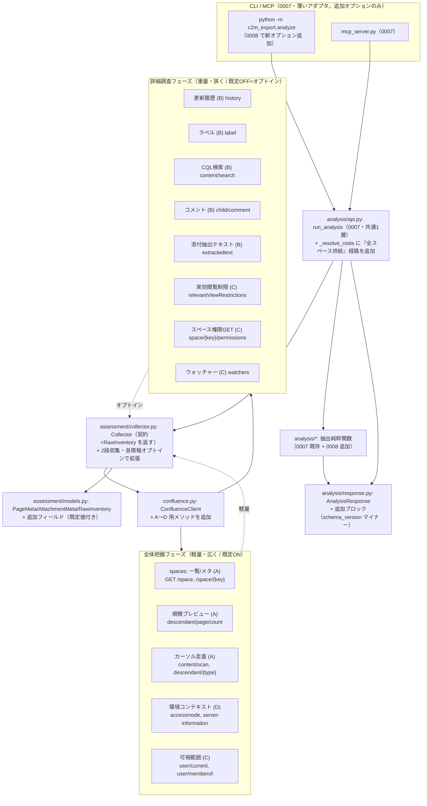
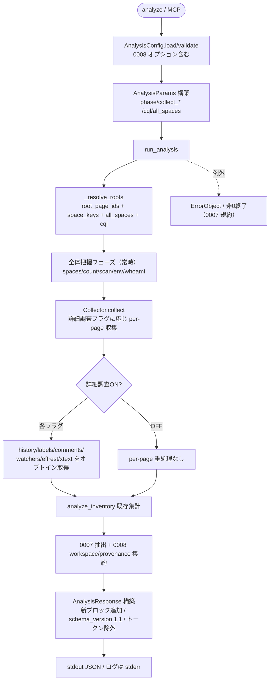

# Design Document

## 要ユーザー確認事項（冒頭・ワークフローは止めない）

本 spec は A〜D の広範な REST API 収集を一度に扱うため規模が大きい。設計者としては**単一 spec（0008）で進めることを既定案として推奨**する（理由は後述「規模と分割の判断」）。ただし次の 1 点のみ、最終的にユーザー確認があると望ましい論点として明記する。確認待ちでワークフローを止めず、既定案（単一 0008）で 3 ファイルを完成させる。

- **論点**: 実装ボリュームが大きいと判断された場合に、本 spec を「0008 = 全体把握フェーズ（A + 環境コンテキスト D + 可視範囲 C 一部）」と「0009 = 詳細調査フェーズ（B + C 残り）」の 2 spec へ分割するか。
- **既定案（本 spec の採用）**: 単一 0008 のまま、実装は tasks.md のフェーズ順（全体把握 → 詳細調査）で段階的にマージできるよう依存順に並べる。分割しなくても各フェーズが独立してレビュー・マージ可能な粒度でタスクを切る。

> spec 名について: 既定は指示どおり `0008_workspace_assessment_collection`（既存最大 `0007` の次）。より内容を表すなら `0008_rest_collection_expansion` も候補だが、「ワークスペース把握のための収集」という目的を名が表しており、0007 design.md「将来拡張の余地」でも本 spec を「0008『ワークスペース把握のための REST 走査・収集層拡張』」と前方参照しているため、**既定名をそのまま採用**する。

## 概要

本設計は、C2M-Export を「ワークスペースレベルで状況把握・詳細調査し、他ストレージへの移設課題抽出・計画立案を支援する」ツールへ成長させるための、**Confluence REST API 収集層（I/O 層）の拡張**を定義する。利用者は管理者特権を持たない一般ユーザーを前提とする。

設計の核は 2 つである。第一に、**収集を 2 段（全体把握フェーズ＝軽量・広く / 詳細調査フェーズ＝重量・狭く・オプトイン）に分離**し、API 呼び出し回数の爆発を避ける。第二に、0007 が確立した枠組み（共通 1 層 `analysis/api.py:run_analysis` → `AnalysisResponse`（`schema_version` 付き）／ CLI `python -m c2m_export.analyze` ／ MCP ／ `SKILL.md`、`Collector` → `RawInventory` → `analyze_inventory` → 抽出純粋関数）を**作り直さず、追加のみ・後方互換で拡張**する。0008 は `ConfluenceClient` にメソッドを足し、`PageMeta` / `AttachmentMeta` / `RawInventory` / `AnalysisResponse` にフィールドを足し、抽出純粋関数を足し、`AnalysisConfig` / `AnalysisParams` にオプションを足す。分析エンジン・JSON スキーマ骨格・Skill/MCP の枠組みは据え置く。

この設計は 0007 design.md「将来拡張の余地」の 3 点に正確に乗る。(1) 起点解決を `_resolve_roots` 1 箇所に閉じ込める方針に、「参照可能な全スペースを起点に供給する」経路を 1 つ足す。(2) 「`Collector` が `RawInventory` を返す」という契約にのみ下流を依存させる方針に、DFS を維持したまま scan / descendant / count を**契約の内側で**差し替え・補強できる収集器として乗せる。(3) 「追加のみ・既定値付き・後方互換」のフィールド追加方針と `schema_version`（キー追加＝マイナー）運用に、A〜D の新規フィールドを乗せる。

技術スタックは 0007・既存から**変更しない**（ロック対象）: Python 3.8 以上、`requests`（REST）、`beautifulsoup4`（XHTML 解析）、`PyYAML`（設定）、`streamlit`（UI。本 spec では非対象）、`pytest`、`mypy`、`pre-commit`。MCP は 0007 同様 optional（`requirements-mcp.txt`・`mcp`/FastMCP・stdio・遅延 import）を踏襲し、本 spec で新規 SDK は導入しない。

### 設計原則（0007・既存の踏襲）

- **追加のみ・非破壊**: 既存メソッド・既存データモデル・既存 CLI・0007 の既存挙動を変えない。新規メソッド・新規フィールド（既定値付き）・新規オプション・新規純粋関数で実現する。
- **2 段収集・軽量既定**: 全体把握フェーズのみが既定で走り、詳細調査フェーズはオプトイン。各情報は種類ごとにオン/オフ可能。
- **I/O と純粋ロジックの分離**: 新 API 呼び出しは `ConfluenceClient` / `Collector` に、集約・提示ロジックは API 非依存の純粋関数（`analysis/*` 配下）に置く。
- **部分成功・取得可否は実機依存**: 管理者なし前提で 403/空/未対応が起こり得る API は、致命化せず欠落として `uncertainties` に記録し継続する。起点解決そのものの 401/403 は従来どおり致命。
- **見えない ≠ 存在しない**: 可視範囲（実行ユーザー・所属グループ・参照可能スペース・取得失敗 API 種別）を明示し、権限不足による欠落可能性を注記する。
- **日本語ログ・現象/原因/対処・秘匿情報の非漏洩**: 0007 の `sanitize_text`・ErrorObject 分類・stdout/stderr 分離をそのまま新経路に適用する。

## アーキテクチャ

### 2 段収集と共通 1 層への接続



要点:

- **0007 の呼び出し経路は不変**。CLI/MCP → `run_analysis` → `Collector` → `RawInventory` → `analyze_inventory` + 抽出純粋関数 → `AnalysisResponse` の流れを維持し、0008 は各ノードに**追加**するのみ。
- **全体把握フェーズ（A + D + C 一部）は既定 ON**。低負荷な一覧/カウント/カーソル/環境/自己診断で規模・構造・可視範囲の当たりをつける。
- **詳細調査フェーズ（B + C 残り）は既定 OFF（オプトイン）**。per-page の重い API を種類ごとに有効化して対象を絞って取得する。
- **起点供給は `_resolve_roots` に閉じ込める**（0007 将来拡張 1）。0008 は「`--all-spaces` 指定時に `GET /space` 一覧の各スペースのトップレベルページを供給する」経路と「`--cql` 指定時に検索結果の ID を供給する」経路を足すだけ。下流は「解決済み root_ids の列」にしか依存しない。

### モジュール構成（0007 への追加のみ）

```
c2m_export/
├── confluence.py              # [拡張・追加のみ] A〜D 用メソッドを追加
├── config.py                  # [拡張・追加のみ] AnalysisConfig に 0008 オプションを追加
├── analyze.py                 # [拡張・追加のみ] 0008 の CLI 引数を追加
├── assessment/
│   ├── collector.py           # [拡張・追加のみ] 2段収集・各情報オプトイン収集
│   └── models.py              # [拡張・追加のみ] PageMeta/AttachmentMeta/RawInventory にフィールド追加
├── analysis/
│   ├── api.py                 # [拡張・追加のみ] _resolve_roots に全スペース/CQL 供給、収集フェーズ制御、新ブロック構築
│   ├── params.py              # [拡張・追加のみ] 0008 パラメータ追加
│   ├── response.py            # [拡張・追加のみ] 新ブロック・新 uncertainties キー・可視範囲・環境コンテキスト
│   ├── workspace.py           # [新規] スペース一覧・可視範囲・環境コンテキストの集約純粋関数（A/C/D 提示）
│   └── provenance.py          # [新規] 来歴/ラベル/コメント/実効制限/抽出テキストの集約純粋関数（B/C 提示）
└── mcp_server.py              # [拡張・追加のみ] ツール説明・オプション追記（枠組みは不変）
```

新規モジュールは 2 つ（`analysis/workspace.py` / `analysis/provenance.py`）に限定し、0007 の `extractors.py` / `categories.py` / `macros.py` は変更しない（既存 UC の抽出責務を保つ）。これにより 0008 の新規提示ロジックは既存純粋関数から分離され、単体テストしやすい。

### 責務分担

| 層 / モジュール | 責務 | 変更種別 |
|---|---|---|
| `confluence.py` `ConfluenceClient` | A〜D の REST 呼び出し（ページング・リトライ・Proxy は既存方針）。 | 追加のみ |
| `assessment/collector.py` `Collector` | 2 段収集の実行制御。全体把握は常時、詳細調査は各フラグ ON 時のみ per-page 呼び出し。失敗は `uncertainties` に集計し継続。`RawInventory` を返す契約は不変。 | 追加のみ |
| `assessment/models.py` | A〜D の取得結果を保持する既定値付きフィールドを追加。 | 追加のみ |
| `analysis/api.py` `run_analysis` / `_resolve_roots` | 起点供給（全スペース/CQL）の追加、収集フェーズ/情報オン・オフの受け渡し、新ブロック（可視範囲・環境・来歴等）の `AnalysisResponse` への組み立て。純粋関数の呼び出しとページネーションは 0007 の責務境界を踏襲。 | 追加のみ |
| `analysis/workspace.py`（新規） | スペース一覧/メタの集約、可視範囲自己診断（ユーザー/グループ/スペース/欠落 API 種別）、環境コンテキスト整形。API 非依存の純粋関数。 | 新規 |
| `analysis/provenance.py`（新規） | 来歴（作成者/更新者/貢献者・オーナー不明判定）、ラベル集計、コメント集計、実効閲覧制限整形、抽出テキスト有無/長さ整形。API 非依存の純粋関数。 | 新規 |
| `config.py` `AnalysisConfig` / `analysis/params.py` `AnalysisParams` | 2 段収集・各情報オン/オフ・CQL・全スペース起点のオプション。既定は軽量・無効。 | 追加のみ |

### 全体フロー



## コンポーネントと実装詳細

### 1. ConfluenceClient に追加するメソッド（A〜D）

既存 `_request`（Bearer・ページング・5xx 指数バックオフ・Proxy）を再利用し、追加メソッドはすべてその上に実装する。カーソル系・ページング系は内部で全件取得（既存 `get_child_pages` 等と同じスタイル）。取得可否が実機依存のメソッドは**例外を上位に送出するだけ**とし、致命化するか欠落扱いにするかの判断は `Collector`/`run_analysis` 側に委ねる（I/O は分類しない）。

下表の「既定 limit」はメソッドシグネチャの既定値を示す。各メソッドの既定 `limit`・既定 `expand` 等の既定値はこの表と tasks.md を**単一の真実**とし（tasks の記載が正）、実装は両者に一致させる。

| メソッド（追加） | 対応 API | フェーズ / 収集単位 | 既定 limit | 取得可否 | 備考 |
|---|---|---|---|---|---|
| `list_spaces(type_, status, label, content_label, expand, limit)` | `GET /rest/api/space` | 全体把握 (A) / workspace | 25 | 一般ユーザーで参照可能範囲のみ | `start`/`limit` ページングで全件。`uncertainties` 対象 |
| `get_space(space_key, expand)` | `GET /rest/api/space/{spaceKey}` | 全体把握 (A) / per-space | — | 可 | スペースメタ |
| `get_descendant_page_count(page_id)` | `GET /rest/api/content/{id}/descendant/page/count` | 全体把握 (A) / per-page（起点） | — | 可 | 規模プレビュー（1 リクエスト） |
| `scan_content(space_key, type_, status, expand, cursor, limit)` | `GET /rest/api/content/scan` | 全体把握 (A) / per-space | 100 | 可 | カーソルページングで全件 |
| `get_descendants(page_id, type_, expand, limit)` | `GET /rest/api/content/{id}/descendant/{type}` | 全体把握 (A) / per-page | 25 | 可 | 型指定フラット列挙 |
| `get_content_history(page_id, expand)` | `GET /rest/api/content/{id}/history` | 詳細調査 (B) / per-page | — | 可 | `expand=lastUpdated,contributors` 既定 |
| `get_labels(page_id, prefix, limit)` | `GET /rest/api/content/{id}/label` | 詳細調査 (B) / per-page | 200 | 可 | ページング |
| `get_space_labels(space_key)` | `GET /rest/api/space/{spaceKey}/labels` | **全体把握 (A) / per-space** | — | 可 | スペースラベル。全体把握でスペースメタの一部として取得し `SpaceMeta.label_count` に反映（ページラベル `collect_labels` とは独立） |
| `search_cql(cql, expand, limit)` | `GET /rest/api/content/search` | 詳細調査 (B) / 起点供給 | 50 | 構文/権限依存 | `expand=history,space,version` 既定・ページング |
| `get_comments(page_id, depth, expand)` | `GET /rest/api/content/{id}/child/comment` | 詳細調査 (B) / per-page | `depth=all` / `expand=extensions.location,extensions.resolution` | 可 | `depth=all` で全コメント取得し `extensions.location`（inline/footer）と `extensions.resolution.status`（未解決判定）で内訳集計。`location` クエリ引数は使わず expand で区分取得（§2.1 参照）。ページング全件 |
| `get_attachment_extracted_text(page_id, attachment_id, limit)` | `GET /rest/api/content/{id}/child/attachment/{attachmentId}/extractedtext` | 詳細調査 (B) / per-page（添付単位） | — | 添付種別/設定依存 | `uncertainties` 対象 |
| `get_relevant_view_restrictions(page_id)` | `GET /rest/api/content/{id}/restriction/relevantViewRestrictions` | 詳細調査 (C) / per-page | — | 実機依存 | byOperation と意味が別 |
| `get_space_permissions(space_key)` | 実機の GET 系（例 `GET /rest/api/space/{spaceKey}/permission`。実機で GET 系実在パスを確認して採用） | 詳細調査 (C) / **per-space** | — | 一般ユーザー可読範囲は環境依存・DC バージョンで未対応あり | 403/未対応/空は欠落扱い（`space_permission_failed_keys`） |
| `get_content_watchers(content_id)` | `GET /rest/api/content/{contentId}/watchers` | 詳細調査 (C) / **per-page** | — | 実機依存 | ページの利害関係者推定 |
| `get_space_watchers(space_key)` | `GET /rest/api/space/{spaceKey}/watchers` | 詳細調査 (C) / **per-space** | — | 実機依存 | スペースの利害関係者推定 |
| `get_current_user(expand)` | `GET /rest/api/user/current` | 全体把握 (C) / workspace | — | 可 | 可視範囲の起点 |
| `get_user_memberof()` | `GET /rest/api/user/memberof` | 全体把握 (C) / workspace | — | 可 | 所属グループ。ページング |
| `get_access_mode()` | `GET /rest/api/accessmode` | 全体把握 (D) / workspace | — | 可 | 読み取り専用モード等 |
| `get_server_information()` | `GET /rest/api/server-information` | 全体把握 (D) / workspace | — | 可 | バージョン（Cloud 布石） |

**収集単位の凡例**: `workspace`＝インスタンス全体で 1 回、`per-space`＝解決済みスペースごとに 1 回、`per-page`＝対象ページ（または添付）ごとに 1 回。`per-space` の API（`get_space` / `get_space_labels` / `scan_content` / `get_space_permissions` / `get_space_watchers`）は DFS per-page ループの外で収集する（§3.2）。

**scan のカーソル処理**: `scan_content` はレスポンスの `_links.next` または `cursor` を辿って全件取得する。既存ページング（`start`/`limit`）とは異なるため、`_links.next` が無くなるまでループし、`limit` 既定は既存に合わせ控えめ（例 100）にする。

**管理者 API は実装しない**: `/rest/api/admin/*`・`backup-restore/*`・グローバル `permissions` PUT・`index/reindex`・`webhooks`・`cluster/nodes`・`audit`・`instance-metrics` に対応するメソッドは追加しない（要件スコープ外）。

### 2. データモデルの追加フィールド（追加のみ・既定値付き・後方互換）

既存フィールドの型・名称・順序・意味は変更しない。すべて末尾に既定値付きで追加する（`PageMeta` / `AttachmentMeta` / `RawInventory`）。既存の生成箇所・既存テストは未修正で通ることを後方互換の担保とする（要件 14.1）。

#### 2.1 `PageMeta` への追加

| 追加フィールド | 型 | 既定 | 意味 / 対応要件 |
|---|---|---|---|
| `created_by` | `Optional[str]` | `None` | 作成者（表示名または username）。来歴 (要件 4) |
| `last_updated_by` | `Optional[str]` | `None` | 最終更新者。来歴 (要件 4) |
| `contributors` | `List[str]` | `[]` | 貢献者一覧。来歴 (要件 4) |
| `owner_unknown` | `bool` | `False` | 作成者・最終更新者とも取得不能＝オーナー不明 (要件 4.3) |
| `labels` | `List[str]` | `[]` | ページラベル (要件 5) |
| `comment_count` | `int` | `0` | コメント総数 (要件 7.2) |
| `unresolved_comment_count` | `Optional[int]` | `None` | 未解決コメント数（resolved 判定が取得不能時 None） (要件 7.2, 7.3) |
| `inline_comment_count` | `Optional[int]` | `None` | インラインコメント数（location 区分が取得不能時 None） (要件 7.2, 7.3) |
| `footer_comment_count` | `Optional[int]` | `None` | フッターコメント数（location 区分が取得不能時 None） (要件 7.2, 7.3) |
| `effective_view_restrictions` | `Optional[RestrictionMeta]` | `None` | 実効閲覧制限（継承含む）。byOperation とは別 (要件 9) |

`effective_view_restrictions` は既存 `RestrictionMeta` を再利用する（新しい型を作らない）。意味の違い（個別設定 vs 実効）はフィールド名とドキュメント・出力キー名で区別する。

**コメント内訳の判定ソースと None 条件（要件 7.2・7.3、レビュー finding 1・2）**: `comment_count` は `get_comments` の取得結果の総数。内訳 3 フィールド（`unresolved_comment_count` / `inline_comment_count` / `footer_comment_count`）はいずれも `Optional[int]`（既定 `None`）とし、判定できない場合に「0 件」と誤認させない。判定は次による。

- **ロケーション（inline / footer）**: 各コメントの `extensions.location`（`"inline"` / `"footer"`）で振り分けて件数化する。`get_comments` の `location` 引数で絞り込む方式ではなく、`depth=all` で全コメントを取得し `extensions.location` で分類する（1 回の取得で両区分を数える）。応答に `extensions.location` が含まれない DC バージョンでは両フィールドとも `None`。
- **未解決（resolved）**: 各コメントの `extensions.resolution.status`（例 `"open"` / `"resolved"`、取得には後述の既定 expand が必要）が `resolved` でないものを未解決として数える。`extensions.resolution` が取得できない DC バージョンでは `None`。
- 上記いずれの内訳も取れない場合でも、`comment_count`（総数）は可能な限り集計を継続する。

#### 2.2 `AttachmentMeta` への追加

| 追加フィールド | 型 | 既定 | 意味 / 対応要件 |
|---|---|---|---|
| `has_extracted_text` | `Optional[bool]` | `None` | 抽出テキストの有無（未取得/未対応は None） (要件 8.2) |
| `extracted_text_length` | `Optional[int]` | `None` | 抽出テキストの概算長（文字数。未取得は None） (要件 8.2) |

抽出テキスト本文そのものは `AnalysisResponse` に載せない（出力肥大・機微情報混入回避）。保持するのは「有無」と「概算長」に限る。

#### 2.3 `RawInventory` への追加

| 追加フィールド | 型 | 既定 | 意味 |
|---|---|---|---|
| `spaces` | `List[SpaceMeta]` | `[]` | 参照可能スペース一覧（A・新 dataclass） |
| `history_failed_page_ids` | `List[str]` | `[]` | 来歴取得失敗 (要件 4.4) |
| `label_failed_page_ids` | `List[str]` | `[]` | ラベル取得失敗 (要件 5.4) |
| `comment_failed_page_ids` | `List[str]` | `[]` | コメント取得失敗 (要件 7.3) |
| `effective_restriction_failed_page_ids` | `List[str]` | `[]` | 実効制限取得失敗 (要件 9.4) |
| `extracted_text_failed_refs` | `List[str]` | `[]` | 抽出テキスト取得失敗 `"page_id:attachmentId"` (要件 8.3) |
| `content_watcher_failed_refs` | `List[str]` | `[]` | コンテンツウォッチャー取得失敗（page_id）(要件 10.5) |
| `space_watcher_failed_keys` | `List[str]` | `[]` | スペースウォッチャー取得失敗（space_key）(要件 10.5) |
| `space_permission_failed_keys` | `List[str]` | `[]` | スペース権限照会失敗（space_key）(要件 10.2) |
| `cql_failed` | `bool` | `False` | CQL がサーバに拒否された (要件 6.4) |
| `visibility` | `Optional[VisibilityMeta]` | `None` | 可視範囲自己診断の生データ（C・新 dataclass） |
| `environment` | `Optional[EnvironmentMeta]` | `None` | 環境コンテキストの生データ（D・新 dataclass） |

新規 dataclass（`models.py` に追加、既定値付き）:

- `SpaceMeta`: `{space_key, name, type, status, description, label_count, page_count_preview, watcher_count, permission_entries}`。
  - `page_count_preview`（`Optional[int]`, 既定 `None`）は**当該スペース配下のページ総数の見積もり**を表す。算出は「そのスペースのトップレベルページ群（`get_space_root_pages`）それぞれの `get_descendant_page_count` の合計 + トップレベルページ数」とし、スペース全体の規模指標として一貫させる（起点ページ 1 つの子孫数ではない）。1 つでもカウントが取れなければ取れた分の合計を入れ、全滅なら `None`。
  - `watcher_count`（`Optional[int]`, 既定 `None`）は per-space ウォッチャー収集（`collect_watchers` ON 時）で `get_space_watchers` から得たスペースウォッチャー数。未収集/失敗は `None`。
  - `permission_entries`（`Optional[List[str]]`, 既定 `None`）は per-space 権限照会（`collect_space_permissions` ON 時）で `get_space_permissions` から得た権限エントリの要約（例 権限種別やプリンシパル名の文字列列。生レスポンス全体は載せない）。未収集/失敗/未対応は `None`。
- `VisibilityMeta`: `{username, display_name, groups: List[str], visible_space_keys: List[str], unavailable_apis: List[str]}`。`unavailable_apis` は 403/空/未対応だった API 種別の識別子（例 `space_permissions` / `watchers` / `extracted_text`）。
- `EnvironmentMeta`: `{access_mode, server_version, build_number, base_url}`。`base_url` は非機微（トークンではない）。

### 3. 2 段収集の `Collector` 拡張

`Collector` の `RawInventory` を返す契約（0007 将来拡張 2）は不変のまま、収集を 2 段に拡張する。

#### 3.1 コンストラクタ（追加のみ）

```python
Collector(
    client,
    analyze_restrictions=True,  # 既存
    collect_macros=False,  # 0007 追加済み
    # 0008 追加（すべて既定 False = 既存挙動不変）
    # per-page 収集フラグ
    collect_history=False,
    collect_labels=False,
    collect_comments=False,
    collect_watchers=False,  # コンテンツ単位・スペース単位の両ウォッチャーを有効化
    collect_effective_restrictions=False,
    collect_extracted_text=False,
    # per-space 収集フラグ
    collect_space_permissions=False,
)
```

既定はすべて軽量・無効。assess / 0007 既存呼び出しはこれらの引数を渡さないため挙動不変（要件 14.1, 15.5）。`collect_watchers` はコンテンツ単位（per-page の `get_content_watchers`）とスペース単位（per-space の `get_space_watchers`）の双方を有効化する単一フラグである。`collect_space_permissions` は per-space の `get_space_permissions` のみを有効化する。

#### 3.2 収集手順

収集手順は「全体把握フェーズ（Collector の新メソッド `collect_workspace_overview`）」「DFS 本体（既存 `collect`）＋ per-page 詳細調査」「per-space 詳細調査（Collector の新メソッド `collect_space_details`）」の 3 つに分かれる。全体把握フェーズと per-space 詳細調査の収集実装は**`Collector` のメソッドに置き**、`run_analysis` はそれらを呼ぶだけとする（finding 6 の確定: 実装場所は Collector 側）。

共有する `list_spaces` 結果は `run_analysis` が 1 回だけ取得し、起点解決（§4）と `collect_workspace_overview` の双方へ同じ結果を渡す（finding 4 の確定: `list_spaces` の単一取得点は `run_analysis`。二重呼び出しと `visible_space_keys`／起点スペースの乖離を防ぐ）。`collect_workspace_overview` / `collect_space_details` は `space_keys` 引数として「解決済みスペース集合」を受け取り、内部で `list_spaces` を再呼び出ししない。

1. **全体把握フェーズ（常時・`Collector.collect_workspace_overview(spaces, root_ids)`）**: `run_analysis` が取得済みの `list_spaces` 結果（`spaces` 引数）と解決済み起点（`root_ids`）を渡して呼ぶ。本メソッドが `RawInventory.spaces` / `visibility` / `environment` を埋める。
   - 渡されたスペース集合の各スペースに対し `get_space` / `get_space_labels` でメタ・ラベル数を取得し `SpaceMeta[]` を構築。`page_count_preview` は各スペースのトップレベルページ群（`get_space_root_pages`）に `get_descendant_page_count` を適用した合計 + トップレベルページ数（§2.3）。**`get_space_root_pages` 自体が失敗した場合（descendant count 全滅とは別事象）も `page_count_preview=None` とし、該当スペースは欠落扱いで継続する**（`get_descendant_page_count` が一部/全滅した場合も同様に None）。失敗事実は `uncertainties`／`VisibilityMeta.unavailable_apis` の既存方針で報告する（finding 5）。
   - `get_current_user` / `get_user_memberof` で可視範囲の起点（`VisibilityMeta`）。
   - `get_access_mode` / `get_server_information` で環境コンテキスト（`EnvironmentMeta`）。
   - これらは `RawInventory.spaces` / `visibility` / `environment` に格納。失敗は欠落扱いで該当を None/空にし `VisibilityMeta.unavailable_apis` と `uncertainties` に反映。
2. **DFS 本体（既存）＋ per-page 詳細調査（`Collector.collect(root_ids)`）**: 既存どおり per-page のページ詳細・添付・（有効時）個別制限を収集しつつ、各フラグ ON 時のみ DFS の各ページ処理内で per-page の重い API を呼ぶ。
   - `collect_history` → `get_content_history`、`collect_labels` → `get_labels`、`collect_comments` → `get_comments`（`depth=all` + `expand=extensions.location,extensions.resolution` で全コメント取得し、`comment_count` 総数、`extensions.location` で `inline_comment_count`/`footer_comment_count`、`extensions.resolution.status` で `unresolved_comment_count` を算出。各内訳は取得不能時 `None`。§2.1）、`collect_effective_restrictions` → `get_relevant_view_restrictions`、`collect_extracted_text` → 各添付へ `get_attachment_extracted_text`、`collect_watchers` → `get_content_watchers`（コンテンツ単位）。
   - 取得結果を対応 `PageMeta`/`AttachmentMeta` フィールドへ格納。各失敗は該当 `*_failed_*`（`history_failed_page_ids` / `content_watcher_failed_refs` 等）に集計し**そのページ全体はスキップしない**（来歴だけ欠落等の部分欠落）。
3. **per-space 詳細調査フェーズ（`Collector.collect_space_details(space_keys)`・DFS の外で各スペース 1 回ずつ）**: `collect_space_permissions` または `collect_watchers` が ON のとき、`run_analysis` が解決済みスペース集合（`space_keys`）を渡して呼ぶ。per-page ループの外で、スペースごとに 1 回ずつ収集する（要件 1.5, 10.1, 10.4）。
   - `collect_space_permissions` → `get_space_permissions(space_key)` → 対応 `SpaceMeta.permission_entries`。失敗/未対応は `RawInventory.space_permission_failed_keys` に `space_key` を追加。
   - `collect_watchers` → `get_space_watchers(space_key)` → 対応 `SpaceMeta.watcher_count`。失敗は `RawInventory.space_watcher_failed_keys` に `space_key` を追加。
   - いずれも致命化せず欠落扱い、`VisibilityMeta.unavailable_apis` と `uncertainties` に反映して継続する（要件 10.2, 13.3）。

**scan / descendant の位置づけ**: 本 spec では `scan_content` / `get_descendants` を `ConfluenceClient` に用意するが、既定の収集経路は引き続き DFS（`get_child_pages`）とする。scan は「`--all-spaces` のような広域走査で DFS が高コストな場合に差し替え可能な代替」として契約の内側に置く（0007 将来拡張 2）。既定で DFS を使うのは、既存の `level` / `ancestors_titles`（階層情報）を維持でき 0007 の分析が無改変で動くためである。scan への完全移行は本 spec では必須としない（規模プレビューで DFS 継続の是非を利用者が判断できるようにするに留める）。

**`get_descendants` の扱い（レビュー finding 4）**: `get_descendants`（型指定フラット列挙）は、本 spec のいずれの収集経路でも**実際には消費しない**（規模プレビューは `get_descendant_page_count`、全件走査は DFS または将来の `scan_content` が担う）。本メソッドは「将来の scan 移行・フラット列挙が必要になった場合に備えた追加」と位置づけ、本 spec ではクライアントメソッドとして用意しテストで path/params を担保するに留める（デッドコードではなく、将来拡張のための用意であることを明示）。不要と判断する場合はクライアント追加（タスク 1）から外してよいが、本設計は将来の scan 経路との対称性のため用意する側を既定とする。

### 4. `_resolve_roots` への起点供給の追加（0007 将来拡張 1 に乗る）

0007 で `analysis/api.py` に新規実装した `_resolve_roots(client, params)`（`sys.exit` を使わず例外送出）に、供給源を 2 つ**追加**する。他処理は「解決済み root_ids の列」にのみ依存する契約を維持する。

- `params.all_spaces` が真: `run_analysis` が**1 回だけ**取得した `list_spaces(...)` の結果を `_resolve_roots` に渡し（§3.2 の共有方針）、各スペースの `get_space_root_pages`（既存）でトップレベルページ ID を供給。`_resolve_roots` 自身は `list_spaces` を呼ばず、受け取った結果を使う。この同一結果が `collect_workspace_overview` にも渡され、`visibility.visible_space_keys` と起点スペースが乖離しないことを保証する。スペース一覧取得失敗は欠落扱いで `uncertainties`、全スペースで 0 件なら他起点と合算して空判定へ。
- `params.cql` 指定時: `client.search_cql(cql, ...)` の結果ページ ID を供給。CQL 拒否は `RawInventory.cql_failed=True` を立て、他起点があれば継続、起点が CQL のみで 0 件なら空判定へ。
- **空判定**: 全起点（`root_page_ids` + `space_keys` + `all_spaces` + `cql`）の解決結果が空のときのみ `TargetNotFoundError` → `TARGET_NOT_FOUND`（終了コード 4）（要件 11.4）。一部スペースのトップレベル 0 件は 0007 と同じく `uncertainties.empty_space_keys` に記録し継続。
- 例外分類は 0007 の規約（`HTTPError.status_code` 401/403→`AUTH_FAILED`/3、404→`TARGET_NOT_FOUND`/4、その他→`ApiError`/`API_ERROR`/5、`RequestException`・素の `Exception`→`API_ERROR`）を踏襲。ただし**実機依存 API（実効制限・スペース権限 GET・ウォッチャー・抽出テキスト）の 403/空/未対応は致命化せず欠落扱い**（要件 13.3）。この「致命 vs 欠落」の切り分けは、起点解決（致命）と詳細調査フェーズの個別収集（欠落）という**呼び出し文脈**で決まる — 起点解決中の例外は分類して送出、詳細調査中の例外は該当 `*_failed_*` に集計して継続する。

### 5. `AnalysisResponse` への追加ブロック（追加のみ・schema_version マイナー）

0007 のトップレベル構造（`schema_version` / `status` / `generated_at` / `mode` / `scope` / `summary` / `usecases` / `uncertainties` / `error`）は不変。0008 はトップレベルに**新ブロックを追加**し、`usecases` 配下の既存 UC（特に UC2 鮮度 / UC3 権限 / UC5 添付あり空）に**フィールドを追加**する。`schema_version` は `"1.0"` → `"1.1"`（キー追加＝後方互換なマイナー、0007 確定事項 3）。

#### 5.1 新トップレベルブロック

| ブロック | 内容 | 対応要件 | 源 |
|---|---|---|---|
| `workspace` | `{ spaces: [{space_key, name, type, status, description, label_count, page_count_preview, watcher_count, permission_entries}], space_count, global_space_count, personal_space_count, archived_space_count }` | 要件 2, 3, 10 | `workspace.summarize_spaces(inventory.spaces)` |
| `visibility` | `{ username, display_name, groups[], visible_space_keys[], unavailable_apis[], note }` | 要件 11 | `workspace.build_visibility(inventory.visibility, inventory)` |
| `environment` | `{ access_mode, server_version, build_number }` | 要件 12 | `workspace.build_environment(inventory.environment)` |

`build_visibility` は 2 引数 `build_visibility(visibility, inventory)` とする（finding 7 の確定）。`unavailable_apis` は別途 `uncertainties` を受け取らず、`inventory` の各 `*_failed_*` / `cql_failed` / `visibility.unavailable_apis` から導出する（§7）。`workspace` ブロックの `watcher_count` / `permission_entries` は per-space 詳細調査（§3.2 手順 3）が ON のときのみ値が入り、OFF/失敗時は `null`。

`visibility.note` は定型日本語文「管理者特権が無いため、権限により参照できないページ/スペースは本結果に含まれていない可能性があります。`unavailable_apis` に挙がった情報は取得できなかったため欠落しています。」を常時付与する（要件 11.2）。`unavailable_apis` は収集中に 403/空/未対応だった API 種別を機械可読に列挙（要件 11.3）。

#### 5.2 既存 UC ブロックへの追加フィールド（detail 時の `items[]`）

| UC | 追加フィールド | 内容 | 対応要件 | 源 |
|---|---|---|---|---|
| UC2 `stale` | `last_updated_by` / `created_by` / `owner_unknown` | 来歴を鮮度一覧に付与 | 要件 4.2, 4.3 | `provenance.enrich_stale(...)` |
| UC3 `restricted` | `effective_read_users[]` / `effective_read_groups[]` / `effective_restriction_present` | 実効閲覧制限を個別制限と併記 | 要件 9.2, 9.3 | `provenance.enrich_restricted(...)` |
| UC5 `empty_with_attachments` | `attachments_extracted_text[]`（`{filename, has_extracted_text, extracted_text_length}`） | 添付の中身概要 | 要件 8.2 | `provenance.enrich_empty_with_attachments(...)` |
| UC5 `empty_with_attachments` | `comment_count` / `unresolved_comment_count` / `inline_comment_count` / `footer_comment_count`（取得不能な内訳は `null`、収集無効/未取得は `comment_count=0`・内訳 `null`） | コメント有無・内訳を本文空ページに付与 | 要件 7.2, 7.3 | `provenance.enrich_empty_with_attachments(...)`（同関数で合成） |

**抽出テキスト取得失敗添付の表現（finding 9 の確定）**: 抽出テキストの取得に失敗した（または未対応だった）添付は、`attachments_extracted_text[]` に `has_extracted_text=null`（未取得を表す）・`extracted_text_length=null` として載せる（成功して「中身なし」だった場合の `has_extracted_text=false` と区別する）。同時に `RawInventory.extracted_text_failed_refs` に `"page_id:attachmentId"` を記録し、`uncertainties.extracted_text_failed_count` と `unavailable_apis`（`extracted_text`）に反映する。これにより「中身が空」と「取得できなかった」をエージェントが機械判別できる。

0007 の責務境界（純粋関数は全件レコード列＋生集計のみ返し、`sort`/`limit`/`truncated`/`counts`/`items` 組み立ては `run_analysis`）を踏襲する。0008 の enrich 系は、0007 抽出関数が返す全件レコードに**追加キーを合成するだけ**の純粋関数とし、ソート/件数制限はしない（`run_analysis` の `_paginate` に委ねる）。

#### 5.3 新ユースケース（任意・将来拡張。本 spec では最小限）

ラベル・コメント・貢献者は、まず既存 UC への付与と `workspace`/`visibility` ブロックで賄う。独立 UC（例「ラベル別ページ分布」「コメント多数ページ」「オーナー不明ページ一覧」）を増やす場合も 0007 の `usecases` 配下に**キー追加のみ**で載せられる（`schema_version` マイナー）。本 spec では「オーナー不明ページ一覧」（要件 4.3）を UC として追加することを推奨するが、実装規模を抑えるため**既定は UC2 への `owner_unknown` 付与で代替**し、独立 UC 化は tasks の任意項目とする。

#### 5.4 `uncertainties` への追加キー

`history_failed_count` / `label_failed_count` / `comment_failed_count` / `effective_restriction_failed_count` / `extracted_text_failed_count` / `content_watcher_failed_count` / `space_watcher_failed_count` / `space_permission_failed_count` / `cql_failed`（真偽）/ `unavailable_apis[]`（可視範囲と同一集合）を追加。すべて既定値（0 / false / 空）で、0007 既存キーは不変。

**count の導出規則（finding 5 の確定）**: 各 `*_failed_count` は対応する `RawInventory` のリスト長から機械的に導出する。

| uncertainties キー | 導出 |
|---|---|
| `history_failed_count` | `len(RawInventory.history_failed_page_ids)` |
| `label_failed_count` | `len(RawInventory.label_failed_page_ids)` |
| `comment_failed_count` | `len(RawInventory.comment_failed_page_ids)` |
| `effective_restriction_failed_count` | `len(RawInventory.effective_restriction_failed_page_ids)` |
| `extracted_text_failed_count` | `len(RawInventory.extracted_text_failed_refs)` |
| `content_watcher_failed_count` | `len(RawInventory.content_watcher_failed_refs)` |
| `space_watcher_failed_count` | `len(RawInventory.space_watcher_failed_keys)` |
| `space_permission_failed_count` | `len(RawInventory.space_permission_failed_keys)` |
| `cql_failed` | `RawInventory.cql_failed`（真偽そのまま） |

ウォッチャーはコンテンツ単位（`content_watcher_failed_refs` = page_id）とスペース単位（`space_watcher_failed_keys` = space_key）を**別リストに分離**し、count も `content_watcher_failed_count` / `space_watcher_failed_count` に分けて出力する（合算はしない）。両者は収集単位も識別子の意味も異なるため分離する。

### 6. CLI / 設定の拡張（`AnalysisConfig` / `AnalysisParams` / `analyze.py`）

0007 の `AnalysisConfig`（`config.py`）/ `AnalysisParams`（`analysis/params.py`）を**拡張（追加のみ）**する。新設の独立 Config は作らない（要件 15.1）。属性命名は 0007・既存 `AssessConfig` の規約（単数形・3 値フラグ）に揃える。

#### 6.1 追加パラメータ

| パラメータ | CLI | 既定 | 意味 |
|---|---|---|---|
| `all_spaces` | `--all-spaces` (`store_true`) | `False` | 参照可能全スペースを起点に供給 (要件 2.3, 15.3) |
| `cql` | `--cql` | `None` | CQL 文字列で起点/課題候補を問い合わせ (要件 6, 15.3) |
| `deep` | `--deep` (`store_true`) | `False` | 詳細調査フェーズの情報を一括有効化 (要件 15.2) |
| `collect_history` | `--collect-history` / `--no-collect-history`（3 値） | `None` | 来歴収集 (要件 4, 15.2) |
| `collect_labels` | `--collect-labels` / `--no-collect-labels` | `None` | ラベル収集 (要件 5) |
| `collect_comments` | `--collect-comments` / `--no-collect-comments` | `None` | コメント収集 (要件 7) |
| `collect_watchers` | `--collect-watchers` / `--no-collect-watchers` | `None` | ウォッチャー収集（per-page コンテンツ + per-space スペースの双方を有効化）(要件 10.3, 10.4) |
| `collect_effective_restrictions` | `--collect-effective-restrictions` / `--no-...` | `None` | 実効閲覧制限収集（per-page）(要件 9) |
| `collect_extracted_text` | `--collect-extracted-text` / `--no-...` | `None` | 添付抽出テキスト収集（per-page）(要件 8) |
| `collect_space_permissions` | `--collect-space-permissions` / `--no-...` | `None` | スペース権限 GET 照会（per-space）(要件 10.1) |

**フェーズ所属の確定（finding 3）**: 上表の `collect_*` はすべて**詳細調査フェーズのオプトイン**（既定 OFF）である。`collect_history` / `collect_labels` / `collect_comments` / `collect_effective_restrictions` / `collect_extracted_text` は per-page、`collect_space_permissions` は per-space、`collect_watchers` は per-page（コンテンツ）と per-space（スペース）の双方を有効化する。この一覧が「どのフラグがどのフェーズ・どの収集単位でオプトインか」の単一の真実であり、要件 1.2（オプトイン対象列挙）・要件 10・§1 表・§3.2 と一致させる。`--deep` はこれら全フラグを一括で真にする。スペースラベル（`get_space_labels`）は `collect_*` のゲート対象ではなく全体把握フェーズ（既定 ON）で収集する（§1 表・要件 5.2）。

**`--deep` と個別フラグの合成規則**: 各 `collect_*` は 3 値（`None`=未指定 / `True` / `False`）。実効値は「個別フラグが明示されていればそれを優先、未指定なら `--deep` の値（`deep=True` なら各 `collect_*` の実効値を真）、`--deep` も未指定なら軽量既定（全 False）」とする。これにより「`--deep --no-collect-comments`（コメント以外の詳細を全部取る）」のような指定が自然に表現できる。この合成は `AnalysisConfig.load()` 後、`AnalysisParams` 構築時に `api.py` が一括で解決する（§6.2）。

#### 6.2 バリデーションと既定の安全性

- 既定（何も指定しない）では全体把握フェーズのみ＝軽量で走る（要件 15.5）。
- `cql` が構文的に空文字のみの場合は `INVALID_PARAM`（意図不明の空指定）。未指定（None）は正常。
- `all_spaces` と `root_page_ids`/`space_keys` の併用は許容（合算して重複排除）。
- 実機依存 API のフラグ（`collect_effective_restrictions` / `collect_watchers` / `collect_space_permissions` / `collect_extracted_text`）を有効化しても、取得失敗は `INVALID_PARAM` ではなく欠落扱い（要件 13.3）。
- 0007 既存のバリデーション（`limit>=1` 等・`restricted`×`--no-restrictions` の矛盾）は不変。

#### 6.3 `analyze.py` への引数追加

0007 の `analyze.py`（案 B の専用エントリーポイント）に §6.1 の引数を**追加**する。stdout は JSON 単独、ログは stderr、終了コード規約・サニタイズ・非対話・冪等（読み取り専用）はすべて 0007 を踏襲。新 API も読み取り専用のため冪等性は保たれる。

### 7. 「見えている範囲」自己診断の出力設計

可視範囲は `visibility` トップレベルブロック（§5.1）に出力する。構成要素と算出:

- `username` / `display_name` / `groups[]`: `get_current_user` / `get_user_memberof` から（`workspace.build_visibility`）。取得失敗時は該当を None/空にし `unavailable_apis` に `current_user` / `memberof` を加える。
- `visible_space_keys[]`: `list_spaces` で参照できたスペースキー。空なら「スペース一覧が取得できない/0 件」を `unavailable_apis` に反映。
- `unavailable_apis[]`: 収集全体で 403/空/未対応だった API 種別の集合。`build_visibility(visibility, inventory)` が `inventory` から機械的に導出する（`uncertainties` を別引数で受け取らない。finding 7）。導出規則は「対応する `RawInventory` の失敗リストが非空、または `cql_failed` が真、または全体把握の該当取得が欠落なら、その API 種別識別子を集合に追加」。API 種別識別子と源の対応は次のとおり（finding 5 の分離に対応）:
  - `history` ← `history_failed_page_ids` 非空
  - `labels` ← `label_failed_page_ids` 非空
  - `comments` ← `comment_failed_page_ids` 非空
  - `effective_restrictions` ← `effective_restriction_failed_page_ids` 非空
  - `extracted_text` ← `extracted_text_failed_refs` 非空
  - `watchers` ← `content_watcher_failed_refs` **または** `space_watcher_failed_keys` のいずれかが非空（コンテンツ/スペースを 1 つの `watchers` 識別子に集約。count は §5.4 のとおり分離）
  - `space_permissions` ← `space_permission_failed_keys` 非空
  - `cql` ← `cql_failed` が真
  - `spaces` ← `list_spaces` 失敗（`visibility.visible_space_keys` 欠落）
  - `current_user` / `memberof` ← `get_current_user` / `get_user_memberof` 失敗
  - `access_mode` / `server_information` ← 環境コンテキスト取得失敗
- `note`: §5.1 の定型日本語注記（要件 11.2）。

この設計により、エージェントは `visibility.unavailable_apis` を見るだけで「移設計画の前提として欠落している観点」を判別でき、人間向けには `note` で前提を伝えられる。

### 8. 0007「将来拡張の余地」3 点への具体的対応

| 0007 の将来拡張点 | 0008 での具体化 |
|---|---|
| 1. 起点解決の抽象化（`_resolve_roots` 1 箇所） | §4 のとおり `all_spaces` / `cql` の供給源を `_resolve_roots` に**追加するのみ**。`run_analysis` 他処理は「解決済み root_ids」にのみ依存し続ける。下流の分析・JSON 層は無改変。 |
| 2. 走査戦略の差し替え余地（`Collector` が `RawInventory` を返す契約） | §3 のとおり `Collector` は契約を保ったまま 2 段収集に拡張。scan / descendant / count を契約の内側に用意し、既定は DFS 継続（階層情報維持のため）。将来 scan 完全移行しても下流無改変。 |
| 3. スキーマのフィールド追加余地（追加のみ・既定値付き・`schema_version` マイナー） | §2・§5 のとおり A〜D を既定値付きフィールド/ブロックで追加し `schema_version` を `1.1` に。削除・リネーム・意味変更はしない。 |

## 既存・0007 への影響範囲と後方互換の担保

| ファイル | 影響 | 後方互換の担保 |
|---|---|---|
| `confluence.py` | A〜D メソッドを追加。既存メソッド・`_request` 不変。 | 追加のみ。既存呼び出しに影響なし。 |
| `assessment/models.py` | `PageMeta` / `AttachmentMeta` / `RawInventory` に既定値付きフィールド + `SpaceMeta`/`VisibilityMeta`/`EnvironmentMeta` 追加。 | 既定値付き末尾追加のみ。既存生成箇所・既存テストは未修正で通る。 |
| `assessment/collector.py` | `collect_*` フラグ（既定 False）追加と全体把握収集。 | 既定で既存挙動と一致（assess / 0007 は引数を渡さない）。 |
| `assessment/analyzers.py` | **変更なし**。 | 影響なし。 |
| `assess.py` / `cli.py` / `fsexport.py` / `permexport.py` | **変更なし**。 | 既存 CLI 不変（要件 14）。 |
| `analysis/api.py` | `_resolve_roots` に供給源追加、収集フェーズ制御、新ブロック構築。既存 UC 経路・責務境界・ページネーションは不変。 | 追加のみ。新オプション未指定時は 0007 と同一出力（`schema_version` のみ 1.1、新ブロックは空/省略可）。 |
| `analysis/params.py` / `config.py` | パラメータ追加（既定は軽量・無効）。 | 追加のみ。既存優先順位・既存キー不変。 |
| `analysis/response.py` | 新ブロック・新 uncertainties キー。`schema_version` 1.1。 | キー追加のみ（マイナー）。既存キー不変。 |
| `analysis/workspace.py` / `provenance.py` | 新規。 | 既存から依存されないため影響なし。 |
| `mcp_server.py` / `skills/*` | ツール説明・手順に新オプション追記。枠組み不変。 | 記述追記のみ。 |

**新オプション未指定時の出力互換**: 0008 を実装しても、`--all-spaces` / `--cql` / `--deep` / 各 `--collect-*` を指定しなければ、収集・分析は 0007 と実質同一（全体把握フェーズの軽量追加は `workspace`/`visibility`/`environment` ブロックを埋めるが、既存 UC 出力は不変）。`schema_version` が `1.1` に上がる点はマイナー更新であり、0007 のキーを機械判定しているエージェントは破壊されない（0007 確定事項 3 のポリシー）。

## 規模と分割の判断

A〜D を一度に収集層へ載せるのは広範だが、次の理由で**単一 0008 spec で進める（既定案）**。

- すべてが「`ConfluenceClient` メソッド追加 → `models` フィールド追加 → `Collector` 収集追加 → `AnalysisResponse` ブロック追加」という**同一の追加パターン**で、設計上の分岐が少ない。
- 2 段収集の制御（全体把握/詳細調査）は A〜D を横断する共通機構であり、分割すると制御層が二重になる。
- tasks.md をフェーズ順（全体把握 → 詳細調査 → スキーマ/CLI → Skill/doc → テスト）に依存順で並べることで、分割せずとも**フェーズ単位で独立レビュー・段階マージ**が可能。

分割する場合の案（冒頭「要ユーザー確認事項」参照）: 「0008 = 全体把握（A + D + C 一部可視範囲）」「0009 = 詳細調査（B + C 残り）」。この場合でも本設計の各節はそのまま 2 分割に写せる（全体把握フェーズ節 / 詳細調査フェーズ節が分割境界）。**本 spec は分割しない前提で 3 ファイルを完成させる。**

## エラーハンドリング

0007 のエラーハンドリング表を基礎に、0008 の新経路を追加する。「致命 vs 欠落」の境界は §4 のとおり**呼び出し文脈**で決まる。

| 失敗点 | 回復可否 | 挙動 / 呼び出し元が受け取るもの | ログ |
|---|---|---|---|
| 起点解決（`root`/`space`/`all-spaces`/`cql`）の 401/403 | 致命 | `AUTH_FAILED` / 終了コード 3（0007 規約）。 | stderr 日本語 |
| 起点解決の 404 / 全起点空 | 致命 | `TARGET_NOT_FOUND` / 終了コード 4（要件 11.4）。 | stderr |
| CQL 構文/権限拒否（他起点あり） | 回復 | `cql_failed=True`、他起点で継続（要件 6.4）。 | stderr warning |
| スペース一覧取得失敗 | 回復 | `visibility.visible_space_keys` 欠落、`unavailable_apis += spaces`、継続（要件 2.4）。 | stderr |
| 規模プレビュー / scan / descendant 失敗 | 回復 | 該当プレビュー欠落、`uncertainties`、DFS 継続（要件 3.5）。 | stderr |
| 来歴 / ラベル / コメント / コンテンツウォッチャー / 実効閲覧制限 取得失敗（per-page） | 回復 | 当該情報のみ欠落、該当 `*_failed_page_ids` / `content_watcher_failed_refs` / `effective_restriction_failed_page_ids` 集計、ページ全体は維持（要件 4.4, 5.4, 7.3, 9.4, 10.5）。 | stderr |
| 抽出テキスト（per-page・添付単位）の 403/空/未対応 | 回復 | **致命化しない**。添付を `has_extracted_text=null` で載せ `extracted_text_failed_refs` と `unavailable_apis += extracted_text` に記録し継続（要件 8.3, 13.3）。 | stderr |
| スペース権限 GET / スペースウォッチャー（per-space）の 403/空/未対応 | 回復 | **致命化しない**。`space_permission_failed_keys` / `space_watcher_failed_keys` に `space_key` を追加し `unavailable_apis += space_permissions`/`watchers`、他スペースの収集を継続（要件 10.2, 10.5, 13.3）。 | stderr |
| 実効閲覧制限（per-page）の 403/空/未対応 | 回復 | **致命化しない**。`effective_restriction_failed_page_ids` と `unavailable_apis += effective_restrictions` に記録し継続（要件 9.4, 13.3）。 | stderr |
| 実行ユーザー / memberof 取得失敗 | 回復 | `visibility` の該当欠落、`unavailable_apis += current_user/memberof`、継続。 | stderr |
| accessmode / server-information 取得失敗 | 回復 | `environment` 該当欠落、`uncertainties`、継続（要件 12.4）。 | stderr |
| 5xx / ネットワーク（リトライ後） | 致命（起点経路）/ 回復（詳細調査経路） | 起点経路は `API_ERROR`/5。詳細調査経路は該当 `*_failed_*` で継続。 | stderr |
| トークン混入の恐れ | — | 0007 `sanitize_text` を stdout/stderr 出力直前に 1 回適用（新 API のエラー文含む）。 | — |

## テスト戦略

0007 のテスト構成（`tests/` 直下・`pytest`・`PYTHONPATH=.`・Python 3.8 互換型注釈・純粋ロジック厚め / I/O は `requests` モック薄め）を踏襲し、0008 分を追加する。

- `tests/test_confluence_0008_client.py`: 追加メソッド（`list_spaces` / `scan_content` のカーソル追従 / `get_descendant_page_count` / `get_content_history` / `get_labels` / `search_cql` / `get_comments` / `get_attachment_extracted_text` / `get_relevant_view_restrictions` / `get_space_permissions` / `watchers` / `get_current_user` / `get_user_memberof` / `get_access_mode` / `get_server_information`）が正しい path/params を組み、ページング・カーソルを全件追従すること、404/403 時に `requests` 例外を素通しすることを `requests` モックで検証。
- `tests/test_collector_0008.py`: `collect_*` 既定 False で既存挙動不変（0007/assess 回帰）、各 per-page フラグ ON で対応フィールドが埋まること、per-page 個別失敗時に該当ページ全体を落とさず `*_failed_*` に集計して継続すること、全体把握収集（`collect_workspace_overview` → spaces/visibility/environment）が `RawInventory` に載ること、per-space 詳細調査（`collect_space_details` → `collect_space_permissions`/`collect_watchers` の `get_space_permissions`/`get_space_watchers`）がスペースごとに 1 回ずつ呼ばれ `SpaceMeta.permission_entries`/`watcher_count` を埋め、失敗時に `space_permission_failed_keys`/`space_watcher_failed_keys` へ記録して継続すること、コンテンツウォッチャーとスペースウォッチャーの失敗が別リストに分離されることを検証。
- `tests/test_analysis_workspace.py`: `summarize_spaces`（種別/状態カウント）、`build_visibility`（`unavailable_apis` 導出・`note` 付与）、`build_environment`。API 非依存の純粋関数として固定入力で検証。
- `tests/test_analysis_provenance.py`: `enrich_stale`（来歴付与・`owner_unknown` 判定）、`enrich_restricted`（実効制限併記・byOperation と別キー）、`enrich_empty_with_attachments`（抽出テキスト有無/長さ付与）が全件レコードに追加キーを合成するだけでソート/件数制限しないことを検証。
- `tests/test_analysis_api_0008.py`: `_resolve_roots` が `all_spaces` / `cql` を供給し全起点空でのみ `TARGET_NOT_FOUND`、CQL 拒否で `cql_failed` 継続、実機依存 API 失敗が欠落扱い（致命化しない）、`AnalysisResponse` に `workspace`/`visibility`/`environment` ブロックと `schema_version=="1.1"` が載り既存 UC に追加フィールドが付くこと、`--deep` と個別 3 値フラグの合成規則、トークン非混入を `ConfluenceClient` モックで検証。
- `tests/test_analysis_response_0008.py`: 新ブロック・新 uncertainties キーの `to_dict` 構造、`schema_version` が `1.1`、0007 既存キー不変（回帰）、トークン保持フィールドが無いこと。
- `tests/test_analysis_config_0008.py`: 新オプションの CLI/env/YAML 優先順位、既定が軽量・無効、`--deep`/個別フラグ 3 値合成、空 CQL の `INVALID_PARAM`、既存 Config 挙動不変（回帰）。
- 後方互換: 既存全テスト（0001〜0007 分）が未修正で通ること。新オプション未指定で 0007 と実質同一出力（`schema_version` 以外）であることを回帰で確認。

純粋関数（`workspace` / `provenance`）は API モック不要で単体テスト、I/O（client / collector / cli）は `requests` モック・`capsys` で薄く検証する（要件 14.4）。最終タスクで `$env:PYTHONPATH="."; python -m pytest`・`mypy`・`pre-commit run --all-files` を実行する。

## 設計上の決定事項

1. **単一 0008 spec で進める**（分割しない）。tasks をフェーズ順に並べ段階マージ可能にする（規模と分割の判断）。
2. **収集は 2 段**（全体把握＝既定 ON・軽量 / 詳細調査＝既定 OFF・オプトイン）。各情報は 3 値フラグで個別制御、`--deep` で一括。合成は `api.py` が解決。
3. **既定走査は DFS 継続**。scan / descendant / count は契約の内側に用意するが既定は DFS（階層情報維持・0007 無改変のため）。
4. **実効閲覧制限は `RestrictionMeta` を再利用**し `effective_view_restrictions` フィールドで byOperation と区別（新型を作らない）。
5. **抽出テキストは本文を載せず「有無・概算長」のみ保持**（肥大・機微回避）。
6. **可視範囲は `visibility` ブロックに集約**し `unavailable_apis` で欠落情報を機械可読化、`note` で人間向け注記。
7. **`schema_version` は `1.0` → `1.1`**（キー追加＝マイナー、0007 確定事項 3）。
8. **実機依存 API の 403/空/未対応は致命化せず欠落扱い**。致命 vs 欠落は呼び出し文脈（起点解決＝致命 / 詳細調査＝欠落）で決める。
9. **新設独立 Config を作らず 0007 `AnalysisConfig`/`AnalysisParams` を拡張**。命名は既存規約（単数形・3 値フラグ）に揃える。
10. **管理者 API は実装しない**（スコープ外）。
11. **per-space 収集を明示フェーズ化**（スペース権限 `collect_space_permissions`・スペースウォッチャー `collect_watchers`）。per-page DFS の外で `Collector.collect_space_details(space_keys)` が解決済みスペース集合に対しスペースごとに 1 回ずつ収集する。全体把握収集も `Collector.collect_workspace_overview()` に置き、`run_analysis` はそれらを呼ぶだけとする（finding 1/2/6）。
12. **`list_spaces` の取得点は `run_analysis` の 1 回のみ**。結果を `_resolve_roots`（`all_spaces` 起点供給）と `collect_workspace_overview` の双方へ共有し、二重呼び出しと可視範囲乖離を防ぐ（finding 4）。
13. **ウォッチャー失敗はコンテンツ単位（`content_watcher_failed_refs`）とスペース単位（`space_watcher_failed_keys`）を分離**し count も分離。各 `*_failed_count` は対応リスト長から導出する（finding 5）。
14. **`build_visibility(visibility, inventory)` は 2 引数**。`unavailable_apis` は `inventory` から導出する（finding 7）。
15. **スペースラベルは全体把握フェーズ（既定 ON）で収集**し `SpaceMeta.label_count` に反映（`collect_labels` オプトインとは独立）（finding 8）。
16. **抽出テキスト取得失敗添付は `has_extracted_text=null`** として UC5 に載せ、「中身なし（false）」と「取得できなかった（null）」を区別する（finding 9）。
17. **スペース権限 GET の実在パスは実機確認で採用**（例 `/space/{key}/permission`）。未対応時は `space_permissions` を `unavailable_apis` に入れて欠落扱い（finding 11）。
18. **`SpaceMeta.page_count_preview` はスペース配下ページ総数の見積もり**（トップレベルページ群の子孫数合計 + トップレベル数）とし、起点ページ 1 つの子孫数ではない（finding 12）。
19. **メソッドの既定 limit/expand は §1 表と tasks を単一の真実**とする（finding 10）。

## レビュー指摘への対応（イテレーション 2）

本改訂は `.review.json` / `.review.md`（判定 CHANGES_REQUESTED、HIGH 2 / MEDIUM 5 / NIT 5）の全 finding を反映した。対応方針は以下のとおり。

| finding | 重大度 | 対応 |
|---|---|---|
| 1. `collect_space_permissions` の収集経路欠落 | HIGH | **対応（採用 (a)）**。per-space 収集フェーズ `Collector.collect_space_details()` を新設（§3.2 手順 3）。`Collector` に `collect_space_permissions` フラグを追加、成功結果を `SpaceMeta.permission_entries` に格納、要件 10.1 に紐付け。tasks タスク 5 に per-space 収集手順を追記。 |
| 2. `get_space_watchers` の収集経路未定義 | HIGH | **対応**。スペースウォッチャーを per-space 収集（§3.2 手順 3）に明記。`SpaceMeta.watcher_count` に格納、失敗は `space_watcher_failed_keys`。コンテンツウォッチャー（per-page）と明確に分離。要件 10.3/10.4、tasks タスク 5 に反映。 |
| 3. `collect_space_permissions` のフェーズ所属矛盾 | MEDIUM | **対応**。要件 1.2 のオプトイン列挙に per-space（スペース権限・スペースウォッチャー）を追加。§6.1 に「フェーズ所属の確定」注記を追加し、要件 1.2・要件 10・§1 表・§3.2 で一貫させた。 |
| 4. `list_spaces` 二重化 | MEDIUM | **対応**。`run_analysis` が `list_spaces` を 1 回取得し `_resolve_roots` と `collect_workspace_overview` へ共有（§3.2・§4・決定 12）。tasks タスク 4/10 に反映。 |
| 5. 失敗リストと count の対応不明 | MEDIUM | **対応**。§5.4 に `*_failed_count = len(対応リスト)` の導出表を追加。watcher を content/space で分離（決定 13）。tasks タスク 8 に反映。 |
| 6. 全体把握収集の実装場所の揺れ | MEDIUM | **対応**。`Collector.collect_workspace_overview()` に確定（§3.2 手順 1・決定 11）。design 本文と tasks タスク 4 を一致させた。 |
| 7. `build_visibility` シグネチャ不一致 | NIT | **対応**。2 引数 `build_visibility(visibility, inventory)` に統一（§5.1・§7・決定 14）。 |
| 8. スペースラベルのフェーズ二重 | NIT | **対応**。全体把握（既定 ON）に確定（§1 表・要件 5.2・決定 15）。 |
| 9. 抽出テキスト失敗添付の UC5 表現未記載 | NIT | **対応**。`has_extracted_text=null` 表現を §5.2 に明記（決定 16）。 |
| 10. 既定 limit が design 表に無い | NIT | **対応**。§1 表に既定 limit 列を追加し「§1 表と tasks を単一の真実」と注記（決定 19）。 |
| 11. スペース権限パスの曖昧 | NIT | **対応**。§1 表 path を実機 GET 系（例 `/space/{key}/permission`）と注記、未対応時は欠落扱い（要件 10.1・決定 17）。 |
| 12. `page_count_preview` の対象曖昧 | NIT | **対応**。スペース配下合計と再定義（§2.3・決定 18）。 |

### 最終ラウンド（2 回目レビュー `CHANGES_REQUESTED` HIGH 0 / MEDIUM 1 / NIT 4 への対応。オーケストレータによる最終整備・ユーザー承認済み）

ユーザー承認: コメントのロケーション区分は**保持する**（案 (ア)）。

| finding | 重大度 | 対応 |
|---|---|---|
| 1. コメント inline/footer 区分の保持フィールド欠落 | MEDIUM | **対応（採用 (a)）**。`PageMeta` に `inline_comment_count` / `footer_comment_count`（ともに `Optional[int]=None`）を追加（§2.1）。要件 7.2 を「総数＋未解決＋inline/footer を保持」と明確化、取得不能時 None の条件を要件 7.3 として追加。収集手順（§3.2 手順 2）・tasks タスク 3/5 に inline/footer 分類と格納を明記。UC5 items にコメント内訳を許容（§5.2・tasks タスク 8）。 |
| 2. resolved / location 判定ソース未特定 | NIT | **対応**。§2.1 に判定ソースを明記: location = 各コメントの `extensions.location`、未解決 = `extensions.resolution.status` が resolved でない件数。取得不能な DC バージョンでは該当内訳 None。 |
| 3. `get_comments` 既定 expand 未指定 | NIT | **対応**。§1 表・tasks タスク 2 の `get_comments` 既定を `depth=all` + `expand=extensions.location,extensions.resolution` に確定（`location` クエリ引数は廃し expand で区分取得）。 |
| 4. `get_descendants` 未消費（デッドコード懸念） | NIT | **対応**。§3.2「scan / descendant の位置づけ」に、本 spec では消費せず将来の scan 移行用に用意しテストで path/params のみ担保する旨を明記（不要ならタスク 1 から外してよいと注記）。 |
| 5. `page_count_preview` の `get_space_root_pages` 失敗時挙動未記述 | NIT | **対応**。§3.2 手順 1・tasks タスク 4 に、root 列挙自体の失敗時も `page_count_preview=None`・欠落扱いで継続し `unavailable_apis`/`uncertainties` に反映する旨を追記。 |
