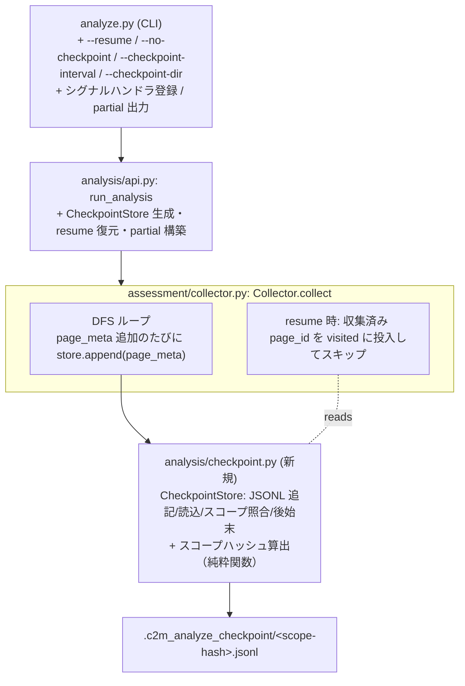

# Design Document

## 概要

本設計は、分析モード（`python -m c2m_export.analyze` / assessment 収集層 `Collector`）に対して、**チェックポイントによる中間永続化・中断からの再開（レジューム）・部分成功結果（partial）の確実な出力・中断シグナルの安全な捕捉**を追加するための実装方針を定義する。

現状の分析モードは、`run_analysis()`（`analysis/api.py`）が `Collector.collect()` で全ページのメタデータをメモリ上の `RawInventory` に収集し終えてから `analyze_inventory()` で集計し、最後に `AnalysisResponse` を JSON として一括出力する。この「収集完了まで成果物ゼロ」構造が、大規模スペース（数千〜1 万ページ規模）で長時間走らせた末の中断時に全損を招く。

本設計の核は 3 つである。第一に、`Collector.collect()` の DFS ループでページ 1 件を `inventory.pages` に追加するたびに、その生メタデータを **JSONL チェックポイント**へ追記し、途中中断でも収集済み分を失わない。第二に、`--resume` 指定時に同一スコープのチェックポイントを読み込み、収集済みの page_id を復元して DFS から除外することで**未収集分だけ再開**する。第三に、収集が全件完了しなくても（シグナル中断・回復不能エラー）、そこまでの `RawInventory` で集計し **`status: "partial"`** の JSON を確実に出力する。

本設計は 0007（共通 1 層 `run_analysis` → `AnalysisResponse`）/ 0008（収集層拡張）が確立した枠組みを**作り直さず、追加のみ・後方互換**で拡張する。チェックポイント機構は収集層（I/O 層）に閉じ、分析純粋関数（`analysis/*` の extractors/provenance/macros 等）はチェックポイントの有無に依存しない。fsexport のマニフェスト（0004/0005）とは別系統の独立した機構とする（fsexport は対象外）。

技術スタックは既存から**変更しない**: Python 3.8 以上、`requests`、`beautifulsoup4`、`PyYAML`、`pytest`、`mypy`、`pre-commit`。新規依存は導入しない（JSONL は標準 `json`、シグナルは標準 `signal`、ハッシュは標準 `hashlib` を用いる）。

### 設計原則（0007/0008・既存の踏襲）

- **追加のみ・非破壊**: 既存メソッド・データモデル・CLI・0007/0008 の既存挙動を変えない。新規モジュール・新規フィールド（既定値付き）・新規オプション・新規純粋関数で実現する。
- **I/O と純粋ロジックの分離**: JSONL の読み書き・スコープハッシュ算出・収集済み集合の差分判定は API 非依存の純粋関数／クラスに置き、API モック不要で単体テスト可能にする。チェックポイントの実ファイル書き込みのみ I/O 層に閉じる。
- **既定で安全・損失最小**: チェックポイント永続化は既定 ON。何もしなくても中断時に partial 出力される。レジュームは明示（`--resume`）時のみ。
- **部分成功の明示**: 全件完了＝`status: "ok"`、中断＝`status: "partial"`。収集済み母数と打ち切り理由を `uncertainties` に機械可読で記録する。
- **秘匿情報の非漏洩**: チェックポイントにトークンを含めない。0007 の `sanitize_text`・stdout/stderr 分離を踏襲する。

## アーキテクチャ

### チェックポイント機構の位置づけ



### 収集と集計の関係（partial の成立根拠）

`analyze_inventory()` 以降の集計・ユースケース抽出は、`RawInventory`（`pages` のリスト等）を入力とする純粋ロジックであり、母数が全件か部分かに依存しない。したがって「収集途中の `RawInventory`」をそのまま `analyze_inventory()` に渡せば、収集できた範囲の集計がそのまま成立する。これが partial 出力を低コストで実現できる根拠である。本設計は集計ロジック自体を変更せず、「どの `RawInventory` を集計に渡すか」と「結果の `status` と `uncertainties` の付け方」のみを制御する。

## コンポーネント設計

### 1. 新規モジュール `c2m_export/analysis/checkpoint.py`

チェックポイントの永続化・復元・スコープ照合を担う。I/O を伴う `CheckpointStore` と、API/ファイル非依存の純粋関数（スコープハッシュ算出・JSONL レコードのシリアライズ/デシリアライズ）に分ける。

#### 1.1 スコープ識別（純粋関数）

```python
def compute_scope_hash(
    base_url: str,
    root_page_ids: List[str],
    space_keys: List[str],
    all_spaces: bool,
    cql: Optional[str],
    collect_flags: Dict[str, bool],
) -> str:
    """スコープを正規化し安定したハッシュ文字列を返す（純粋関数）。"""
```

- 正規化: `base_url` は末尾スラッシュ除去、`root_page_ids` / `space_keys` はソート、`collect_flags`（`analyze_restrictions` / `collect_macros` / `collect_history` 等、収集結果に影響するフラグ）はキー順に整列。
- 算出: 正規化した JSON 文字列を `hashlib.sha256` にかけ、先頭 16 桁程度の短縮ハッシュを返す。
- `collect_flags` にはトークンを含めない。収集母集合に影響しない表示系パラメータ（`limit` / `sort` / `mode`）はハッシュに含めない（これらは集計時の表示制御であり、収集済みデータの再利用可否に影響しないため）。

#### 1.2 `CheckpointStore`（I/O 層）

```python
class CheckpointStore:
    def __init__(self, path: Path, scope_hash: str, scope_meta: dict, interval: int = 1): ...
    def open_for_write(self, *, append: bool) -> None: ...  # ファイルを開きヘッダ検証/書込
    def append_page(self, page_meta: PageMeta) -> None: ...  # 1 レコード追記（interval で flush 制御）
    def flush(self) -> None: ...  # 明示 flush（fsync 相当）
    def load_collected(self) -> Tuple[List[PageMeta], Set[str], List[str]]:
        """収集済み PageMeta 復元・収集済み page_id 集合・破損行リストを返す。"""

    def scope_matches(self, scope_hash: str) -> bool: ...  # ヘッダのスコープ照合
    def finalize(self, *, success: bool) -> None: ...  # 完了印付与 or 後始末（削除）
    def close(self) -> None: ...
```

- **ファイル形式（JSONL）**: 先頭行をヘッダレコード `{"_type": "header", "scope_hash": "...", "scope": {...}, "schema_version": "..."}` とし、2 行目以降を 1 ページ 1 レコード `{"_type": "page", "page": {...PageMeta を dict 化...}}` とする。
- **スコープ照合**: `load_collected` / レジューム開始時にヘッダの `scope_hash` と今回の `scope_hash` を比較。不一致なら使わない（要件 2.3）。
- **flush 粒度**: `interval=1`（既定・1 件ごと flush）。`interval=N` なら N 件ごとに flush（末尾は必ず flush）。追記は `open(path, "a", encoding="utf-8")` で行い、`flush()` は `file.flush()` + `os.fsync()`。
- **破損耐性**: `load_collected` は 1 行ずつ読み、`json.loads` に失敗した行はスキップして破損行として記録（要件 2.4）。途中で切れた最終行（部分書き込み）も破損行として扱い、読める範囲までを復元する。
- **PageMeta の dict 化/復元**: `dataclasses.asdict` でシリアライズ、復元は PageMeta/AttachmentMeta/RestrictionMeta のネストを明示的に再構築するヘルパー（純粋関数 `page_meta_to_record` / `record_to_page_meta`）で行う。`asdict` に頼りきらず復元関数を用意することで、ネストした dataclass の型を保つ。

### 2. `Collector` の拡張（`assessment/collector.py`）

`Collector.__init__` にチェックポイント連携の引数を追加する（すべて既定値付き・追加のみ）。

```python
def __init__(self, client, ..., checkpoint_store=None, resume_collected_ids=None):
    ...
    self.checkpoint_store = checkpoint_store          # CheckpointStore | None
    self.resume_collected_ids = resume_collected_ids or set()  # Set[str]
```

`collect()` の DFS ループを次の 2 点だけ変更する（既存ロジックは不変）。

1. **レジューム時のスキップ**: ループ先頭の `visited_page_ids` 初期化に `resume_collected_ids` を投入し、収集済み page_id を再取得しない。復元済み PageMeta は呼び出し側（`run_analysis`）が `inventory.pages` に先行投入しておくため、`collect()` は未収集分のみ追加する。
2. **追記**: `inventory.pages.append(page_meta)` の直後に `if self.checkpoint_store: self.checkpoint_store.append_page(page_meta)` を追加する。

> 子ページ探索は従来どおり行うため、収集済みページの子（未収集）も正しくスタックに積まれる。収集済み判定は page_id（不変キー）で行う（要件 2.2）。

### 3. `run_analysis` の拡張（`analysis/api.py`）

チェックポイントのライフサイクルを `run_analysis` が統括する。既存の収集・集計・レスポンス構築フローは維持し、以下を差し込む。

1. **スコープハッシュ算出とストア生成**: 起点解決後、`compute_scope_hash(...)` を算出し、`checkpoint_dir / f"{scope_hash}.jsonl"` を対象に `CheckpointStore` を生成（チェックポイント有効時のみ）。
2. **レジューム復元**: `resume` 指定かつストアが存在しスコープ一致なら `load_collected()` で復元。復元した PageMeta を `collector.raw_inventory.pages` に先行投入し、収集済み page_id 集合を `Collector(resume_collected_ids=...)` に渡す。破損行数は `uncertainties` の新キーに積む。スコープ不一致なら復元せず警告ログ（要件 2.3）。
3. **追記付き収集**: `collector.collect()` を実行（上記 2 の差し込みで逐次追記される）。
4. **partial 判定**: 収集が `CollectInterrupted`（下記）で中断した場合、そこまでの `raw_inventory` で `analyze_inventory()` 以降を実行し、`status="partial"`、`uncertainties` に打ち切り理由（`interrupted_reason`）と収集済み件数を設定する。正常完了なら従来どおり `status="ok"` とし、`finalize(success=True)` でチェックポイント後始末。
5. **シグナル連携**: シグナル捕捉は CLI 層（`analyze.py`）で行い（下記 4）、捕捉時にライブラリ層へ中断を伝える仕組みは「協調的中断フラグ」を用いる（プロセス全体を即時 kill せず、ループ境界で安全に抜ける）。

#### 3.1 中断の表現

- `run_analysis` に `interrupt_checker: Optional[Callable[[], bool]] = None` を追加（既定 None）。`Collector.collect()` の DFS ループ先頭で `interrupt_checker()` が True を返したら、収集済み `raw_inventory` を保持したまま内部例外 `CollectInterrupted` を送出してループを安全に抜ける。
- `run_analysis` は `CollectInterrupted` を捕捉し、partial 経路へ分岐する。これにより「シグナル捕捉 → フラグを立てる → 次のループ境界で安全に中断 → flush 済みチェックポイント + partial 出力」が成立する。

### 4. CLI 層の拡張（`analyze.py`）

- **シグナルハンドラ登録**: `signal.signal(SIGINT, handler)` / `signal.signal(SIGTERM, handler)` を登録。ハンドラはモジュールスコープの中断フラグ（`threading.Event` 等）をセットするのみ（ハンドラ内で重い処理をしない）。`run_analysis` にはこのフラグを読む `interrupt_checker` を渡す。
  - Windows では SIGTERM の扱いが限定的なため、SIGINT（Ctrl+C）を主とし、SIGTERM は登録可能な場合のみ登録する（`try/except` で握りつぶす）。要件 4 は「捕捉時に安全終了」であり、捕捉できないシグナルまでは保証対象外とする旨を docstring/README に明記する。
- **partial の出力と終了コード**: `status == "partial"` のとき、JSON を stdout に出力し、stderr に「部分成功結果を出力した・`--resume` で再開可能」と日本語案内する（要件 7.3）。終了コードは新設 `6`（`PARTIAL`）とする。`ok`=0 と区別でき、既存のエラーコード（2/3/4/5/10）とも衝突しない。
- **設定**: `AnalysisConfig` 経由で `resume` / `checkpoint_enabled` / `checkpoint_interval` / `checkpoint_dir` を解決し、`AnalysisParams` にも対応フィールドを追加して `run_analysis` に渡す。

### 5. データモデル・スキーマの追加（後方互換）

#### 5.1 `AnalysisResponse.status`

- 取りうる値に `"partial"` を追加（既存 `"ok"` / `"error"` は不変）。`schema_version` を `1.1` → `1.2`（マイナー更新）に上げる。

#### 5.2 `Uncertainties` への追加キー（すべて既定値付き・追加のみ）

| キー | 型 | 意味 |
|---|---|---|
| `interrupted` | bool | 収集が中断されたか（partial の根拠） |
| `interrupted_reason` | Optional[str] | `signal` / `error` / `null`（打ち切り理由） |
| `collected_page_count` | int | 収集できたページ件数（集計母数） |
| `resumed_from_checkpoint` | bool | チェックポイントから再開したか |
| `checkpoint_reused_count` | int | 復元（再利用）したページ件数 |
| `checkpoint_corrupted_line_count` | int | 読み取り不能だったチェックポイント行数 |

#### 5.3 `AnalysisParams` / `AnalysisConfig` への追加（追加のみ）

| 設定 | CLI | 既定 | 意味 |
|---|---|---|---|
| `checkpoint_enabled` | `--no-checkpoint`（offで無効化） | True | チェックポイント永続化の有効/無効 |
| `resume` | `--resume` | False | 既存チェックポイントから再開 |
| `checkpoint_interval` | `--checkpoint-interval N` | 1 | flush 粒度（N 件ごと） |
| `checkpoint_dir` | `--checkpoint-dir PATH` | `.c2m_analyze_checkpoint` | 保存ディレクトリ |

- YAML は `analysis` セクションに `checkpoint_enabled` / `resume` / `checkpoint_interval` / `checkpoint_dir` を追加（0008 の既存キーと同じ読み込みパターン）。
- 既定値の設計判断（要件に対する確定）:
  - **flush 粒度の既定 = 1 件ごと**（最も損失が少ない。大規模でも 1 行の追記 + fsync は収集 1 ページあたりの API 往復に比べ十分軽量）。性能懸念があれば `--checkpoint-interval` で緩める。
  - **全件完了時の後始末の既定 = チェックポイント削除**（要件 5.5）。成功時に残すとディスクに滞留し次回スコープ一致時の誤用リスクがあるため、既定は削除。残したい場合に備え、将来 `--keep-checkpoint` を追加できる余地を残す（本 spec では既定削除のみ実装、残置オプションは任意）。

## エラー処理・部分成功の分類

| 事象 | status | 終了コード | 扱い |
|---|---|---|---|
| 全件収集・正常完了 | ok | 0 | チェックポイント削除（finalize success） |
| SIGINT/SIGTERM による中断 | partial | 6 | flush → 収集済みで集計 → `interrupted_reason="signal"` |
| 収集中の回復不能エラー（API_ERROR 等）だが収集済みあり | partial | 6 | 収集済みで集計 → `interrupted_reason="error"`（元エラーは detail/ログに残す） |
| 起点解決の 401/403/404（収集前） | error | 3/4 | 従来どおり致命（partial 化しない） |
| パラメータ不正 | error | 2 | 従来どおり |
| チェックポイント書込失敗 | — | — | 現象/原因/対処を日本語で報告。収集自体は継続し、最悪チェックポイントなしで通常実行にフォールバック |

> 「収集前の致命エラー（起点解決失敗）」は partial にしない。partial は「収集フェーズに入った後、1 件以上収集できたが全件に至らなかった」場合に限る。収集フェーズ前・収集 0 件の中断は従来の error 経路とする（この境界を docstring/README に明記）。

## テスト方針

- **純粋関数（API 非依存・モック不要）**: `compute_scope_hash`（正規化・安定性・スコープ差でのハッシュ差）、`page_meta_to_record` / `record_to_page_meta`（往復同値性、ネスト dataclass の保全）、JSONL 破損行のスキップ復元。
- **CheckpointStore（一時ディレクトリ使用）**: 追記 → 再読込の同値性、スコープ不一致検出、破損ファイルからの部分復元、finalize（成功時削除）。
- **Collector（既存テストのモック client 流用）**: チェックポイント追記が呼ばれること、resume 時に収集済み page_id をスキップし未収集分のみ追加すること。
- **run_analysis（既存テスト流用）**: 正常完了で `status="ok"` + チェックポイント削除、`interrupt_checker` が True を返す状況で `status="partial"` + `uncertainties.interrupted`、resume 復元で `checkpoint_reused_count` が反映されること。
- **CLI（`test_... ` 既存パターン）**: `--no-checkpoint` でストア未生成、partial 時の終了コード 6 と stderr 案内、`--resume` のパラメータ伝播。
- **後方互換**: 既存の analyze 系テストが変更なしで通ること（既定挙動は従来の分析 + チェックポイント追記のみ増える。出力 JSON は `status="ok"` 時に従来キー不変、新 `uncertainties` キーは追加のみ）。

## 既存挙動への影響と後方互換

- 既定（`--resume` なし・チェックポイント ON）では、従来の分析に「収集中の JSONL 追記」と「正常完了時の削除」が加わるだけで、stdout の JSON は `status="ok"` のまま、既存キーは不変。`uncertainties` に新キーが増えるのみ（追加のみ）。
- `schema_version` は `1.2` へマイナー更新。`status` 値 `"partial"` の追加・`uncertainties` キー追加はいずれも後方互換（0007/0008 の互換ポリシー準拠）。
- MCP 経由（`run_analysis` 直呼び）でも `status="partial"` が返り得る。MCP 側はシグナル駆動ではないが、`interrupt_checker` 未指定なら中断は起こらず従来どおり `ok`/`error` のみとなるため、既存挙動は不変。
- ドキュメント更新対象: `README.md` / `README_DEV.md` / `c2m_config_sample.yaml` / `skills/confluence-analysis/SKILL.md`（+ `.github/skills/` / `.kiro/skills/` 複製）/ `mcp_server.py` 記述 / `.kiro/steering/*.md`。

## スコープ外（設計レベルの非対象）

- 結合モード（`cli.py`）への適用。本設計の `checkpoint.py` は結合モードからも流用しやすい純粋関数構成とするが、結合モードへの組込みは行わない。
- `Collector.collect()` のジェネレータ化による全件非メモリ保持（ストリーミング 2 パス集計）。本設計は収集済みを従来どおりメモリ保持する前提で、永続化により中断損失のみを防ぐ。
- 過去分析との差分比較・増分分析。チェックポイントは単一実行の中断再開専用。
