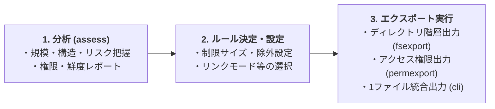

# Confluence to Markdown Exporter (C2M-Export)

Confluence Data Center 9.2 のページツリーを REST API で取得し、AIナレッジ向けに Markdown へ統合エクスポートするローカルCLIツールです。

特定ページ配下のドキュメント群を 1 つの Markdown ファイルにまとめる基本機能（結合モード）のほか、大規模移行向けの分析・ファイルシステム出力・権限出力・差分同期機能を提供しています。

## クイックスタート（最短手順）

設定ファイル（`c2m_config.yaml`）を作成せずに、特定ページ配下をまとめて 1 つの Markdown ファイルに統合出力する最短手順です。

1. **依存関係のインストール**
   ```cmd
   pip install -r requirements.txt
   ```

2. **コマンドの実行**
   `--base-url`、`--token`、`--root-page-id` を指定して実行します。
   ```cmd
   python -m c2m_export.cli --base-url https://your-confluence/wiki --token <TOKEN> --root-page-id 12345678
   ```

3. **出力の確認**
   実行完了後、カレントディレクトリに `【<spaceKey>】 <タイトル>.md` の形式で 1 つの Markdown ファイルが出力されます。

## ユースケース別ガイド

目的に応じて以下のセクションを参照してください。

- **1 ページ配下を 1 ファイルで取得したい（基本）**
  - 上記の [クイックスタート（最短手順）](#クイックスタート最短手順) を参照するか、設定ファイルを用いた詳細な手順は [結合モード（統合エクスポート）の実行](#結合モード統合エクスポートの実行) を参照してください。
  - ブラウザから GUI で操作したい場合は [Web UI での実行](#web-ui-での実行) を参照してください。
- **大規模移行・構造分析・アクセス権限・フォルダ階層出力を行いたい（応用）**
  - [応用機能（アセスメント・ファイルシステム・権限・差分同期）](#応用機能アセスメントファイルシステム権限差分同期) を参照してください。推奨する作業手順は [推奨ワークフロー](#推奨ワークフロー) を確認できます。
- **AI エージェント（Copilot / Kiro / Agent Skills / MCP）から分析を行いたい**
  - [分析 CLI と Agent Skill / MCP サーバ](#分析-cli-と-agent-skill--mcp-サーバ) を参照してください。

## 主な機能（モード）

1. **統合エクスポート（結合モード / `cli`）**:
   - ページツリーを再帰的に取得し、全ページを 1 つの Markdown ファイルに結合して出力します（サイズ制限・Zip 圧縮対応）。
2. **分析 CLI（`analyze`）および Agent Skill / MCP サーバ**:
   - ワークスペースの状況分析（移設リスク、古いページ、個別アクセス制限、圧縮ファイル、添付あり空ページ、マクロ使用統計）を標準出力 (stdout) へ機械可読な構造化 JSON として単独出力します。
   - エージェント（GitHub Copilot / Kiro / 汎用 Agent Skills）向けの `SKILL.md` や MCP サーバとして利用可能です。
3. **コンテンツ分析（アセスメントモード / `assess`）**:
   - 添付バイナリをダウンロードせずに高速にメタデータを収集し、規模・構造・移設リスク（SharePoint/OneDrive 向け制約など）・権限・鮮度のレポート（Markdown & JSON）を出力します。
4. **ファイルシステムエクスポート（ファイルシステムモード / `fsexport`）**:
   - Confluence のページツリーを OS のディレクトリ/ファイル構造に再現し、ページ本文（YAML Frontmatter 付き Markdown）と添付バイナリを保存します。
4. **権限エクスポート（権限モード / `permexport`）**:
   - Confluence のページに設定されたコンテンツ制限 (Read / Read+Write) を収集し、管理者向けの参照用権限レポート（Markdown & JSON）を出力します。

## 共通仕様・特徴
- Confluence Data Center 9.2 対応 (REST API)
- HTTP/HTTPS Proxy (CONNECTトンネル) 対応
- Windows ファイル名制約に基づいたサニタイズ・衝突回避採番
- 表・リスト・引用・コードブロック・各種マクロなど幅広い Confluence 表現の Markdown 変換対応
- 一部ページの取得・変換に失敗しても処理を止めず、取得できた分を出力する「部分成功」設計

## セットアップ

Python 3.8以上が必要です。

```cmd
# 依存関係のインストール
pip install -r requirements.txt
```

## 結合モード（統合エクスポート）の実行

1 ページ配下のページツリーを 1 つの Markdown ファイルに統合して出力する基本モードです。

### 1. 設定ファイルの準備と実行

リポジトリ直下の `c2m_config_sample.yaml` を `c2m_config.yaml` にコピーし、環境に合わせて内容を編集してください。

```cmd
copy c2m_config_sample.yaml c2m_config.yaml
```

`c2m_config.yaml` の例:
```yaml
base_url: "https://your-confluence/wiki"
token: "your_bearer_token_here"
root_page_ids:
  - "12345678"
  - "98765432"
output_dir: "."
max_mb: 100
stop_threshold_mb: 95
```

#### 最も簡単な実行方法
設定ファイル（`c2m_config.yaml`）が準備されている場合、引数なしで実行可能です。

```cmd
python -m c2m_export.cli
```

※設定ファイルで `root_page_ids` が指定されていない場合や、別のページを書き出したい場合は、コマンドライン引数で指定します。

```cmd
python -m c2m_export.cli --root-page-id 98765432
```

複数のページIDを一度に指定して実行することも可能です（スペース区切り）。

```cmd
python -m c2m_export.cli --root-page-id 12345678 98765432
```

#### 設定を上書きして実行
コマンドライン引数を指定することで、設定ファイルの内容を一時的に上書きして実行できます。

```cmd
python -m c2m_export.cli --base-url https://other-confluence/wiki --token other_token --root-page-id 12345678 --proxy http://proxy.example.com:8080
```

### Web UI での実行
Streamlitを使用したブラウザベースのインターフェースも利用可能です。

```cmd
python -m c2m_export.web
```

起動後、ブラウザで表示されるURL（既定では `http://localhost:8501`）にアクセスしてください。
Web UIでは、複数のRoot Page IDの動的な追加、進捗のリアルタイム表示、およびエクスポート結果のZipダウンロードが可能です。

### CLI パラメータ（共通）
- `--base-url`: ConfluenceのベースURL (例: `https://host/wiki`)
- `--root-page-id`: 起点となるページのID（複数指定可能）
- `--output-dir`: 出力先ディレクトリ (既定: カレントディレクトリ)
- `--max-mb`: 出力ファイルの最大サイズ(MB) (既定: 100.0)
- `--stop-threshold-mb`: 処理を停止する閾値(MB) (既定: 95.0)
- `--proxy`: プロキシURL
- `--config`: 設定ファイルパス (既定: `c2m_config.yaml`)
- `--token`: Bearerトークン
- `--zip`: エクスポート結果をZip圧縮する
- `--overwrite`: 既存ファイルを上書きする

## ファイル名規則
出力ファイル名は以下の形式になります：
`【<spaceKey>】 <トップページタイトル>.md`

## 分析 CLI と Agent Skill / MCP サーバ

AI エージェント（GitHub Copilot, Kiro, 汎用 Agent Skills, MCP クライアント）から Confluence ワークスペースの分析結果を機械可読 JSON としてパース・利用できます。

### 1. 分析 CLI (`python -m c2m_export.analyze`)

標準出力 (stdout) に純粋な JSON のみを出力し、人間向けの進捗ログ・エラーメッセージは標準エラー出力 (stderr) に分離されます。

```bash
# 環境変数でトークンを設定（推奨）
export C2M_CONFLUENCE_TOKEN="your-confluence-pat"

# 分析 CLI の実行
python -m c2m_export.analyze \
  --base-url "https://confluence.example.com" \
  --space-key "DEV" \
  --usecase "stale" "restricted" "macros" \
  --mode "detail" \
  --limit 50
```

主要なオプション：
- `--base-url`: Confluence ベース URL
- `--space-key` / `--root-page-id`: 分析対象の Space キーまたはルートページ ID (複数可)
- `--usecase`: 実行する分析ユースケース (`risk`, `stale`, `restricted`, `archives`, `empty_with_attachments`, `macros` / 既定: 全6種)
- `--mode`: 出力モード (`summary`: 集計値のみ, `detail`: 条件合致ページ/添付の個別一覧含む)
- `--limit`: `detail` モード時の項目抽出上限件数 (既定: 1000)
- `--stale-days` / `--stale-years`: 長期未更新ページの判定基準（日数または年数）

終了コード規約: `0` (成功), `2` (パラメータ不正), `3` (認証失敗), `4` (対象未存在), `5` (APIエラー), `10` (内部エラー)。

### 2. Agent Skill (`SKILL.md`)

GitHub Copilot、Kiro、および汎用 Agent Skills で共通して利用可能な `SKILL.md` が提供されています。

- **正本ファイル**: `skills/confluence-analysis/SKILL.md`（および補助スクリプト `skills/confluence-analysis/scripts/run_analysis.py`）
- **複製配置先**:
  - GitHub Copilot 用: `.github/skills/confluence-analysis/SKILL.md`
  - Kiro 用: `.kiro/skills/confluence-analysis/SKILL.md`

※ SKILL.md を編集・更新する場合は、必ず正本 `skills/confluence-analysis/SKILL.md` を変更した上で他配置先へ同期（上書きコピー）を行ってください。

### 3. MCP サーバ (`c2m_export/mcp_server.py`)

Model Context Protocol (MCP) を経由して分析機能をツール (`analyze_confluence`) として公開できます。

```bash
# MCP 追加依存のインストール
pip install -r requirements-mcp.txt

# stdio トランスポートで MCP サーバを起動
python -m c2m_export.mcp_server
```

---

## 応用機能（アセスメント・ファイルシステム・権限・差分同期）

大規模移行やワークスペース全体の分析、OSディレクトリ構造での書き出し、アクセス権限レポート出力等を行いたい場合に使用する機能群です。

### 推奨ワークフロー

C2M-Export は大規模移行等の目的において以下の 3 ステップのワークフローで利用することを推奨しています。



### 1. 分析（アセスメント）モードの実行

Confluence の規模・構造・移設リスク（SharePoint/OneDrive 向けのパス長・禁止文字・ブロック拡張子・巨大添付・同名衝突など）を事前に分析したい場合は、以下のコマンドを実行します。

```cmd
python -m c2m_export.assess
```

Space キーを直接指定して分析を行うことも可能です：
```cmd
python -m c2m_export.assess --space-key SPACE_A SPACE_B
```

主要なオプション：
- `--space-key`: 分析を開始する Space キー（複数指定可能）
- `--root-page-id`: 分析を開始するルートページ ID
- `--restrictions` / `--no-restrictions`: 個別権限（コンテンツ制限）の分析の有効/無効化
- `--single-file-max-mb`: 巨大添付判定の閾値 MB (既定: 250)
- `--path-length-limit`: 移設先パス長上限文字数 (既定: 400)
- `--report-format`: 出力形式 (`md`, `json`, `both` / 既定: `both`)

アセスメント完了後、`confluence_assessment_<YYYYMMDD_HHMMSS>.md` および `.json` が `output_dir` 配下に出力されます。

共通分析 API（`run_analysis`）も、設定に明示値がない場合は同じリスク判定の既定値を使います。マクロ解析失敗は警告と `macro_parse_failed_count` に記録し、そのページの部分集計は含めません。分析 CLI の認証情報マスキングは Bearer・Basic に対応し、JSON の引用符や区切りを保持します。

---

### 2. ファイルシステムモードの実行

Confluence のページ階層および添付ファイル（バイナリ）を、OS のディレクトリ・ファイル構造としてローカルに書き出したい場合は、以下のコマンドを実行します。

```cmd
python -m c2m_export.fsexport
```

`fsexport` の主要なオプション：
- `--root-page-id`: エクスポートの起点となるページ ID（複数指定可）
- `--space-key`: エクスポートの起点となる Space キー（複数指定可）
- `--attachment-dir`: 添付ファイルを格納するサブディレクトリ名 (既定: `_attachments`)
- `--attachment-link-mode`: 本文中の添付参照のリンク先 (`relative` | `original` / 既定: `relative`)
- `--page-filename-mode`: ページ本文ファイル命名方式 (`title` | `index` / 既定: `title`)
- `--single-file-max-mb`: 単一ファイルの保存サイズ上限 MB (既定: 250)
- `--exclude-ext`: 保存から除外する添付ファイルの拡張子リスト
- `--overwrite`: 既存の出力先を上書き許可する
- `--sync`: 前回マニフェストと現在インベントリを比較した差分同期を有効化する
- `--resume`: 中断されたエクスポートの未処理分からのレジューム再開を有効化する
- `--full`: マニフェストを無視して全件フル再取得する（破損時等のフォールバック）
- `--deletion-policy`: 削除同期の方針 (`quarantine` 退避 | `delete` 物理削除 | `report` 報告のみ / 既定: `quarantine`)
- `--quarantine-dir`: 退避先ディレクトリ名 (既定: `_c2m_quarantine`)

エクスポート完了後、`output_dir` 配下にディレクトリ/ファイル構造、Markdown ファイル、添付バイナリ、および実行結果サマリファイル `fsexport_summary_<YYYYMMDD_HHMMSS>.txt` が出力されます。

`#` で始まる添付ファイル名もリンク書き換えの対象です。`original` ではダウンロード URL に書き換え、`relative` では未保存の添付参照を未解決件数に含めます。

サマリの出力先作成やファイル書き込みに失敗した場合も、実行結果はログに出力され、日本語のエラーで原因と対処方法を確認できます。

ルートページ・子ページ・Space のルート一覧の取得失敗も、対象と理由をサマリに記録します。全起点の取得に失敗した場合は、失敗サマリを出力して終了コード 1 で終了します。

---

### 3. 権限エクスポートモードの実行

Confluence ページに設定されたアクセス権限（コンテンツ制限: Read / Read+Write）を単独またはファイルシステムエクスポートと対応付けて記録・出力したい場合は、以下のコマンドを実行します。

```cmd
python -m c2m_export.permexport
```

`permexport` の主要なオプション：
- `--root-page-id`: 対象を開始するルートページの ID（複数指定可能）
- `--space-key`: 対象を開始する Space キー（複数指定可能）
- `--report-layout`: レポート格納形態 (`aggregate` 集約 | `per_page` 分散 / 既定: `aggregate`)
- `--report-format`: 出力形式 (`md` | `json` | `both` / 既定: `md`)
- `--attachment-dir`: 分散モード時の相対パス計算用添付ディレクトリ名 (既定: `_attachments`)
- `--page-filename-mode`: 分散モード時の相対パス計算用本文ファイル命名方式 (`title` | `index` / 既定: `title`)
- `--overwrite`: 既存のレポートを上書き許可する

実行後、指定したフォーマットのレポート (`_permissions.md`, `_permissions.json`) およびサマリファイル (`permexport_summary_<YYYYMMDD_HHMMSS>.txt`) が `output_dir` 配下に出力されます。

※本機能は Confluence 側の権限設定の**記録・参照情報の提供**を目的としており、移行先（SharePoint 等）への権限の自動適用は行いません。また、親からの権限継承の実効展開は行わず、個別制限が「あり」の箇所のみを明確化する設計（継承/制限なしと区別）となっています。

---

### 4. 差分同期とレジューム（中断再開）機能

大規模な Confluence ツリーのエクスポートでは、ネットワーク切断による中断や、定期実行時の変更追従が必要となります。

`fsexport` で `--sync` または `--resume` オプションを指定すると、出力ディレクトリ直下のマニフェストファイル（`.c2m_manifest.json`）を利用して以下の処理を行います。

#### 差分追従と運用前提
- **追加**: 新規作成されたページ・添付ファイルのみを取得・出力します。
- **変更**: バージョン更新されたページや添付ファイルのみを再ダウンロードして更新します（未変更分は再利用され本文ダウンロードをスキップします）。
- **削除**: Confluence 上で削除されたページ・添付ファイルを、設定された `deletion_policy` に従って処理します（既定では `_c2m_quarantine/<日時>/` へ構造ごと退避します）。
- **移動・改名**: ページタイトルの変更や親階層の移動があっても `page_id` を不変キーとして追跡し、ローカルのフォルダ・ファイル配置を追従させます。新しい親と移動先を占有するページの移動完了を待ち、改名の入れ替えなどの循環は一時退避して解消します。
- **レジューム**: 途中で処理が中断した場合、`--resume` を指定して再実行することで、取得済みデータを無駄にせず未処理・失敗分から再開します。
- **フル出力からの同期**: フル出力に成功したページと添付のバージョン・実際の保存先もマニフェストに記録され、次回の同期で再利用されます。

#### 運用上の注意点
- **1 出力先 = 1 エクスポート対象**: マニフェストは出力ディレクトリごとに単一で管理されます。前回と異なる Confluence サーバ（`base_url`）や異なるルート対象が指定された場合、誤削除防止のため安全停止します（別ディレクトリを指定するか `--full` で再取得してください）。
- **探索失敗時の削除保留**: Space のルート一覧、ページ詳細、子ページ一覧、添付一覧の取得に失敗した場合、その実行では削除判定を保留します。
- **移動先の競合**: 移動対象同士の占有は順序調整・一時退避で解消します。それ以外の既存出力は、移動元が欠落していても書き込まずエラー停止します。`--resume` では、本文の識別情報から同じサーバの同一ページと確認できる移動済み出力のみ再利用します。競合する出力を確認して別の場所へ退避してから再実行してください。

## 変換方針（AI ナレッジ利用を最優先）

本ツールの出力は、人間が閲覧するためではなく **AI（LLM）のナレッジベースへの入力** を主用途としています。
そのため、次の方針で変換します。

- **情報の非欠損を最優先**します。綺麗なレンダリングは目的としません。
  Markdown の標準構文で表現できない要素も、近似表現やプレーンテキスト化によって
  「情報そのもの」は必ず残します。
- 見た目の再現より、テキストとして意味が残ることを重視します。

### ページリンクの扱い

Confluence のページ間リンクは、「リンクを辿るための導線」ではなく
「**参照先の名前（ページタイトル）が本文に残ること**」に価値があると考えています。
AI ナレッジ用途では、リンクを辿るよりもタイトルがテキストとして残る方が、
検索や文脈理解に有効なためです。

- ページリンクは `[ページタイトル](Confluence の絶対 URL)` の形式で残します。
  スペースキーが判別できない場合はタイトルのみをテキストとして残します。
- **ファイル内アンカーや、分割ファイル間の相対パス解決は行いません。**
  DFS 統合・Zip 分割・サイズ制限によって「どのページがどのファイルのどこに入るか」が
  実行のたびに変わり得るため、リンク先を安定して解決できないためです。
  Confluence の絶対 URL を残すことで、人間が原典を参照できる状態は維持します。

## サポートする Confluence 表現

| 表現 | Markdown 変換 |
|---|---|
| 見出し（h1〜h6） | 階層に応じた `#`（最大 6） |
| 段落・改行・太字・斜体・インラインコード | 標準記法 |
| 打ち消し線 | `~~...~~` |
| 下線・上付き・下付き | 専用構文がないためテキストのみ残す |
| 箇条書き・番号リスト（ネスト対応） | 親項目の本文開始位置に揃えたインデント付きリスト |
| タスクリスト | `- [ ]` / `- [x]` |
| 引用 | `> ...` |
| 水平線 | `---` |
| 表（thead/tbody 対応） | Markdown テーブル。ヘッダー不明時は空ヘッダーで整合 |
| コードブロック（code / noformat / plantuml / pre） | フェンス（中身に応じて長さを自動調整） |
| 画像（img / 添付画像） | ``。画像・添付リンクの参照先に空白や丸括弧があれば `<参照>` で保護 |
| ページリンク | `[タイトル](URL)`（上記方針参照） |
| ユーザーメンション | `@ユーザー名` |
| 絵文字 | Unicode またはショートコード |
| 定義リスト | 用語（太字）+ 説明 |
| レイアウト（段組み） | 見た目は捨て、中身を縦積みで残す |
| ナビゲーション系（toc / children 等） | AI ナレッジに不要のため空文字 |

> 補足: 表のセル結合（colspan/rowspan）やセル内の複雑な入れ子は、
> Markdown 表の制約上、完全再現はせず列整合を保った近似変換になります（テキストは残します）。

## 部分成功とエラー時の挙動

一部のページで取得や変換に失敗しても、**処理全体を止めず、後続ページの処理を継続**します。

- 子ページ一覧の取得に失敗したページは、本文を出力せずスキップとして集計します。
- スキップしたページは「現象・原因・対処方法」を含む日本語ログで通知します。
- 処理完了時に、成功ページ数・スキップページ数・スキップした page_id をサマリとして表示します。
- 取得できた分の Markdown は必ず出力されます（黙って停止したり、無言で欠損したりしません）。

## よくあるエラー

API 通信・添付ダウンロードの最終失敗時は、URL や元の例外メッセージを含まないエラーを返します。HTTP エラーではステータスコードを確認できます。5xx も最終試行では再試行の待機を行わず、ステータスコードを保持した HTTP エラーを返します。

- **401/403**: トークンが無効か権限がありません（現象）。詳細: 認証エラー（原因）。正しいトークンが設定されているか確認してください（対処方法）。
- **404**: ページIDまたはURLが間違っています（現象）。詳細: リソース未発見（原因）。ベースURLに `/wiki` などのコンテキストパスが含まれているか確認してください（対処方法）。
- **Proxy Error**: プロキシ設定が正しくないか、ネットワークが遮断されています（現象）。詳細: 接続失敗（原因）。プロキシURLの設定やネットワーク接続を確認してください（対処方法）。
