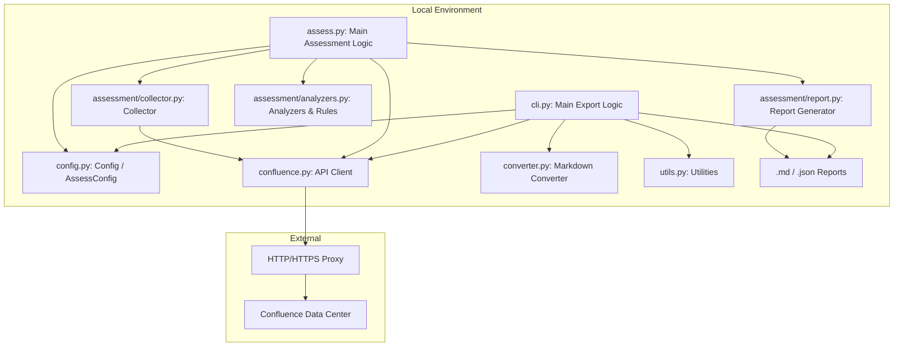
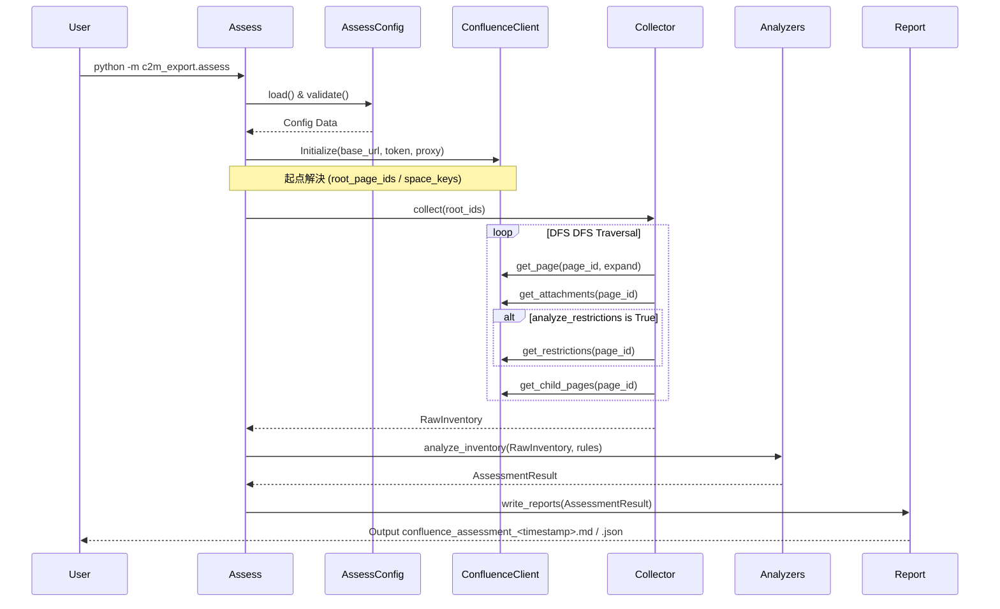

# 開発者向けドキュメント (README_DEV.md)

このドキュメントは、C2M-Export の内部構造、設計思想、および拡張方法について解説します。

## システム概要

C2M-Export は、Confluence Data Center のページツリーを再帰的に取得し、1つの Markdown ファイルに統合する Python ベースの CLI ツールです。また、実エクスポート前に Confluence ワークスペース全体の規模・構造・移設リスク（SharePoint/OneDrive 向け制約など）を把握するための**アセスメント（分析）機能**も提供しています。

## システム構成図

システムの主要コンポーネントと外部接続の構成を以下に示します。



## アセスメント機能のモジュール構造とアーキテクチャ設計

アセスメント機能（`c2m_export/assessment/`）は、I/O 層（Collector）と純粋集計・分析ロジック層（Analyzers & Rules）を完全に分離するアーキテクチャを採用しています。

```
c2m_export/
├── confluence.py      # [拡張] get_attachments, download_attachment, get_restrictions, get_space_root_pages 等を追加
├── config.py          # [拡張] AssessConfig, FsExportConfig を追加
├── assess.py          # 分析モードのエントリーポイント（python -m c2m_export.assess）
├── fsexport.py        # [新規] ファイルシステムモードのエントリーポイント（python -m c2m_export.fsexport）
├── fs_export/         # [新規] ファイルシステム出力ロジック一式
│   ├── __init__.py
│   ├── models.py      # PageNode / AttachmentRef / SkipRecord / ExportResult 等
│   ├── tree.py        # DFS 巡回とローカルパス割当（命名・衝突回避・パス長警告）
│   ├── writer.py      # 本文 + Frontmatter 書き込み、添付 DL 保存、単一ファイル上限判定
│   ├── frontmatter.py # YAML フロントマターの生成（純粋関数）
│   ├── links.py       # 本文中の添付参照リンク書き換え（純粋関数）
│   └── summary.py     # 実行結果サマリ生成（ログ + 日時サフィックス付きファイル出力）
└── assessment/        # 分析ロジック一式
    ├── __init__.py
    ├── models.py      # PageMeta / AttachmentMeta / RestrictionMeta / RawInventory / AssessmentResult 等
    ├── collector.py   # DFS巡回でページ/添付/権限/更新情報のメタデータを収集する I/O 層
    ├── rules.py       # SharePoint/OneDrive 判定ルール（パス長、禁止文字、予約語、ブロック拡張子等）
    ├── analyzers.py   # RawInventory を入力とする純粋関数群（API非依存＝テスト容易）
    └── report.py      # AssessmentResult から Markdown / JSON を生成
```

### ファイルシステムエクスポートのリンクと探索失敗

`fs_export/links.py` は山括弧付きの添付参照を認識し、書き換え先に空白や丸括弧が含まれる場合はリンク先を山括弧で囲みます。
`build_page_tree` は任意の `skipped_pages` リストにルートページ・子ページ・Space のルート一覧の取得失敗を追記します（既存の戻り値は維持）。
`fsexport.py` は探索失敗を `ExportResult.skipped_pages` に合流してからサマリを出力します。全起点の取得失敗時も、失敗サマリを出力して終了コード 1 で終了します。

サマリ出力は、出力先ディレクトリの作成とファイル書き込みを同じ例外処理で保護し、失敗時もサマリのログ出力と戻り値を維持します。

### 本文サイズ概算の偏りについての設計背景

アセスメント機能では、大量ページの巡回および API 負荷の抑制・処理時間短縮を目的として、**添付バイナリのダウンロードや Markdown 変換処理を行いません**。

- **添付ファイルサイズ**: Confluence API メタデータ (`extensions.fileSize`) をそのまま合算するため、実測値とほぼ一致します。
- **ページ本文サイズ**: Storage Format (XHTML) の UTF-8 バイト長を素に概算します。Markdown 変換後は一般に HTML/XHTML タグの削除によってサイズが減少するため、本文の推定総サイズは**やや過大（安全側）に試算**されます。

> 偏りの結論: 本文はやや過大、添付はほぼ正確となり、総容量は「上振れ方向に安全側」の見積もりとなります。この前提は生成される Markdown レポートの注記およびドキュメントに明記されます。

## クラス図

主要なクラスとその責務、および関係性を以下に示します。


## 処理シーケンス

アセスメントモードの実行フローは以下の通りです。



## 探索アルゴリズムのフローチャート

`export_tree` 関数における深さ優先探索（DFS）とサイズ制限の処理フローです。


## 変換ロジックの設計（converter.py）

`MarkdownConverter` は `convert` → `_walk` → `_process_tag` の再帰巡回で構成されます。
AI ナレッジ利用を最優先し、**情報を欠損させない**ことを設計原則とします。

### タグ変換の追加ポイント（`_process_tag`）

タグごとの分岐は `_process_tag` に集約されています。処理は「特異なもの → 汎用」の順です。
主な対応要素:

- インライン/ブロック: `blockquote`（`>`）、`hr`（`---`）、`del/s/strike`（`~~`）、
  `u/sup/sub`（テキストのみ）、`pre`（コードブロック）、`dl/dt/dd`（定義リスト）。
- リスト: `ul/ol/li`。祖先リストのマーカー幅（`ol` は3列、`ul` は2列）を加算し、
  子項目のインデントを親項目の本文開始位置に揃えます。`_handle_list_item` が項目本文と子リストを分離して出力します。
- 表: `_handle_table` と補助の `_collect_table_rows` / `_table_row_cells`。
  `thead/tbody/tfoot` を考慮して行を収集し（`recursive=False` でネスト表の tr を親に取り込まない）、
  ヘッダー不明時は空ヘッダー行で区切り線を成立させます。セル内の `|` はエスケープ、改行は `<br>`。
- Confluence 固有: `ac:image`、`ac:link`（ページ/ユーザー/添付）、`ac:emoticon`、
  `ac:task-list`、`ac:layout*`。

画像と添付リンクの参照先は `_format_destination` で整形し、空白や丸括弧を含む場合のみ山括弧で囲みます。

### コードフェンスの動的伸長（`_wrap_code_block`）

コードブロックを生成する箇所（legacy code/noformat、structured-macro の plain-text-body、
plantuml、`pre` 単体）はすべて `_wrap_code_block(content, lang)` を経由します。
中身に含まれる最長の連続バッククォートより 1 つ長いフェンス（最小 3 連）を用いることで、
コード中の ```` ``` ```` によってフェンスが割れ、後続テキスト（同一ページの後続要素や
次ページの本文）をコードとして巻き込む構文汚染を防ぎます（CommonMark 準拠）。

### 堅牢性（例外の非伝播）

個別ハンドラ（表・画像・リンク・タスク・マクロ）は `_safe` ラッパー経由で呼び出され、
想定外の構造で例外が発生しても変換全体を止めず、空文字を返しつつ日本語の警告ログを出します。
これにより、不完全なページデータが後続ページの変換に波及しません。

### ページリンクの方針（A案）

`ac:link` + `ri:page` は、`ri:space-key` が判明する場合のみ `[タイトル](絶対URL)` を出力し、
不明な場合はタイトルをテキストとして残します。ファイル内アンカー解決や相対パス解決は行いません。

## CLI の部分成功設計（cli.py）

`export_tree` は個別ページの失敗を `try/except ... continue` で捕捉し、スキップした page_id を
`skipped_page_ids` に集計します。戻り値は `(md, total_bytes, page_count, skipped_page_ids)` です。
子ページ一覧を取得してから本文・バイト数・成功数を確定し、取得失敗したページを二重集計しません。
Web 側も4つの戻り値を受け取ります。
処理完了時に成功数・スキップ数・スキップ page_id をサマリログとして出力します。

## 拡張ポイント

### 新しいマクロの変換サポート
`c2m_export/converter.py` の `MarkdownConverter` クラスにハンドラを追加します。

1.  `_handle_structured_macro` または `_handle_macro` 内にマクロ名の判定を追加。
2.  BeautifulSoup を使用してマクロのパラメータやボディを抽出。
3.  Markdown 形式の文字列を返す。コードブロックを出力する場合は `_wrap_code_block` を使う。

### API呼び出しの追加
`c2m_export/confluence.py` の `ConfluenceClient` にメソッドを追加します。共通の `_request` メソッドを使用することで、リトライロジックやProxy設定が自動的に適用されます。

## 開発環境のセットアップ

ランタイム依存と開発依存（pytest / ruff / mypy など）をまとめてインストールします。

```bash
pip install -r requirements.txt -r requirements-dev.txt
```

- ランタイム依存: `requirements.txt`
- 開発・テスト依存: `requirements-dev.txt`

コード品質チェックは pre-commit で自動化されています（`.pre-commit-config.yaml`）。

```bash
pre-commit run --all-files
```

## テスト方法

`pytest` を使用してテストを実行します。

```bash
# プロジェクトルートで実行
PYTHONPATH=. pytest
```

静的型検査は mypy で行います（対象や設定は `pyproject.toml` の `[tool.mypy]` を参照）。
Python 3.8 を対象とし、対応する mypy 1.10 以上 1.15 未満を使用します。型注釈は `typing.List` / `typing.Dict` / `typing.Tuple` などの Python 3.8 互換形式を使用します。

```bash
mypy
```

### 主要なテストファイル
- `tests/test_converter.py`: 基本的な HTML から Markdown への変換ロジックを検証。
- `tests/test_converter_extended.py`: 表（thead/tbody）、インライン/ブロック要素、ネストリスト、
  タスクリスト、画像、ページリンク・メンション・絵文字・レイアウトなど拡充表現を検証。
- `tests/test_macros_extended.py`: 各種マクロの変換を検証。
- `tests/test_robustness.py`: コードフェンスの動的伸長、変換器の例外非伝播、
  CLI の波及防止・部分成功・ログ、ページ連結でのフェンス波及防止を検証。
- `tests/test_cli_overwrite.py`: CLI の上書き挙動・フェイルファストを検証。
- `tests/test_utils.py`: ファイル名サニタイズやサイズ計算のロジックを検証。
- `tests/test_confluence_assess_client.py`: アセスメント用 Confluence API 拡張のテスト。
- `tests/test_assessment_rules.py`: 移設リスク判定ルール単体テスト。
- `tests/test_assessment_analyzers.py`: 規模・構造・権限・鮮度の分析純粋ロジック単体テスト。
- `tests/test_assessment_collector.py`: DFS メタデータ収集およびスキップ継続のテスト。
- `tests/test_assessment_report.py`: Markdown / JSON レポート生成および上書き挙動のテスト。
- `tests/test_assess_config.py`: AssessConfig の設定読み込み・優先順位のテスト。
- `tests/test_assess_main.py`: assess.py メイン処理およびルート解決のテスト。
