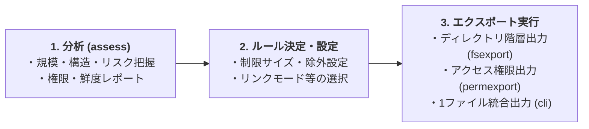

# アセスメントモード（コンテンツ分析）詳細

Confluence の規模・構造・移設リスク（SharePoint/OneDrive 向けのパス長・禁止文字・ブロック拡張子・巨大添付・同名衝突など）を事前分析・評価するアセスメントモード（`python -m c2m_export.assess`）の詳細ガイドです。

---

## 1. 推奨ワークフロー

C2M-Export は大規模移行等の目的において、以下の 3 ステップのワークフローで利用することを推奨しています。



---

## 2. アセスメントモードの実行

Confluence の規模・構造・移設リスクを事前に分析したい場合は、以下のコマンドを実行します。

```cmd
python -m c2m_export.assess
```

Space キーを直接指定して分析を行うことも可能です：
```cmd
python -m c2m_export.assess --space-key SPACE_A SPACE_B
```

### 主要なオプション
- `--space-key`: 分析を開始する Space キー（複数指定可能）
- `--root-page-id`: 分析を開始するルートページ ID（複数指定可能）
- `--restrictions` / `--no-restrictions`: 個別権限（コンテンツ制限）の分析の有効/無効化
- `--single-file-max-mb`: 巨大添付判定の閾値 MB (既定: 250)
- `--path-length-limit`: 移設先パス長上限文字数 (既定: 400)
- `--report-format`: 出力形式 (`md`, `json`, `both` / 既定: `both`)

---

## 3. 出力結果と仕様

アセスメント完了後、`confluence_assessment_<YYYYMMDD_HHMMSS>.md` および `.json` が `output_dir` 配下に出力されます。

- **共通分析 API (`run_analysis`) 仕様**:
  - 設定に明示値がない場合は、上記と同じリスク判定の既定値を使用します。
  - マクロ解析失敗は警告と `macro_parse_failed_count` に記録し、そのページの部分集計は含めません。
  - 認証情報マスキングは Bearer・Basic に対応し、JSON の引用符や区切りを保持します。

---

[READMEへ戻る](../README.md)
