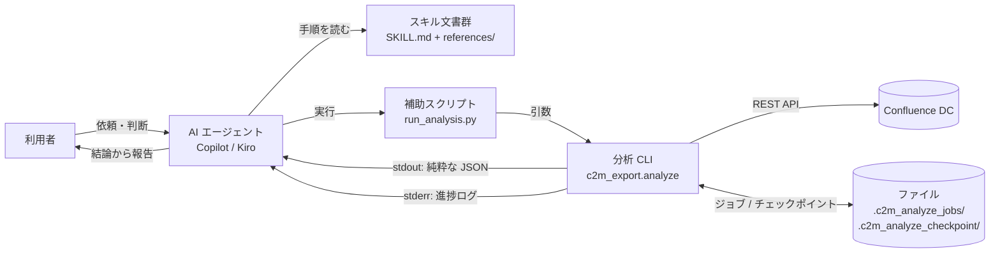
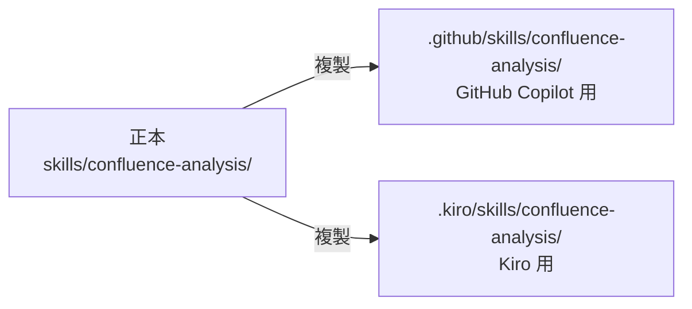
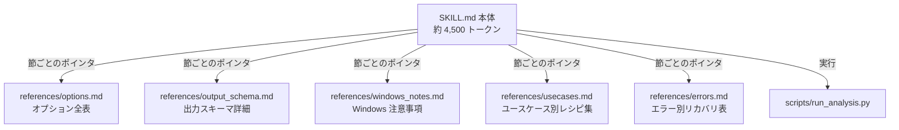
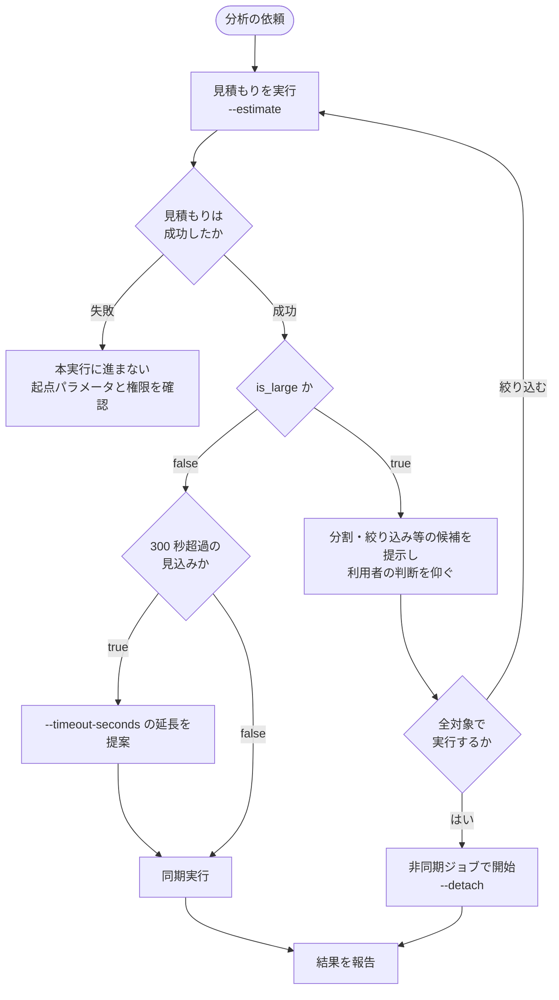
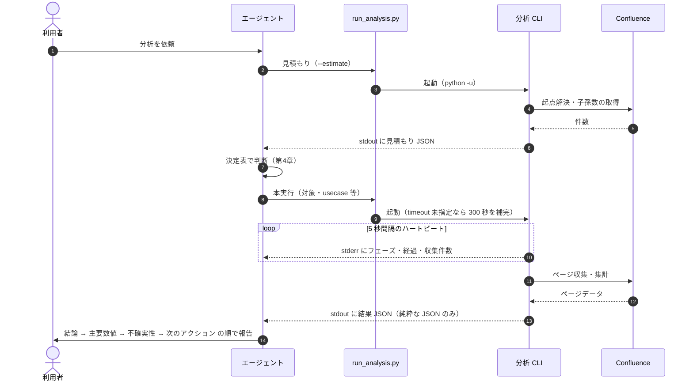
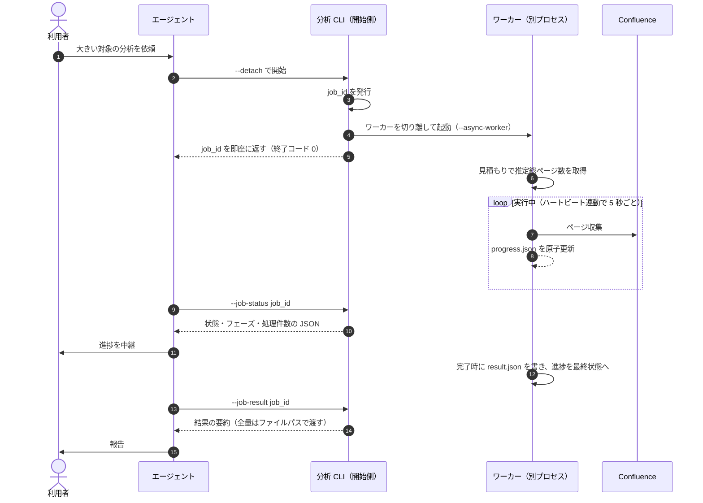
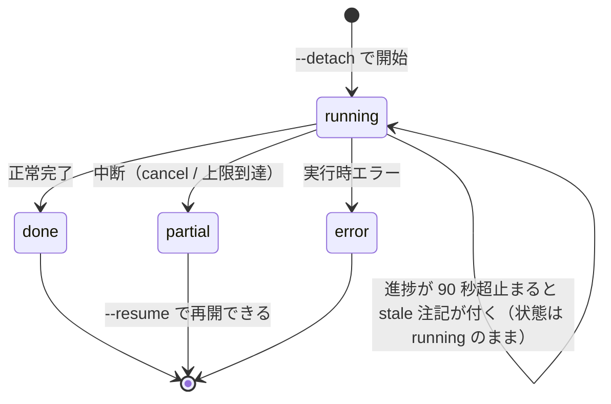
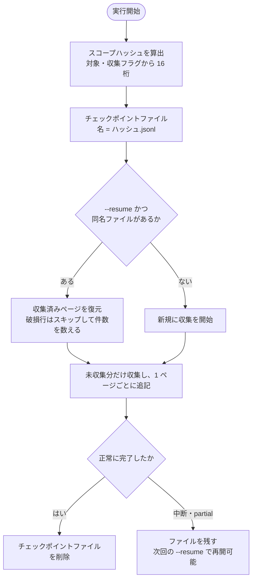
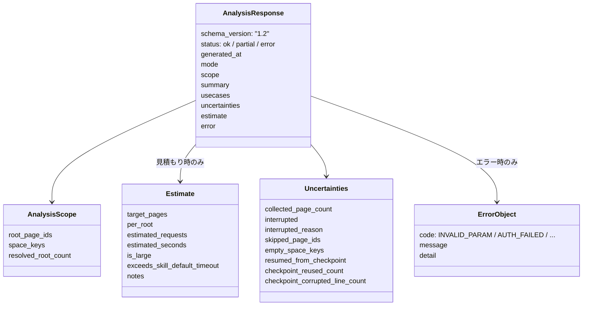
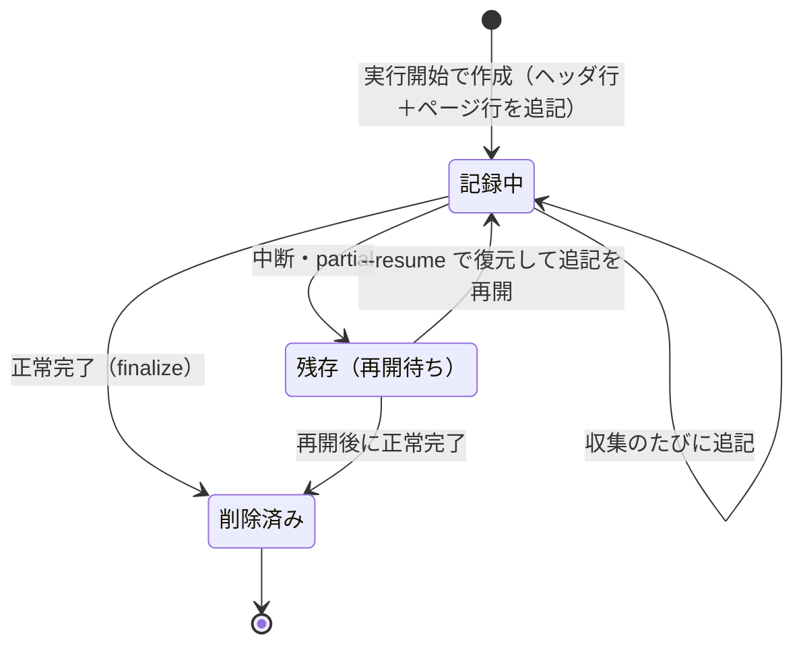

# スキルの仕組み（エージェント実行の設計とデータ管理）

このドキュメントは、Agent Skill（`skills/confluence-analysis/`）と分析 CLI（`python -m c2m_export.analyze`）の間で「どのように処理が流れ、どのように判断し、JSON データがどのように管理されるか」という**仕組みと設計意図**を解説します。使い方（コマンド例やオプションの一覧）は [AI 連携機能詳細](ai_integration.md) を参照してください。

対象読者は、スキルや分析 CLI を保守・拡張する開発者です。各仕組みの根拠は `.kiro/specs/` の spec 0011〜0019 にあります。

---

## 1. 全体像

スキルは「エージェントへの手順書」であり、実行そのものは分析 CLI が担います。両者の接点は、(a) コマンドライン引数、(b) 標準出力の JSON、(c) 非同期ジョブとチェックポイントのファイル、の3つに限定されています。この接点を狭く保つことが、取り違いや状態の不整合を防ぐ土台になっています。



登場要素の役割:

| 要素 | 役割 |
|---|---|
| SKILL.md（本体） | 毎回の判断に使う要点（前提、手順、決定表、報告の型）。常時読み込まれるため小さく保つ |
| references/ | 必要なときだけ引く詳細（オプション全表、出力スキーマ、Windows 注意事項、レシピ集、エラー対応表） |
| run_analysis.py | スキル側の薄い配管。CLI の起動と、既定タイムアウトの補完だけを行う |
| 分析 CLI | 見積もり、収集、集計、JSON 出力、ジョブ管理、チェックポイント管理のすべて |
| ジョブ / チェックポイントファイル | プロセスをまたぐ状態の受け渡し（第6〜8章） |

---

## 2. スキルの配置と同期

スキルは正本を `skills/` に置き、利用先に合わせて2箇所へ複製します。GitHub Copilot は `.github/skills/` を、Kiro は `.kiro/skills/` を探索するためで、どちらのエージェントでも同じスキルが使えるようにするための配置です。



同期に関する決まり:

- 修正は必ず正本に入れ、複製先2箇所へ同じ内容を反映する。3箇所のファイルはバイト単位で同一（監査時はハッシュで照合する）。
- 片方だけ直すと、エージェントによって手順・判断基準が食い違う。特に決定表や終了コードの表がずれると、同じ状況でも振る舞いが変わってしまう。
- この同期はビルド手順ではなく運用規約であり、スキル監査（第9章）の確認項目になっている。

---

## 3. SKILL.md の構造設計（progressive disclosure）

SKILL.md は、エージェントがスキルを使うたびに全文がコンテキストへ読み込まれます。大きくなるほど毎回のコスト（トークン消費）が増えるため、「常時必要な情報」と「必要なときだけ引く情報」を分ける progressive disclosure の構造にしています。



設計のポイント:

- **本体は要点版**: 前提要件、実行手順、見積もりの読み方、決定表、結果の読み方（要点）と報告の型、終了コードの規約、頻出オプションの抜粋だけを置く。
- **ポインタは inline 配置**: 各節の末尾に「詳細は references の○○を参照」と書き、エージェントが「いつ読むべきか」を判断できるようにする。末尾にまとめて置くと辿られにくい。
- **トークン予算**: 本体は 5,000 トークン未満を上限とする（単一ファイル時代は 5,509 トークンあった）。references へ移す判断は「毎回の判断に使うか」で行い、情報そのものは削除しない。
- 効果は代理計測で確認済みで、典型的な実行では読み込み量が約 33% 減り、不要な references は読まれなかった（第9章）。

---

## 4. 状況判断ロジック（見積もり → 決定表）

エージェントは本実行の前に必ず見積もり（`--estimate`）を行い、その結果で実行方法を機械的に決めます。判断をエージェントの感覚に任せず、CLI が返す数値とスキル側の決定表に固定している点が要点です。

### 4.1 見積もりが返す判断材料

見積もりは本実行と同じ起点解決を行い、起点ごとの子孫ページ数を数えて、以下の2つの判定値を計算します（`c2m_export/analysis/estimate.py`）。

| 判定値 | 条件 | 意味 |
|---|---|---|
| `is_large` | 推定所要 > 120 秒、または対象ページ数 > 500 | 「大きい」対象。同期実行で抱え込むべきでない規模 |
| `exceeds_skill_default_timeout` | 推定所要 > 300 秒 | スキル既定のタイムアウト（300 秒）では partial になる見込み |

推定所要は、見積もり自身の API 呼び出しで実測した平均レイテンシに、収集モデルの想定リクエスト数を掛けて算出します。本文取得を含まないため下限寄りの目安であり、その前提は見積もり結果の `notes` にも明記されます。起点同士の配下が重なる場合は二重に数えること、子孫数の取得に失敗した起点は起点のみとして数え `count_failed_root_page_ids` に明示することも、仕様として決まっています。失敗した起点がある場合は `may_be_underestimated` が `true` になり、見積もりが過小の可能性を機械可読に示します（spec 0021）。また全体把握でも、Space 内で子孫数取得に一部失敗した場合は `descendant_count_partial` として記録され、プレビュー件数が下限であることが示されます。

### 4.2 決定表

見積もり結果から実行方法を決める表（SKILL.md 本体に記載）:

| 見積もりの結果 | 実行方法 |
|---|---|
| `is_large` が false かつ超過見込みが false | そのまま同期実行する |
| `is_large` が false かつ超過見込みが true | `--timeout-seconds` の延長を提案してから同期実行する（または `--detach` に切り替える） |
| `is_large` が true | そのまま本実行しない。対象分割 / usecase の絞り込み / `--no-restrictions` / `--mode summary` を提示して判断を仰ぐ。全対象で実行すると決まった場合は `--detach` で開始する |
| 見積もり自体が失敗した | 本実行に進まず、起点パラメータと権限を確認する |

守るべき原則は2つです。

- **自動で対象を絞らない**: 大きいからといってエージェントが勝手に範囲を狭めると、利用者の意図と違う分析結果になります。絞る候補の提示までがエージェントの役割で、決定は利用者が行います。
- **失敗を成功に読み替えない**: 見積もりが失敗したら本実行に進まない。結果が partial の場合は「完了」と表現しない（報告の型、第5章）。

### 4.3 判断フロー図



---

## 5. 同期処理の流れ

同期実行は、エージェントが補助スクリプト経由で CLI を起動し、終了まで待つ方式です。当初の課題は「シェルを起動したまま10分以上無反応に見える」ことだったため、進捗の可視化と上限の設定が仕組みとして入っています。



同期方式を支える仕組み:

- **stdout / stderr の分離契約**: stdout には純粋な JSON だけを出し、人間向けの進捗・警告はすべて stderr へ出します。エージェントは stdout をそのまま JSON として解釈でき、進捗は stderr で「動いている」ことを確認できます。
- **ハートビート**: `ProgressHeartbeat`（`c2m_export/analysis/progress.py`）が 5 秒間隔でフェーズ・経過秒数・収集済み件数を stderr に出します。長い無反応が「ハング」と誤認されるのを防ぐためのものです。
- **タイムアウトの補完**: 補助スクリプト `run_analysis.py` は、CLI 引数でも設定ファイル（`analysis.timeout_seconds`）でも上限が指定されていない場合に限り、既定の 300 秒を補完します。利用者や設定ファイルの指定を上書きしないための条件付けで、`--timeout` のような一意な前方一致の省略形も「明示指定」として検出します。
- **部分成功（partial）**: 上限到達や中断時は、収集済み分から部分結果を構築し、終了コード 6 で返します。「途中まででも結果が返る」ことが、同期方式の安全弁になっています。
- **報告の型**: 結果の報告は「結論 → 主要数値 → 不確実性 → 次のアクション」の順序を SKILL.md に固定しています。partial を「完了」と表現しない、取得失敗は uncertainties から必ず拾う、という読み替え防止のルールも併記されています。

---

## 6. 非同期処理の流れ

大きい対象では、エージェントのターミナルを長時間占有しないよう、分析を別プロセス（ワーカー）で実行し、進捗と結果をファイルで受け渡します。MCP のような常駐の仕組みは使わず、ファイルベースの単純なプロトコルにしているのは、スキル経由の実行環境（エージェントのシェル）に追加の前提を持ち込まないためです。

### 6.1 開始から結果取得まで



中断は協調的に行います。`--job-cancel` は対象ジョブのディレクトリに `cancel.requested` ファイルを置くだけで、ワーカーは収集中の節目（ページ取得の合間、並列待機中の 0.5 秒間隔の確認など）でそれを検知し、収集済み分を partial として残します。プロセスを強制終了しないため、結果ファイルが壊れた状態で残ることがありません。

### 6.2 ジョブの状態遷移

進捗の状態（`state`）は running から始まり、done / partial / error のいずれかで終わります。`stale` は独立した状態ではなく、「running なのに進捗の最終更新が 90 秒を超えて古い」場合に status 応答へ付けられる注記で、ワーカーが異常終了した**可能性**を示すものです。確定ではありません。ワーカー起動直後の見積もり中（進捗の初回更新より前）など、ワーカーが動作中でも付く場合があるため、最終的な判断は `worker.log` の内容と合わせて行います（status の注記自体もその案内を含んでいます）。なお実行中の進捗はハートビート連動で 5 秒ごとに更新されるため、90 秒は18回分の更新欠落に相当します。



### 6.3 ワーカー側の見積もり

ワーカーは開始直後に自分でも見積もりを実行し、推定総ページ数（`estimated_total`）を進捗に載せます。これにより status の `processed / estimated_total` で「あとどれくらいか」が分かり、無反応に見える問題を非同期でも繰り返さないようにしています。見積もりに失敗しても本実行は継続します（進捗の総数が出ないだけです）。

---

## 7. チェックポイントと再開

同期・非同期のどちらでも、収集はチェックポイントファイルへ逐次記録され、中断時は `--resume` で未収集分から再開できます。ここでの最大の関心は「条件が変わったのに前回の収集分を再利用してしまう」事故を防ぐことです。



同一性を担保する仕組み:

- **スコープハッシュ**: base_url、起点ページ、Space、all_spaces、CQL に加え、収集結果に影響するフラグ（`collect_*` 群と制限取得、`collect_macros`）をすべて含めて算出します。表示系のオプション（limit / sort / mode）や集計系のパラメータは収集結果に影響しないため含めません。
- **ファイル名そのものがハッシュ**: 条件が変われば別のファイルになるため、誤って前回のファイルを開く経路自体がありません。読み込み時にもヘッダ行のハッシュと照合する二重の確認があります。
- **削除忘れの防止**: 正常完了時はファイルが自動で削除されます（`finalize`）。残るのは中断時だけで、それが再開の入力になります。ただし削除自体が失敗する場合（権限不足など）があり、その場合は警告ログを残してファイルが残存します。警告が出ていたら、残存ファイルを整理してから `--resume` してください。古い収集分を再利用してしまいます。
- **破損への耐性**: 追記は JSONL 形式で、読み込み時に壊れた行はスキップし、件数を結果の `uncertainties.checkpoint_corrupted_line_count` に出します。同一ページの重複行は page_id で一意化されます。
- **チェックポイントが使えない条件**: `--no-checkpoint` を指定した場合と、チェックポイントファイルのオープンに失敗した場合は、記録せずに通常実行へフォールバックします。この実行は中断しても `--resume` で復元できません。
- **認証主体は分離の対象外**: スコープハッシュにトークンは含まれません（資格情報を識別子に使わないための意図的な設計です）。そのため、同じチェックポイントディレクトリのまま権限の異なるトークンへ切り替えて `--resume` すると、前のトークンで収集したページが再利用されます。認証主体や権限が変わった場合は、チェックポイントディレクトリを分ける（`--checkpoint-dir` を変える）か、既存ファイルを削除してください。

---

## 8. JSON データの管理（取り違い・削除忘れを防ぐ仕組み）

スキルと CLI の間でやり取りされる JSON は、(a) 標準出力を流れる分析レスポンス、(b) ジョブディレクトリ内のファイル群、(c) チェックポイントファイル、の3種類です。プロセスも時間もまたぐため、「どのデータが、誰の、いつのものか」を常に機械的に識別できることが重要になります。

### 8.1 分析レスポンスの構造



構造上の約束:

- `schema_version` は全レスポンスに付き、受け手は形式の版を前提に解釈できます。通常実行のレスポンスには `estimate` キー自体が含まれません（後方互換のため、見積もり時のみ追加されます）。
- 不確実な点は `uncertainties` に集約され、成功の数値と混ざりません。報告の型（第5章）はここを必ず拾うことを求めます。
- エラーは `error.code` で機械的に分類され、終了コード（2: パラメータ不正、3: 認証失敗、4: 対象なし、5: API エラー、6: 部分成功、10: 内部エラー）と対応します。エージェントはコードを見て再試行の可否を判断します（認証失敗やパラメータ不正は繰り返さない、など）。

### 8.2 ジョブのファイル群

ジョブは `job_id` をキーに、ジョブごとのディレクトリへ分離されます。status / result / cancel の各操作は必ず job_id を指定し、CLI はディレクトリ名からしか対象を特定しません。

```text
.c2m_analyze_jobs/
  job-20261106093000-a1b2c3/
    job.json          ジョブ記録（作成時刻、PID、対象スコープの要約のみ）
    progress.json     進捗（状態、フェーズ、処理件数、最終更新時刻）
    result.json       結果の全量（完了時に書き込まれる）
    cancel.requested  中断要求フラグ（存在するかどうかだけを見る）
    worker.log        ワーカーの stdout / stderr
```

### 8.3 取り違いを防ぐ仕組み

| リスク | 仕組み |
|---|---|
| 別ジョブの結果を読んでしまう | すべての操作が job_id 指定で、ジョブごとにディレクトリ分離。job_id は「時刻＋ランダム6桁16進」で発行され、形式検証（英数字・ハイフン・アンダースコアのみ、先頭は英数字、64文字まで）を通過しない ID はファイルに触れる前に弾かれる（パストラバーサル防止を兼ねる） |
| 書き込み途中の壊れた JSON を読んでしまう | 進捗と結果は「一時ファイルへ書いてから rename」する原子書き込み。一時ファイル名にはプロセス ID を含め、書き手同士も衝突しない。読み手は常に完全な版だけを見る |
| 壊れたファイルで読み手が異常終了する | 読み込みは失敗時に「なし」として扱い、status は取得できた範囲で状態を組み立てる。未知の job_id は `state: "not_found"` の JSON を終了コード 4 で返し、通常のエラー応答と区別する |
| 結果の全量がエージェントの文脈を圧迫し、要約と混同される | `--job-result` は全量を返さず、状態・スコープ・要約・不確実性の要点と結果ファイルへのパスだけを返す。全量が必要な場合も、ファイルパス経由で明示的に読む |
| 別条件のチェックポイントを再開してしまう | ファイル名がスコープハッシュそのもの（第7章）。条件が変われば物理的に別ファイルになる |
| 秘密情報がファイルに残る | job.json にはトークンや引数列を保存しない（スコープの要約のみ）。result.json は書き込み前にトークンでサニタイズされる。チェックポイントに資格情報は含まれない |

### 8.4 削除忘れを防ぐ仕組み

- **チェックポイント**: 正常完了時に自動削除され（第7章）、残るのは「再開すべきもの」だけに保たれます。削除に失敗した場合は警告が残りファイルも残存するため、警告の確認と手動整理が前提になります。
- **一時ファイル**: 原子書き込みの一時ファイルは rename で消えるため残りません。
- **ジョブ記録**: 完了したジョブの記録は、結果ファイルへの参照（`--job-result`）が後からも引けるよう、あえて自動削除しません。ここは意図的な設計判断で、削除は利用者の明示操作に委ねています。長期間の運用で蓄積が気になる場合は `.c2m_analyze_jobs/` を手動で整理してください（実行中でないジョブのディレクトリから消すのが安全です）。自動掃除を入れなかった理由は、利用者が保持している job_id の参照と競合しうるためで、将来入れる場合は「完了から一定期間経過したものだけ」といった条件付けが必要です。

### 8.5 ファイルのライフサイクル（チェックポイント）



---

## 9. 品質を保つ仕組み

仕組みが意図どおりであり続けるために、以下の確認を運用として行っています。

- **スキル監査**: スキル文書の記述（オプション、既定値、終了コード）を実装と機械的に照合します。新規に書いた文書のフィールド名や挙動の記述も監査範囲に含めることが、過去の見落とし（存在しないフィールド名の記載）からの教訓です。
- **代理計測**: references 分離の効果は、文脈を引き継がない新規セッションで固定プロンプトを実行し、「どのファイルが読まれたか」「読み込み量がどれだけ減ったか」で測りました。ポインタ誘導が設計どおり働くことの確認です。
- **信頼性レビュー**: 追加した仕組みの「壊れ方」を観点別に確認するレビュー（spec 0019）を行い、所見と根拠を spec 配下に残しています。本書の記述（stale 判定、スコープ同一性、原子書き込みなど）は、このレビューで実装を確認した内容に基づきます。
- **実機スモークテスト**: 自動テストで届かない「Windows + Copilot の実環境での振る舞い」は、チェックリスト形式で人が一度通して確認します。
